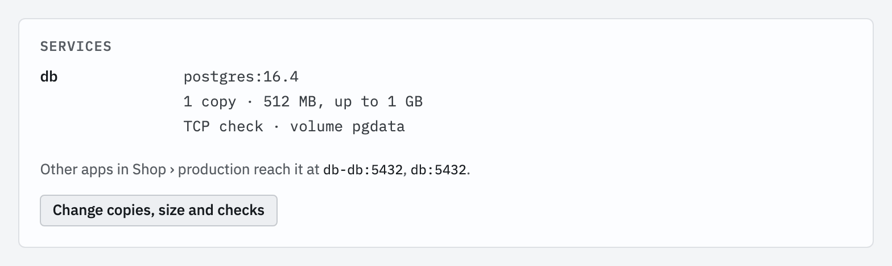

# Connect apps to each other

An app often needs another app: an `api` that talks to a `db`, a worker that talks to a queue. Apps of one
project and one environment reach each other by name, with no public address, no published port and no IP
address to look up. If `db` is a Postgres app in `shop › production`, the `api` app of the same environment
connects to `db:5432`. This page says which names exist, where the console shows them, and what they do not do.

## The names

Every service that has a port has names. A service without a port has none: it runs as a worker that nobody
connects to.

- **Inside an app**, a service answers to its own name, as in Compose. In an app with services `web` and `db`,
  `web` connects to `db:5432`. See [From a Compose file](../deploy/compose.md#services-reach-each-other-by-name).
- **From other apps of the environment**, a service answers to `<app>-<service>`. When it is the only service of
  its app that has a port, it also answers to `<app>`.

`<app>` is the app's name in its environment (`db`), not its long ID (`shop--production--db`). In the **Default**
project's **production** environment the ID and the name are the same. Names are lowercase letters, digits and
dashes, at most 63 characters, so a name is always a valid host name.

| App in `shop › production` | Services with a port | Other apps reach it at |
| --- | --- | --- |
| `web` | `web` on 8080 | `web-web`, `web` |
| `db` | `db` on 5432 | `db-db`, `db` |
| `blog` (a Compose file) | `web` on 8080, `cache` on 6379 | `blog-web`, `blog-cache` |

`blog` has no bare `blog` name because two of its services have ports: `blog` could mean either. Its own services
still reach each other as `web` and `cache`.

A name carries no port: you write the port yourself, as the container listens on it (`db:5432`). The connection goes straight to the container, not through the proxy, so any TCP protocol works
(Postgres, Redis, a message broker), and there is no HTTPS on it.

## Example: an api that uses a database

1. Give the database a port. A service without one has no name. In this example `db` is a Postgres app whose
   service has the port `5432` (the **Container port** field of **New app › Image**, or `expose: ["5432"]` in a
   Compose file). Leaving **Health check path** empty makes a TCP check, which suits a database.
2. Open the `db` app and choose **Configure**. On **Overview**, the **Services** panel says where it answers:
   **Other apps in Shop › production reach it at** `db-db:5432`, `db:5432`.

<picture>
  <source media="(prefers-color-scheme: dark)" srcset="../../images/app-configure-address-dark.png">
  
</picture>

3. Open the `api` app, **Configure › Variables & secrets**, and set a secret `DATABASE_URL` to
   `postgres://shop:<password>@db:5432/shop`. It is a secret because it holds the password. Press **Set and
   deploy**. See [Variables and secrets](variables.md).

The `api` copies that start from that deploy connect to `db` by name. If `db` is deployed again or moves to another
server, `api` needs nothing: see "The names follow the copy" below.

## Where to read an app's address

- **Configure › Overview**, in the **Services** panel.
- The **Running** tab, above the table of copies. It is drawn only while the app has copies.
- The **Deployments** tab you land on after installing a template, under **Installed from the … template**.
- The API: `getApp` (`GET /v1/apps/{id}`) answers `addresses`, one entry per service with a port, with its `ports`,
  the `names` other apps use, its `ownName` and any `conflicts`. The MCP tool `get_app` returns the same answer.

When a service has more than one name, or the app has more than one service, the line is repeated for each service,
and an app with several services adds **Its own services reach it at** `web:8080`. The console shows the first port
of the service next to each name. With a single project and environment, **Other apps in** says **this
environment** instead of `Shop › production`.

Installed from the PostgreSQL template, the app is called `postgres` and has two services with a port, Postgres
and Adminer. Other apps reach the database at `postgres-postgres:5432`, not at `postgres`.

## What a name does and does not reach

- **Another environment.** `staging` apps do not resolve `production` names, and the other way round. A preview
  (`pr-<n>`) is an environment too: it reaches the apps deployed into it. See
  [Projects and environments](../operate/projects.md).
- **A name two apps claim.** It answers to neither. Both apps' pages say so and name the other:
  "`db-admin` answers to nothing: app `db-admin` claims it too." (This is the page of an app `db` with a service
  `admin`, and another app called `db-admin`: both claim `db-admin`.) If every name of a service collides, the page says
  "No other app can reach it by name until one of the apps below is renamed." An app's own service names always win
  inside that app. The claim ends when one of the apps or services goes away or is named differently.
- **A service with several copies.** Its name leads to every running copy: the hosts file has one line per copy.
  Which one a connection reaches is up to the client's resolver. During a deploy, canaries are left out until they
  are promoted, so the name keeps pointing at the version that was live.
- **A stopped app.** Its names do not resolve, and the pages do not count it as claiming any, so it cannot cause
  a collision. An app that is defined but not deployed yet resolves nothing either, but the pages count its names
  as claimed, since they are the ones it will register.
- **A worker with no port.** It has no name, but it resolves everyone else's. So do the runs of a
  [schedule](../operate/schedules.md).

## The names follow the copy

A restart, a redeploy or a move to another server gives a copy a new address. The apps that connect to it do not
need a deploy: their copies notice the change and update their names, usually within seconds. The same is true
when a new app appears, an app is deleted, or a service is stopped.

Between servers the traffic crosses the private WireGuard network that [Add a server](../host/servers.md) sets up,
so it is encrypted there. On one server it stays on the host and is not encrypted.

## What this is not

- **It is not a firewall.** A name that does not resolve is not a barrier: any app's container can still reach
  another app's port by address, and an environment is not a network boundary. See [Install](../install.md#apps-share-the-hosts-network).
- **It is not a public address.** Nothing outside the installation resolves these names. To serve a service to the
  internet, add a [domain](domains.md), or for a port that is not HTTP, [publish a port](../../published-ports.md).
- **It is not HTTPS.** The connection is plain TCP to the container.

## After an upgrade

An app gets its names the next time it is deployed. Redeploy both apps of a pair once, the one that is called
and the one that calls, before they reach each other by name.

## How it works

Every service with a port registers its address in Nomad under its names. Every group of every app has a small
helper task, `names`, that rewrites the group's `/etc/hosts` from that list and keeps it up to date. It reserves
16 MB of memory and 20 MHz of CPU per group, in apps with one service too. You can see it as a task in an app's
exported jobspec.

## Next

- [Variables and secrets](variables.md)
- [From a Compose file](../deploy/compose.md)
- [Projects and environments](../operate/projects.md)
