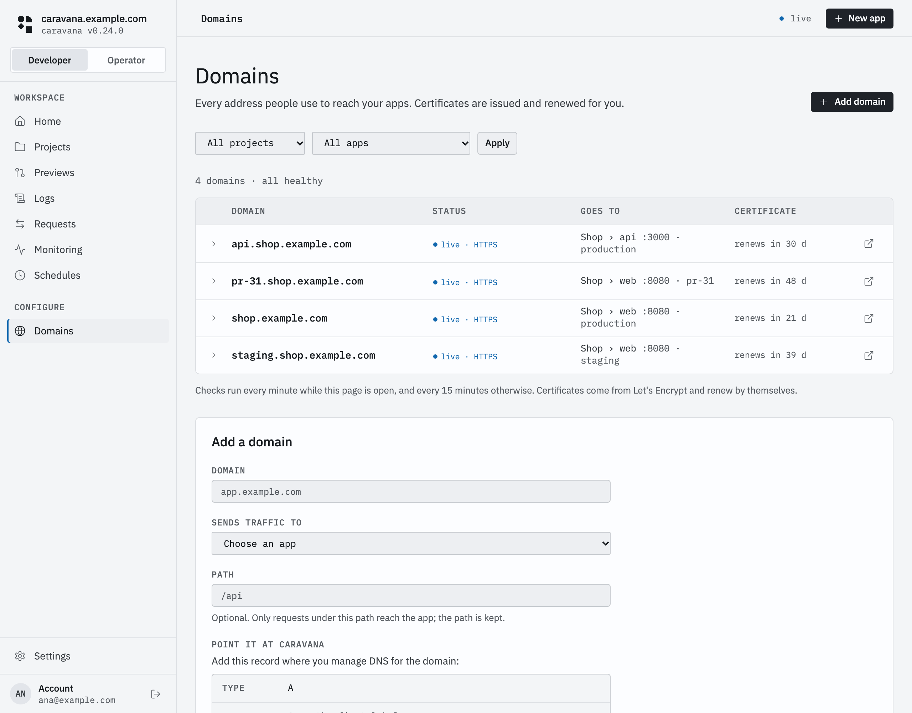
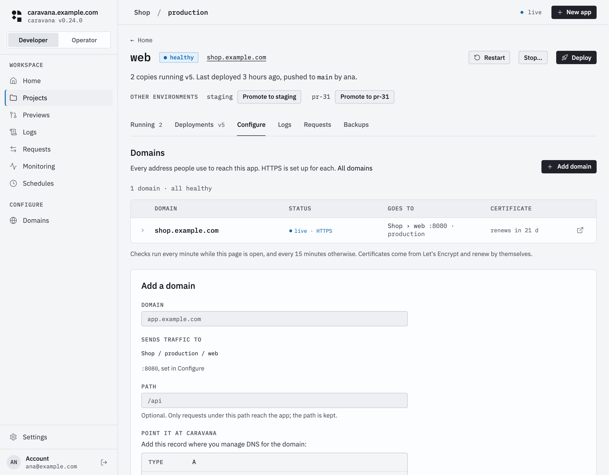

# Domains and HTTPS

A domain is a public host name that reaches one service of an app. Caravana routes it through Traefik,
gets and renews its HTTPS certificate, and shows you what state it is in. You manage domains in two
places that draw the same rows:

- **Domains** in the sidebar (under **Configure**), which lists every domain of every app you may see, with
  a project and app filter.
- An app's own page: **Configure**, then **Manage domains**, which lists only that app's domains.

<picture>
  <source media="(prefers-color-scheme: dark)" srcset="../../images/domains-dark.png">
  
</picture>

## Add a domain

1. Open **Domains** (or the app's Domains page) and find **Add a domain**.
2. Type the **Domain**, for example `shop.example.com`. Capital letters are lowercased.
3. Choose where it **Sends traffic to**: an app, and a service when the app has several. A service's
   port is set in **Configure**; every domain of a service goes to the same port. If a service has several
   ports, **Configure** has a **Domains go to** select to pick which.
4. Optionally set a **Path**, such as `/api`. Only requests under that path reach the app, and the path is kept
   (it is not stripped).
5. Create the DNS record the panel shows, where you manage DNS for the domain: **Type** `A` (and `AAAA` when
   the server has a public IPv6 address), **Name** the host (`@` for the root, or the first label of a
   subdomain), **Value** the server's public address.
6. Press **Check now**. Under **Check** the panel shows two lines, each with a reason under it: `DNS points at
   caravana` once the record is right, and **HTTPS certificate** (`issued after you add it` for a new domain).
7. Press **Add domain and deploy**.

Adding a domain is a deploy of the app, like any change to its definition: you land on the **Deployments**
tab. The domain starts answering once the new copies are healthy. You may add a domain before its DNS record
is in place; the row then says what is missing.

If the domain is under a zone you connected to Cloudflare, you do not create the record: Caravana makes it
when you add the domain. See [DNS providers](../../dns-providers.md).

A domain can be refused when it is already used by another app ("`shop.example.com` is already a domain of
`api`. Remove it there first."), or when it is the console's own address ("an app can't use it, or the console
would stop answering"). A host must be a lowercase host name with no final dot.

## Certificates

HTTPS certificates are automatic. By default they come from Let's Encrypt through Traefik: the first request
for a new host triggers the order, and the certificate usually arrives within a minute of that first visit.
It is renewed 30 days before it ends. This needs the domain's DNS to point at the server and port 80 to reach
it. A different ACME issuer, or a certificate you upload yourself, is set under **Settings › Certificates**;
see [Certificates](../../certificates.md). On an installation made with `--acme none` the issuer cannot be set
there: upload a certificate in **Settings › Certificates**, or run the installer again with `--acme production`
and then choose the issuer there.

## The states of a domain

Each row has a status pill. The first row that needs you opens by itself. Caravana checks every domain every 15
minutes, and every minute while a Domains page is open; **Check again** checks at once.

| Pill | What it means | What to do |
| --- | --- | --- |
| **live · HTTPS** | DNS points here and a certificate is issued. | Nothing. |
| **getting certificate** | DNS points here and Caravana is waiting for the issuer. It usually arrives within a minute of the first visit. | Wait, or press **Open it once** to make that first visit. If it lasts, check that port 80 reaches the server. |
| **no DNS record** | The name has no record yet. | Add the record the row shows, then **Check again**. |
| **DNS points elsewhere** | The record points at an address that is not this server, so no certificate can be got and visitors do not reach the app. The row shows what DNS says **now** and what it **should be**. | Change the record to the address shown. |
| **DNS points elsewhere**, and "points here and at …" | DNS answers this server's address and another one: some visitors reach the other host. | Remove the old record shown (an old `A` beside the new one, or an `AAAA` to another server). |
| **certificate expiring** | The certificate is near its end and has not been renewed. Let's Encrypt renews 30 days before the end, so a renewal has been failing. | Check that DNS points here and that port 80 reaches the server. For an uploaded certificate, upload a replacement. |
| **Traefik's own certificate** | Traefik serves the domain with its own certificate, so browsers will warn. This is what an installation without an ACME issuer does. | Set an issuer, or upload a certificate, in **Settings › Certificates**. |
| **redirects to …** | This is the `www` or apex name that redirects to its pair (see below). | Change it on the pair's row. |
| **not deployed** or **app stopped** | Nothing is deployed yet, or the app is stopped, so nothing serves the domain. | Deploy the app, or start it. |
| **couldn't check** / **not checked yet** | The check could not tell: the resolvers did not answer, or Traefik did not present a certificate; or no check has run yet. | **Check again**. |

Press a row to open it: it shows the sentence for its state, the certificate (issuer, when it renews and
when it ends), the DNS answer, the router name, and when it was last checked.

<picture>
  <source media="(prefers-color-scheme: dark)" srcset="../../images/app-domains-dark.png">
  
</picture>

### A domain behind a proxying CDN

If DNS answers addresses that belong to a proxy in front of your server, such as Cloudflare's proxy, the
domain is not "pointing elsewhere" once a trusted certificate exists for it: that certificate proves the
issuer reached your server. The row is then **live · HTTPS** and its DNS fact adds "Cloudflare's proxy" (or "a
proxy or CDN in front of this host"). Before the first certificate, the **Add** panel says the DNS "points at
Cloudflare's proxy", that this works when Cloudflare forwards to this server, and that the certificate is
checked after the deploy. A mix of this server's address and an address that is neither this server's nor a
proxy's is not treated as a proxy: it stays **DNS points elsewhere**.

## Options of a domain

Open a domain's row to see **Options**. Changing them and pressing **Save and deploy** deploys the app. A
domain with an option gets a router of its own, so the option applies to that domain and not to the others of
the same service.

- **Force HTTPS.** Always on, for every domain, and not switchable: plain HTTP requests are redirected to HTTPS.
- **Team only (a shared password).** Puts HTTP basic authentication in front of the domain. The user name is
  `team`. Caravana makes a password when you turn it on and shows it **once**, on the page that answers the
  save; it keeps only a hash and cannot show it again. **New password** (then **Make a new password**) replaces
  it: the old one stops working at once and the new one is shown once.
- **Redirect `example.com` here** / **Redirect `www.example.com` here.** Makes this domain the target of its
  pair: for an apex such as `example.com` the pair is `www.example.com`, and for a `www.` host the pair is the
  name without it. One certificate covers both names, and the pair is redirected to the same path on this host
  (permanently; with status 301 for a `GET` and 308 for other methods). For visitors to reach the pair, its
  own DNS record must point here too. The switch is drawn for an apex or a `www.` host, the only hosts that have a pair; a host with more than
  one dot that is not `www.` has none. Saving it is refused when the pair is already a domain of the app.
- **Path.** Limits the domain to URLs under a prefix (up to 200 bytes, starting with `/`).

To remove a domain press **Remove…**, then **Remove and deploy**: the app stops answering on it once the new
copies are healthy.

## DNS records made for you

If you connected the zone to Cloudflare under **Settings › DNS providers**, adding a domain under that zone
makes its `A`/`AAAA` records, and the domain's row says "DNS record · made by Caravana in `example.com`
(Cloudflare, direct)" (or "proxied"). If a record already exists and points somewhere else, the add is refused
("already has a record at Cloudflare pointing at …"). See [DNS providers](../../dns-providers.md).

## Problems on the needs-you list

Two domain problems reach the needs-you list on the Apps home, and the notification channels:

- "**`shop.example.com`** points at **`203.0.113.9`**, which isn't this host." (or "points here and at …: remove
  the record to …", or "points at another host") for **DNS points elsewhere**.
- "the certificate for **`shop.example.com`** expires in 6 days and hasn't been renewed." for **certificate
  expiring**. Warning starts 14 days before the end unless you changed it in **Settings › Certificates**.

An uploaded certificate that is near its end has its own item; see [Certificates](../../certificates.md).
See [Monitoring and the needs-you list](../operate/monitoring.md) and [Notifications](../operate/notifications.md).

## Next

- [Certificates](../../certificates.md)
- [DNS providers](../../dns-providers.md)
- [Projects and environments](../operate/projects.md): domains are per app, and a copy of an app starts with none
