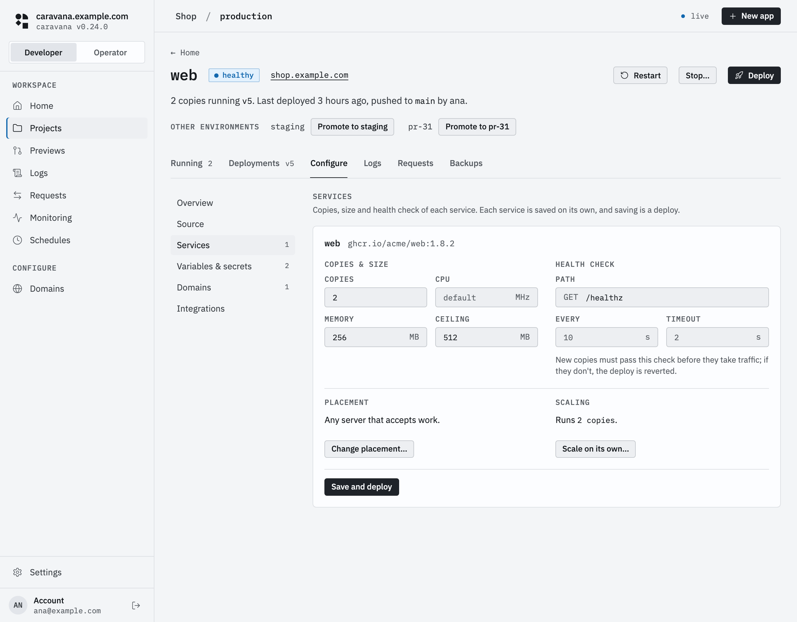
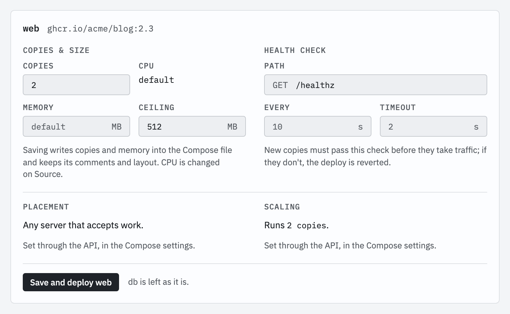

# Copies, memory and health checks

This page covers how many copies of a service run, how much CPU and memory each reserves, how Caravana decides
a copy is healthy, and the few settings that change how the container starts and resolves names. Most of them
are on the app's **Configure** tab. **Configure › Services** has one panel per service with **Copies & size** and
**Health check**, and its placement and scaling below them. The image and container port are on **Configure › Source**.

<picture>
  <source media="(prefers-color-scheme: dark)" srcset="../../images/app-configure-services-dark.png">
  
</picture>

Every save on **Configure** is a deploy, and each section saves on its own. On Services the button reads **Save and
deploy** (or **Save and deploy web** when the app has several services, and only that service is saved), and the new
copies must be healthy before the old ones go. If the app changed after you opened the page, the form keeps what you
typed, and a panel says "This app changed since you opened the form." and lists the current values that differ. Save
again to deploy what is typed over the current app. An app that keeps a Compose file is a special case, described under
[Apps that keep a Compose file](#apps-that-keep-a-compose-file).

## The fields

Each field has a name in the console and a name in the app's definition (what the API and the Compose overlay
use). Where the console does not offer a field, **Configure › Services** shows it read-only under **Also set** and a
save keeps it.

| What | In the console | In the definition | Default and limits |
| --- | --- | --- | --- |
| Number of copies | **Services** › **Copies** | `replicas` | 1. At least 1. A service with a volume or a published port runs one copy. |
| CPU | **Services** › **CPU** (MHz) | `resources.cpuMHz` | 100 MHz, set by `CARAVANA_DEFAULT_CPU_MHZ`. |
| Memory reserved | **Services** › **Memory** (MB) | `resources.memoryMB` | 256 MB, set by `CARAVANA_DEFAULT_MEMORY_MB`. At least 10. |
| Memory ceiling | **Services** › **Ceiling** (MB) | `resources.memoryMaxMB` | The larger of the reservation and 1024 MB (`CARAVANA_DEFAULT_MEMORY_MAX_MB`). Not below the reservation. |
| Image | **Source** › **Image** | `image` | Required. |
| Container port | **Source** › **Container port** (shown for a service with one port) | `ports[].containerPort` | 1 to 65535. |
| Health check | **Services** › **Health check**: **Path** (after `GET`), **Every**, **Timeout** | `health.path`, `health.interval`, `health.timeout` | Empty path: a TCP check. Every 10 s, timeout 2 s. |
| Entrypoint | **Services** › **Also set** › **Entrypoint**, read-only | `entrypoint` | Empty keeps the image's. |
| Command and arguments | **Services** › **Also set** › **Command**, **Arguments**, read-only | `command`, `args` | Empty keeps the image's. |
| Time to stop | **Services** › **Also set** › **Stop timeout**, read-only | `stopTimeout` | 1 to 30 seconds. Unset: 30 for a service with a volume, Nomad's 5 otherwise. |
| Name resolution | **Services** › **Also set** › **DNS servers**, **DNS search domains**, **DNS options**, read-only | `dns` | None: the server's own. |

Durations in the definition are strings such as `"10s"`. Leaving a numeric field empty in the console means
"the default".

In the definition a service looks like this:

```json
{
  "name": "web",
  "image": "ghcr.io/acme/web:1.4",
  "replicas": 2,
  "resources": { "cpuMHz": 200, "memoryMB": 256, "memoryMaxMB": 512 },
  "ports": [{ "name": "http", "containerPort": 8080 }],
  "health": { "path": "/healthz", "interval": "10s", "timeout": "2s" }
}
```

## Apps that keep a Compose file

For an app that keeps its Compose file (see [From a Compose file](../deploy/compose.md#the-file-is-kept)), **Configure ›
Services** has the same form per service, and **Save and deploy** is one deploy for everything on it.

<picture>
  <source media="(prefers-color-scheme: dark)" srcset="../../images/app-configure-services-compose-dark.png">
  
</picture>

- **Copies**, **Memory** and **Ceiling** are written into the Compose file. A value the file already has is changed
  where it is, in its own quoting. A value it does not have is added at the top of the service: `mem_limit` and
  `mem_reservation`, and `replicas` under `deploy:` (at the top of that mapping, or in a new one if the service has
  none). A value the file states twice
  (`scale` and `deploy.replicas`, or `mem_limit` and `deploy.resources.limits.memory`) is changed in both places. Memory
  is written in MB with Compose's `m`, such as `mem_limit: 600m`. Only what you changed is written, so a size the file
  spells its own way (`1g`) stays as typed. The file's comments and layout stay as they were, and it remains the kept file.
- The health check is written into the app's Compose settings, beside the file, as before.
- **CPU** is read-only here, and so are **Placement** and **Scaling**, which say *Set through the API, in the Compose
  settings.* Change CPU in the file on **Configure › Source**. A service that scales shows **Copies** as *Set by scaling*,
  and a service with a volume or a published port runs one copy.
- If the file says a size in a way that can't be rewritten without guessing (a value that is an alias, has an anchor, a
  tag, a variable (`$`) or spans several lines; a service or mapping that is an alias, has an anchor or a merge key
  `<<`; a key that would have to be added to a mapping written as `{...}`, or to an empty one), the service's copies and
  size stay read-only text, and the page says *Set in the Compose file. It can't be written from here: at
  services.web.mem_limit, the value is an alias. Change it on Source.* with the path and reason that apply. The health
  check is still a form.
- **Memory** and **Ceiling** can't go back to the default from here, since that means taking the key out of the file.
  Emptying one is refused at its input: *Ceiling can't go back to the default from here: that means taking the key out of
  the file. Change it on Source.* (**Memory** says the same with its own name). Nothing is deployed. Raising **Memory**
  above **Ceiling** is refused at **Memory**, as for any app.

## Copies

**Copies** is how many identical copies of the service run. Two or more give you a service that keeps
answering while one copy restarts. With several servers, the copies of a service with more than one copy are
spread over the servers rather than piled onto the emptiest one. To say which servers a service may use, see
[Placement and moving work between servers](../../placement-and-drain.md).

If a service should add and remove copies by itself, set up scaling instead; the **Copies** field then reads
"Set by scaling" with the range, and the count is owned by the **Scaling** panel on the same page. See
[Autoscaling](../../autoscaling.md).

## CPU and memory

**CPU** is a share counted in MHz, which the scheduler uses to decide where a copy fits. (Compose's `cpus`
becomes MHz, one CPU being 1000 MHz, and the deploy warns about it.)

Memory has two numbers:

- **Memory** is the **reservation**: what the scheduler counts when it places copies. It is what the service
  is guaranteed to be able to use.
- **Ceiling** is the most the service may use while its server has memory to spare. Past the ceiling the copy
  is killed and restarted.

If you set only a ceiling lower than the default reservation, the reservation becomes that ceiling. A
reservation above the ceiling is refused, naming the field (`services[0].resources.memoryMB` for the first service). Compose's `mem_reservation`
is the reservation and `mem_limit` is the ceiling.

The ceiling works because the installer turns on Nomad's memory oversubscription. On a Nomad where it is off,
Nomad ignores the ceiling and the deployment's warnings say so.

### What an out-of-memory kill looks like

A copy that goes past its ceiling is killed and Nomad starts it again. You see it in two places:

- On the **Running** tab, the copy's row says **ran out of memory** and its **Restarts** count goes up. Before
  that happens, a copy at 90% of its ceiling or more says **close to its ceiling**. The **Memory** cell shows
  the use, for example "120 MB", with "of 256 MB ceiling, 64 reserved" under it.
- On the needs-you list: "1 copy of **web** ran out of memory."

Raise the **Ceiling** (and **Memory**, if the service always needs that much) and save. See
[Monitoring and the needs-you list](../operate/monitoring.md).

## Health checks

A service that receives traffic needs a health check. If a service has a port, the definition must have a
`health` block; without a port the service is a worker, with no address and no check, and a `health` block on
it is refused.

- With a **Health check** path (**Path** on Services, `health.path`, which must start with `/`), Caravana makes an HTTP `GET` on that
  path.
- With the path empty, it opens a TCP connection to the port instead.
- **Every** is the time between checks and **Timeout** how long one check may take. The timeout must be shorter
  than the interval, and neither may be shorter than 1 second.
- The check runs against the port the domains use; if the service has several ports and no domain, name the
  port in `health.port`. The check connects over TCP, so it cannot name a UDP port.

New copies must pass the check before they take traffic; if they do not, the deploy is reverted. A running copy that starts failing is shown as unhealthy and reaches the needs-you list
("failing its health check"). Compose's `healthcheck:` cannot be honored (Nomad's checks are HTTP or TCP, and
cannot run a command), so a file with one is replaced, with a warning: by the health check you send in the
overlay if there is one, otherwise by a TCP check on the first port. A service with no port gets no check.

A service with a domain should use an HTTP path on the domain's port: the proxy uses it to stop sending
requests to a copy it cannot reach. See [Network blips](../../network-blips.md#the-proxy-needs-an-http-health-path).

## Entrypoint, command and arguments

By default a service runs what its image says. To change that:

- `entrypoint` is a list: the program and its first arguments, replacing the image's entrypoint.
- `command` is one program name and `args` its arguments, which follow the entrypoint.

Compose's `entrypoint` and `command` map to these (a `command` list becomes `command` and `args`). The console
does not edit them: set them through the API or the Compose file, and **Configure › Services** shows them under **Also
set**. See [From a Compose file](../deploy/compose.md) and [The HTTP API](../reference/api.md).

## Custom DNS

A service may set the resolvers of its copies: up to 3 DNS servers (IP addresses, not names), up to 6 search
domains and up to 8 resolver options such as `ndots:2`. They go in `dns` (`servers`, `searches`, `options`), or
in Compose as `dns`, `dns_search` and `dns_opt`. Services of one app still reach each other by name. Like the
entrypoint, the console shows these read-only.

## Ulimits, sysctls and files

A service may set `ulimits` (`memlock` and `nofile`), network `sysctls` and read-only `files`, for apps such as
OpenSearch. Like the DNS settings, the console shows them read-only under **Also set**. See [Limits, sysctls and
files](../../opensearch-apps.md).

## Stopping

A copy gets a stop signal and `stopTimeout` seconds to finish before it is killed, on a deploy, a restart and
a stop. The default is Nomad's 5 seconds, or 30 for a service with a volume so a database can shut down
cleanly. Raise it for a slow shutdown, up to 30. Compose's `stop_grace_period` sets it.

## Next

- [Volumes](volumes.md)
- [Autoscaling](../../autoscaling.md)
- [Placement and moving work between servers](../../placement-and-drain.md)
- [Published ports](../../published-ports.md)
- [Limits, sysctls and files](../../opensearch-apps.md)
- [Stop, start, restart, Run a command, Terminal](../operate/commands.md)
