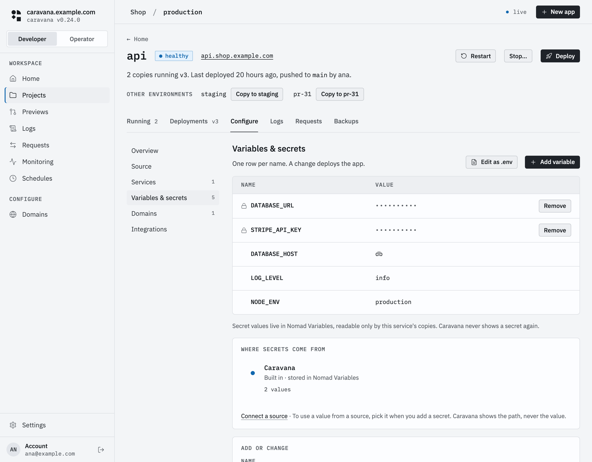

# Variables and secrets

An app's configuration reaches its containers as environment variables. Caravana keeps two kinds: **plain
variables**, which anyone who can see the app may read, and **secrets**, whose values are write-only. Both
are managed on the app's **Variables & secrets** page: open the app, choose **Configure**, then **Variables &
secrets** in its side menu (the **Overview** section has a **Manage variables and secrets** button that opens the same
page).

<picture>
  <source media="(prefers-color-scheme: dark)" srcset="../../images/app-variables-dark.png">
  
</picture>

## Plain variables and secrets

| | Plain variable | Secret |
| --- | --- | --- |
| Value shown in the console | Yes, in the table | Never. The table shows dots |
| Stored in | The app's definition (Caravana's database), the deployment history and the jobspec export | Only in Nomad's variable store, in a variable that only that service's copies can read |
| In the API's answers and the logs | Yes, as part of the definition | No: the stored app, the answers, the logs and the Nomad job hold the name only |
| Reaches the container as | An environment variable | An environment variable |

To point one app at another, such as a `DATABASE_URL` for a database app of the same environment, use the other
app's name; see [Connect apps to each other](connect-apps.md).

Use a secret for anything that grants access when read: passwords, API keys, tokens, private keys. Use a
plain variable for ordinary settings such as `NODE_ENV=production`. The **Add or change** form has a box,
**Keep as a secret (the value is never shown again)**, which is ticked by default. Untick it only for a value
that anyone signed in may read.

A secret's value is UTF-8 text without a NUL byte, and may have line breaks (a private key, for example). A
in the console a plain variable's value is one line, so keep a value with line breaks as a secret. The secrets of one app may hold at most 60 KiB in total (service name,
secret name and value counted together). A secret's name is letters, digits and `_`, not starting with a
digit, and it cannot share a name with a plain variable of the same service.

Two things to know about where values live:

- Caravana's database holds secret **names**, never values. Nomad's variable store holds the values, at
  `nomad/jobs/<app>/<service>`, and Nomad lets only that service's copies read that path. Another app, or
  another service of the same app, cannot read it.
- Anyone who administers Nomad on the host with a management token can read Nomad's variables, and a secret
  is an ordinary environment variable inside its container, so someone who may run a command or open a
  terminal in a copy can print it. Changing variables needs the maintain role; see
  [People and roles](../../people.md).
- A secret can also be a **file** instead: a key, a certificate. A service's `files` name a secret, and Caravana
  writes its value to that file and not to the environment. The row says *Written to /path, not to the environment.*
  See [Limits, sysctls and files](../../opensearch-apps.md#files).

## Set, replace and remove

Every change on this page is a deploy. The page says so ("One row per name. A change deploys the app."),
and after you submit you land on the **Deployments** tab to watch the rollout.

1. Open **Configure › Variables & secrets**.
2. In **Add or change**, choose the **Service** (asked only when the app has more than one), type the **Name**
   and the **Value**, leave **Keep as a secret** ticked or not, and press **Set and deploy**.

Setting a name that already exists replaces its value. To remove a secret, press **Remove** on its row, then
**Remove and deploy**. Plain variables are removed with the `.env` editor below.

To change many plain variables at once, press **Edit as .env**. There is one box per service holding
`NAME=value` lines; lines that start with `#` are ignored, and **Save and deploy** replaces the whole list of
that service's plain variables with what you typed. Secrets are not in this box: set them above.

New values do not reach running copies on their own. Caravana deploys the app as a normal rollout: new copies
start with the new values, and the old ones keep the old values until the new ones are healthy. See
[How a deploy works](../deploy/rollback.md) for the rollout and the automatic revert. If the deploy fails its
health check and reverts, the secrets go back to their earlier values too.

If the app changed after you opened the page, the change is refused ("This app changed since you opened this
page. What is shown now is current: make the change again."). The page now shows the current values; repeat
the change.

## Each deploy replaces the whole set

Deploys are declarative. A deploy that names a set of variables and secrets **replaces** the app's previous
set; it is never merged with it. A variable or secret the new deploy does not name is removed.

A secret in a deploy has a name and, optionally, a value:

- **With a value:** the secret takes that value.
- **Without a value (a name only):** the secret keeps the value it has now. This is not a merge: the deploy
  still has to name every secret the service should have, and only the stored value is carried over. A name
  with no value that has no stored value yet is refused (`secret "API_KEY" has no value yet: send one`).
- **Not named:** the secret is deleted, and the deploy says so in its warnings (`service "web" no longer has
  secret "API_KEY"; its value is deleted`).

What this means when you deploy from outside the console:

- **The API.** The body of a deploy is the whole app. Each service's `secrets` is a list of
  `{ "name": "API_KEY", "value": "…" }`. Send `{ "name": "API_KEY" }` to keep the current value. A deploy with
  an empty body redeploys the stored app, which keeps every secret. See [The HTTP API](../reference/api.md).
- **A Compose file.** Secrets are not written in the Compose file (Caravana does not read files from your
  disk). They go in the overlay sent with the file, under `services.<name>.secrets`, with the same rules: a
  value sets it, a name alone keeps it, a name left out deletes it. See
  [From a Compose file](../deploy/compose.md).
- **Rollback.** Rolling back to an earlier deployment brings back the earlier definition but keeps your
  **current** secret values. If that definition uses a secret that has no value now, the rollback is refused,
  naming the secret.

## Apps edited through a Compose file

An app made from a Compose file keeps the file, so its plain variables come from the file. On such an app the
Variables page shows them read-only ("This app is edited through its Compose file."); change them in the file,
under **Configure › Source**. Secrets can still be added and removed on this page: the console rewrites the secret
names in the kept overlay for you, and no secret value is ever stored in the kept file or in a deployment
record.

## Secrets from a provider, and templates

A secret does not have to be typed. It can be a reference to a secret in Bella Baxter (**From a provider** in
the Add form, once a provider is connected under **Settings › Secret providers**): Caravana reads the current
value at each deploy, and **Refresh secrets** rolls the app out when a value changed. A secret can also be a
template, such as a connection string with a password inside it, built from text and references. See
[Secrets from a secret provider](../../secret-providers.md) and
[Templates](../../secret-providers.md#templates-a-value-built-from-text-and-references).

## Copying an app to another environment

**Copy to** an environment copies the app's plain variables and the **names** of its secrets. It cannot copy
secret values, because Caravana never stored them in its database. The copy is not deployed, and a deploy is
refused until each secret has a value. Right after the copy you land on its **Configure** tab, which says
once, for example, "Copied to `staging`. Set its domains and these secrets before deploying: `web/API_KEY`."
Secrets that are references to a provider need nothing, since they are read at the deploy. See
[Projects and environments](../operate/projects.md#copy-to).

**Promote to** an environment keeps the target's own variables and secrets and takes only the image and shape
from the source, so promotion never moves a value. See
[Projects and environments](../operate/projects.md#promote-to).

## Next

- [Domains and HTTPS](domains.md)
- [Secrets from a secret provider](../../secret-providers.md)
- [From a Compose file](../deploy/compose.md)
