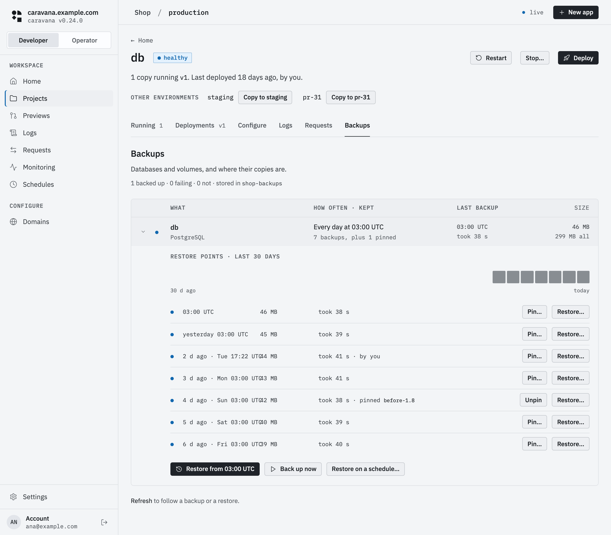

# Volumes

A container's own filesystem is thrown away every time a deploy replaces it. A **volume** is a folder that
survives: the data of a database, uploaded files, an application's SQLite file. This page says what a volume
is in Caravana, how you declare one, and what it changes about how the service runs.

## What a volume is

A volume is a directory on one of your servers, created by Caravana on the first deploy that names it and
mounted into one service at a path you choose. Each volume belongs to one app and to one service of that
app; its name is unique inside the app, and two apps can both have a volume called `data` without meeting.
Underneath, Nomad calls it a host volume named `<app>_<volume>`.

A volume has three properties:

| Property | Meaning |
| --- | --- |
| `name` | Lowercase letters, digits, `-` and `_`, starting with a letter or digit, at most 63 characters. Names that start with `caravana-` are reserved for Caravana's own volumes. |
| `path` | Where the service sees it: a clean absolute path, not `/`, and not the same path twice in one service. |
| `readOnly` | Mount it read-only. Optional. |

The folder is created open to every user of the container (mode `0777`), because Nomad cannot copy the image's
ownership onto a host folder the way Docker does for a named volume. An image whose process is not root can
therefore write to it.

## Declare a volume

The console's **New app** forms for an image do not have a volumes field. You declare volumes in one of two
places.

**In a Compose file.** Use named volumes, as you would anywhere:

```yaml
services:
  db:
    image: postgres:17
    volumes:
      - pgdata:/var/lib/postgresql/data
volumes:
  pgdata:
```

Caravana accepts named volumes only. A bind mount (`./data:/data` or an absolute host path) and a `tmpfs`
mount are refused with an error naming the field, as are `external: true`, `driver_opts` and any driver other
than `local`: volumes are directories that Caravana creates itself. See
[From a Compose file](../deploy/compose.md).

**In the app's definition, through the API.** Each service has a `volumes` list:

```json
{
  "name": "db",
  "image": "postgres:17",
  "volumes": [{ "name": "pgdata", "path": "/var/lib/postgresql/data" }]
}
```

Send it with a deploy (see [The HTTP API](../reference/api.md)). Configure shows what a service mounts under
**Also set** › **Volumes**, one line per volume (`/var/lib/postgresql/data → pgdata`, with `(read-only)` when it
is), and a save of the Configure form keeps them; they are not edited there.

## What changes for a service with a volume

- **It runs one copy.** A service with a volume that asks for more than one copy is refused (`a service with a
  volume runs one copy`). A volume is written by one copy at a time.
- **Deploys stop the old copy before they start the new one.** Other services roll out blue/green, with the new
  copy running beside the old one until it is healthy. A service with a volume cannot, because the old copy
  still holds the volume. So a deploy stops the running copy, then starts the new one: the service is down for
  that gap, however short. The new copy must still pass its health check, and a failed deploy is reverted like
  any other.
- **It gets a longer stop time.** Unless you set `stopTimeout`, a service with a volume gets 30 seconds to shut
  down after the stop signal (Nomad's own default is 5), so a database can finish cleanly. The most you can set
  is 30.
- **It stays on its server.** A volume is created on one server and is never moved. Every volume of one
  service lives on the same server, so the copy can always be placed. With several servers, Nomad picks the
  server for the first volume; later volumes of that service follow it. Two services of one app may end up on
  different servers. To keep a volume on particular servers, use [placement rules](../../placement-and-drain.md).
- **It carries an extra start-up task.** Every service with a volume gets a small helper task,
  `caravana-volumes`, that measures the volumes each time the copy starts. It is how Caravana knows their size
  and how volume backups run. Service names `caravana-volumes`, `caravana-sqlite` and `caravana-upload` are
  therefore reserved.

There are two limits worth knowing before you rely on volumes:

- **A volume belongs to one service.** Two services of an app cannot mount the same volume (`volume "data" is
  already mounted by another service; each volume belongs to one service`), and one app cannot use another
  app's volume. There are no shared volumes.
- **A volume cannot move between servers.** If a service has volumes on two servers, a deploy is refused, naming
  the service and the volumes. If the placement rules of a service forbid the server its volume is on, the
  deploy is refused too ("a volume never moves, so change the rules or label that server").

## Where to see them

Open the app's **Backups** tab. A service backed up with the `volume` engine has a row; open it and the line
under it names each volume's folder on the server, how big it was and when that was measured (the folder, then "on this host", or the server's name when you have several, then for example
"312 MB, measured 3 hours ago"). The sizes are measured by the
`caravana-volumes` task when a copy starts, so a volume of an app that has not been deployed since that task
existed has no size yet. The same list, with each volume's mounts, host path, server, size and last backup, is
`GET /v1/apps/{id}/volumes`.

<picture>
  <source media="(prefers-color-scheme: dark)" srcset="../../images/app-backups-dark.png">
  
</picture>

Under the rows, **Volumes no service mounts** lists volumes that still exist for the app but that no service
mounts any more, with their size and a **Delete…** link (see below). The link is drawn even while a copy still mounts the
volume; the page it opens then refuses ("A running copy mounts this volume. It can be deleted once nothing
uses it.").

## Back up a volume

A service's volumes are backed up by setting its backup `engine` to `volume`: Caravana stops the service,
archives its volumes to your backup destination, and starts it again; a restore works the same way. A
database such as Postgres is better backed up with its own engine, which does not stop it. See
[Backups and restore](../operate/backups.md). A volume is **not** backed up unless you set this up.

## When a deploy drops a volume, or the app is deleted

**A deploy that no longer names a volume does not delete it.** The data stays on its server, and the deploy
warns: `volume "pgdata" is no longer mounted: its data stays on server one until you delete it under Operator ›
Servers`. The volume appears under **Volumes no service mounts** on the Backups tab, where it stays until:

- a service mounts it again by the same name (it comes back with its data);
- you delete it, with **Delete…**, which opens the volume's page under **Operator › Servers** (where you type
  its name to confirm, and may back it up to the backup destination first); or
- the app is deleted.

If a deploy that dropped a volume was reverted, the live version still mounts it, and the delete page refuses
until nothing uses it.

**Deleting an app deletes its volumes and the data in them.** The confirmation says so ("Its volume `pgdata` and
the data in it are erased. … This can't be undone."). Backups already in the backup destination stay there.

Removing unused volumes, the daily clean-up of unused images, and what **Back up first** does are described in
[Reclaim space](../../reclaim-space.md).

## Next

- [Backups and restore](../operate/backups.md)
- [Reclaim space](../../reclaim-space.md)
- [Placement and moving work between servers](../../placement-and-drain.md)
