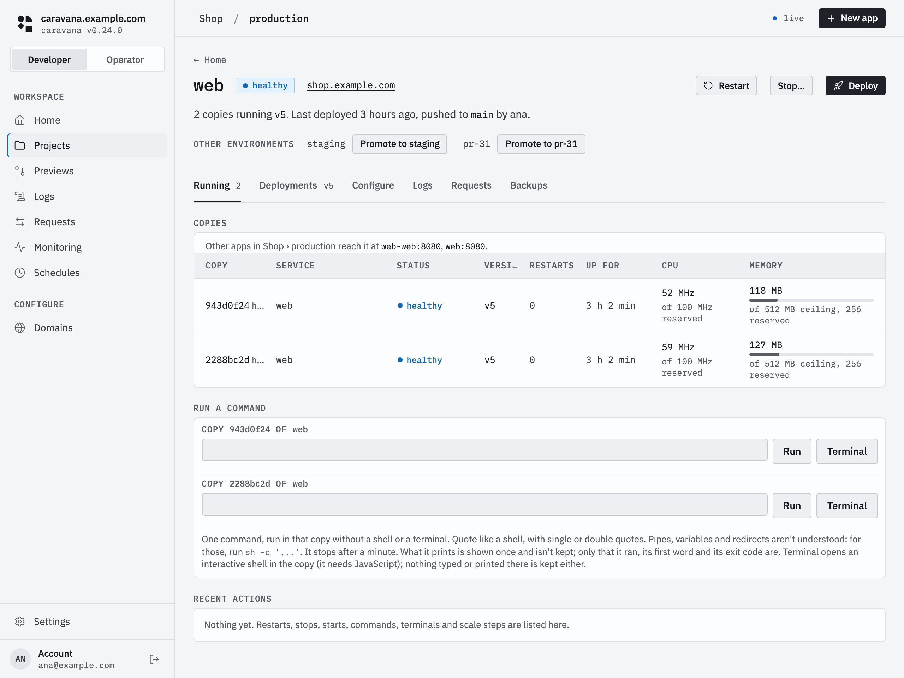
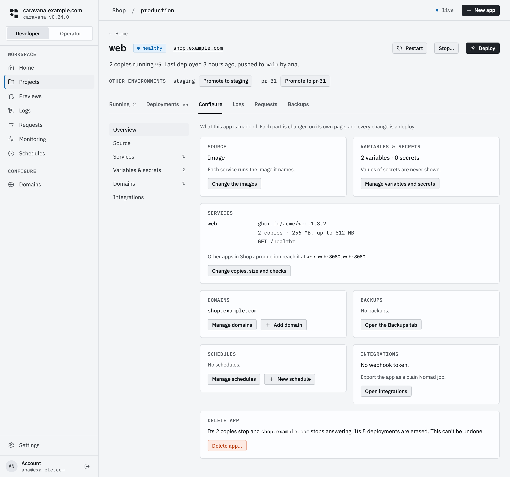
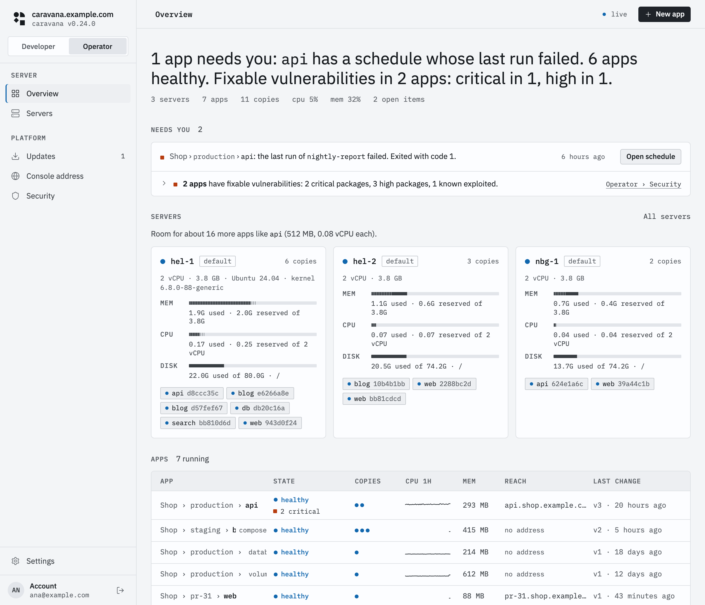

# A tour of the console

The console is the web interface of Caravana, at the address you gave the installer. This page goes
through it in the order you will meet it: the sidebar, the Apps home, an app's pages and the Operator
view. Every page named here has its own guide.

## The frame

On a wide screen there is a sidebar on the left. Under 900 pixels wide it becomes a top bar with a
**Menu** button that holds the same entries. The top bar has a breadcrumb, a small indicator that says
whether the page is receiving live updates, and the **New app** button.

At the bottom of the sidebar is your account (your email) and a button to sign out.

## The Developer and Operator views

Under the brand at the top of the sidebar are two links: **Developer** and **Operator**. They switch the
console between two views:

- **Developer** is about your apps: deploying them, their logs, schedules, domains.
- **Operator** is about the machine and Caravana itself: the servers, updates, the console's address and
  the image scanner.

Only owners and admins see the toggle and the Operator pages. A member sees the Developer view,
limited to the projects and environments they have a role in. Roles are in [People and
roles](../people.md). **Settings** and the pages of one app are shared by both views; the console
remembers which view you were in last and draws that view's sidebar on them. Signing in always lands
on the Developer home.

## The Developer sidebar

The entries, in order:

| Entry | What it is for |
| --- | --- |
| **Home** | The Apps page: every app, what needs you, what is deploying, recent activity. See below. |
| **Projects** | Projects and their environments, such as `shop` with `staging` and `production`. [Projects and environments](operate/projects.md) |
| **Previews** | One copy of the app per pull request, closed with the pull request. [Previews](../previews.md) |
| **Logs** | The output of every copy of every service of one project and environment, in one stream. [Logs](operate/logs.md) |
| **Requests** | Each HTTP request Traefik served, with filters. [Requests](../requests.md) |
| **Monitoring** | Requests, errors, slowest responses and memory against the usual week, plus the host's capacity. [Monitoring](operate/monitoring.md) |
| **Schedules** | A command on a timer, and the built-in backup schedules. [Schedules](operate/schedules.md) |
| **Domains** | Every address that reaches an app, with its DNS and certificate state. [Domains and HTTPS](configure/domains.md) |
| **Settings** | The installation's connections and your account. See below. |

## Home: the Apps page

<picture>
  <source media="(prefers-color-scheme: dark)" srcset="../images/apps-home-dark.png">
  
</picture>

The first thing on the page is the sentence that sums everything up, followed by the needs-you
list. It has one row per thing that wants your attention, each with a button that takes you to the
place to deal with it: a deploy that failed or was reverted, a copy that ran out of memory or keeps
crashing, an unhealthy copy, a backup that failed, no backup destination for a service that has a
backup, a domain whose DNS points elsewhere, a certificate about to expire, a disk filling up, and
more. When there is nothing, it says **Nothing needs you.** The list is worked out again on every
read, so a problem leaves it when it is fixed. [Monitoring](operate/monitoring.md) lists the kinds, and
[Notifications](operate/notifications.md) pushes them to you.

The sentence at the top names an app by its name (`api`), not by its ID. It counts outages: an app
whose only items are image findings counts as healthy. If you installed the [image
scanner](../image-scanning.md), a last sentence says how many apps have fixable vulnerabilities, for
example "Fixable vulnerabilities in 2 apps: critical in 1, high in 1." Those findings are not a row each in the list: they are
one closed row at its end, and an app that has some shows a small tag such as "■ 2 critical" under
its status in the table. [Monitoring](operate/monitoring.md#image-findings) and [Image
scanning](../image-scanning.md#what-you-see) say more.

Below it, **Deploying now** shows rollouts in progress. Then come the apps, grouped by project and
environment, with a filter box and a state and kind filter. On the right are **This host**, a small panel
with memory, disk and room for more apps (owners and admins only), and **Activity**, the latest deploys.

**New app** opens the form with its five tabs: an image, a Compose file, a GitHub repository, a Git
repository to build, or a template. [Your first app](first-app.md) walks through the first.

## An app's pages

Click an app to open it. Its header shows its name, status, addresses and a summary, with **Restart**,
**Stop…** and **Deploy** buttons. Under it are six tabs:

| Tab | What it shows |
| --- | --- |
| **Running** | The copies with their status, version, restarts, CPU and memory. Below them, **Run a command**, a **Terminal** link for each copy and **Recent actions**. [Stop, start, restart, run a command](operate/commands.md) |
| **Deployments** | The deploy form and the history of every deploy, with its stages, and **Redeploy this version**, **Export jobspec** and a download of the Compose file. [How a deploy works and rollback](deploy/rollback.md) |
| **Configure** | The app's settings, in six sections: **Overview**, **Source**, **Services**, **Variables & secrets**, **Domains** and **Integrations**. See below. |
| **Logs** | The Logs page, filtered to this app. |
| **Requests** | The Requests page, filtered to this app. |
| **Backups** | Backups and restores of the app's databases and volumes. [Backups and restore](operate/backups.md) |

<picture>
  <source media="(prefers-color-scheme: dark)" srcset="../images/app-running-dark.png">
  
</picture>

Configure has a side menu with six sections, each its own page with its own form, and each save is its own deploy:

| Section | What it holds |
| --- | --- |
| **Overview** | A read-only summary of the app: its source, variables and secrets, services, domains, backups, schedules and integrations, each with a button to the page that changes it. **Delete app…** is at the bottom. |
| **Source** | What the app runs: an image and port for each service, the Compose file for an app made from one, or the repository and build for an app built from Git. |
| **Services** | Copies, size and health check of each service, with its placement and scaling. [Copies, memory and health checks](configure/resources.md) |
| **Variables & secrets** | [Variables and secrets](configure/variables.md) |
| **Domains** | [Domains and HTTPS](configure/domains.md) |
| **Integrations** | The webhook token, a deploy token for CI, and **Export jobspec**. [From CI](deploy/ci.md) |

<picture>
  <source media="(prefers-color-scheme: dark)" srcset="../images/app-configure-dark.png">
  
</picture>

## Settings

**Settings** is grouped in its own sidebar:

- **Account**: your email and password.
- **Connections**: **Registries** ([Private registries](deploy/registries.md)), **Builds**
  ([Build from Git](../building-from-git.md)), **Secret providers**
  ([Secret providers](../secret-providers.md)), **Backup storage**
  ([Backup destinations](../backup-destinations.md)), **Certificates**
  ([Certificates](../certificates.md)), **DNS providers** ([DNS providers](../dns-providers.md)) and
  **Notifications** ([Notifications](operate/notifications.md)).
- **Security**: **People** ([People and roles](../people.md)), **Sign-in** ([Sign-in](host/sign-in.md)),
  **API tokens** ([The HTTP API](reference/api.md)) and **Audit log** ([Audit log](../audit-log.md)).
- **This browser**: **Appearance**.

The Connections entries and **People** and **Audit log** are for owners and admins. A member sees
**Account**, **Sign-in**, **API tokens** and **Appearance**.

## The Operator view

The Operator sidebar has two groups:

- **Server**: **Overview**, the host and everything on it, with its **Needs you** and **Live activity**;
  and **Servers**, the list of servers and a page for each ([Servers](host/servers.md)).
- **Platform**: **Updates**, what is waiting for Caravana and for the server's operating system
  ([Upgrade](host/upgrade.md)); **Console address**, to change the console's domain
  ([Console address](../console-address.md)); and **Security**, the optional image scanner
  ([Image scanning](../image-scanning.md)).

<picture>
  <source media="(prefers-color-scheme: dark)" srcset="../images/ops-overview-dark.png">
  
</picture>

## It updates by itself

Pages that show changing things, such as a rollout, the copies of an app or the needs-you list, update
while you look at them. The server sends a short notice that something changed, and the page fetches
that part again. The indicator in the top bar shows whether the page is connected. Nothing you type is
replaced by an update.

## It works without JavaScript

Pages and forms are plain HTML: a form posts and the next page is drawn by the server, and every link
is a link. JavaScript adds the live updates, the copy buttons and
a few pieces that cannot work without it: following logs live, the terminal in a copy and signing in
with a passkey.

## Light and dark

The console follows your system's light or dark setting. To choose, open **Settings › Appearance** and
pick **Match the system**, **Light** or **Dark**, then **Save**. The choice is kept in this browser only.

## Everything is also in the API

Nothing exists only in the console. Every page here calls the same layer as the HTTP API, so what you
do by clicking you can do with a script, a CI job or a coding agent: see [The HTTP
API](reference/api.md) and [MCP for coding agents](../mcp.md).

## Next

- [Your first app](first-app.md)
- [How a deploy works, history and rollback](deploy/rollback.md)
- [Monitoring and the needs-you list](operate/monitoring.md)
