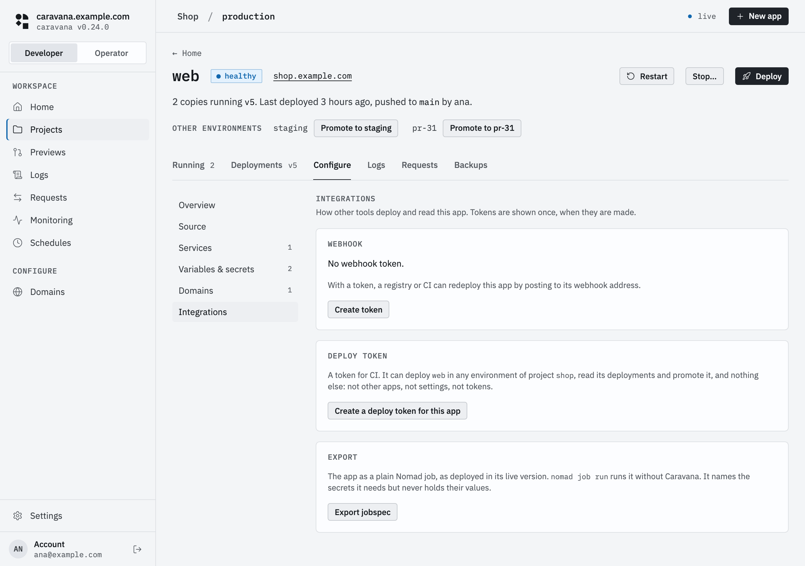
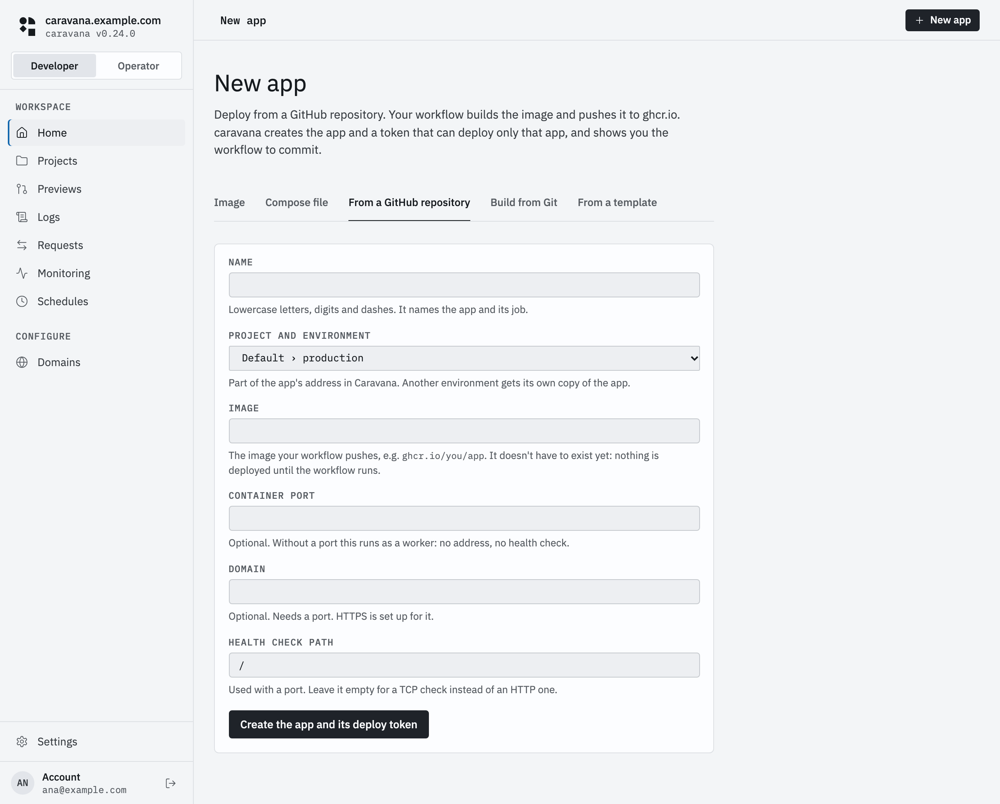

# From CI

The usual way to run your own code on Caravana is to let your CI system build the image and push it to a registry, and
then tell Caravana to deploy it. Caravana pulls the image, pins it to a digest, rolls it out, and tells CI whether it
came up healthy. Your CI holds one narrow token, and the app's settings (ports, domains, secrets, memory) stay in
Caravana, where you can change them without touching the pipeline.

(If you would rather have Caravana build the image from a repository itself, see
[Build from a Git repository](../../building-from-git.md).)

This page covers four ways to do it, from the most guided to the most plain:

1. New app › **From a GitHub repository**, which sets everything up for GitHub Actions.
2. The GitHub Action `Cosmic-Chimps/caravana-action`, by hand.
3. The app's **webhook**, when a call with no image is enough.
4. Plain `curl`, for any other CI system.

All of them use a **deploy token** or the webhook's own token, so start there.

## Deploy tokens

A deploy token is an API token that can deploy one app and nothing else, so a leaked CI secret cannot reach your other
apps or Caravana's settings. It is limited to one app **name** in one **project**, and it works in every environment of
that project: the same token deploys `shop--staging--web` and `shop--production--web`.

A deploy token may:

- read the app and its deployments, and read its Compose file;
- deploy it (with an image, a definition or a Compose file), create it without deploying, and refresh its secrets from a
  provider;
- preview and run a [promotion](../operate/projects.md) between the project's environments;
- open and close [previews](../../previews.md) of its own project, and delete its own app inside one.

Everything else answers `403 token_scope`, with a message such as *this token can only deploy app web of project shop*:
other apps, settings, tokens, deleting an app in a real environment, logs, and so on. A deploy token also has no more
rights than the person who made it: that person needs the deploy level or more in at least one environment of the project,
and every call is checked against both (see [People](../../people.md)).

You can make one in two places:

- **Settings › API tokens**, under **New token**, with the **Only for one app** row: choose the project and type the app
  name. The app does not have to exist yet.
- **Configure › Integrations** of the app, under **Deploy token**: **Create a deploy token for this app**.

The token (`cvat_…`) is shown once, so copy it into your CI system's secrets right away. Caravana stores only a hash of it.
You can revoke it on **Settings › API tokens**.

<picture>
  <source media="(prefers-color-scheme: dark)" srcset="../../images/app-configure-integrations-dark.png">
  
</picture>

## From a GitHub repository

This is the quickest way to wire up GitHub Actions. Open **New app** and choose the **From a GitHub repository** tab.

<picture>
  <source media="(prefers-color-scheme: dark)" srcset="../../images/new-app-github-dark.png">
  
</picture>

Fill in the same fields as for [an image](image.md): the **Name**, the **Image** your workflow pushes (it must be on
`ghcr.io`, for example `ghcr.io/acme/web`, and it does not have to exist yet), the **Container port**, a **Domain** and a
**Health check path**. Press **Create the app and its deploy token**. Caravana:

1. creates the app without deploying it (nothing runs yet);
2. makes a deploy token named after the app (`web-ci`, or with a number added if that name is taken), limited to that
   app name in the app's project;
3. answers with a page, **Created** followed by the app's ID, that has three parts. The page is the only place the token is shown.

The three parts are **1. Deploy token** (copy it), **2. Repository secret** (in your GitHub repository, open Settings ›
Secrets and variables › Actions and add a secret named `CARAVANA_TOKEN` with the token; *as of writing, not checked live*),
and **3. Workflow**, which you commit as `.github/workflows/deploy.yml`. The workflow builds the repository's Dockerfile,
pushes the image to `ghcr.io` and deploys the exact digest it pushed. It is the first job of "A complete workflow"
below in compact form, with `app:` (the app's ID) in place of `project`, `environment` and `name`, and with your
console's address filled in.

The first run deploys the app as you defined it on this page. For Caravana to pull the image, the package must be
readable by it: make the package public, or add credentials for `ghcr.io` in **Settings › Registries**
([Private registries](registries.md)).

## The GitHub Action

[`Cosmic-Chimps/caravana-action`](https://github.com/Cosmic-Chimps/caravana-action) is a step that calls Caravana's API
for you. It sends the deploy, follows the deployment every five seconds until it is healthy, prints Caravana's warnings,
and fails the workflow with Caravana's own reason when the deploy fails or is reverted. It can also promote the
deployment to another environment.

It is one shell script (curl and jq), so it runs on any GitHub-hosted Linux or macOS runner.

### The inputs

| Input | Required | What it does |
| --- | --- | --- |
| `url` | yes | Your Caravana address, for example `https://caravana.example.com`. |
| `token` | yes | A deploy token or a full API token. Store it as a repository secret. |
| `app` | one of | The app ID: the bare name in project `default`, environment `production`, otherwise `<project>--<environment>--<name>`. |
| `project`, `environment`, `name` | one of | The app's place, instead of `app`. All three are needed. |
| `image` | no | The image to deploy, best pinned by digest. Only this image changes: the app's other settings stay as stored. Without it, the stored app is deployed again and its tags are looked up again. |
| `service` | no | Which service gets the image. Needed when the app has more than one. |
| `definition` | no | A JSON file holding the app, used only when the app does not exist yet or has no definition. After that the app stored in Caravana is the truth, so edits made in the console are never overwritten. |
| `wait` | no | `true` by default. `false` prints the deployment ID and finishes. |
| `timeout` | no | Seconds to wait for a deployment, 600 by default. |
| `promote` | no | An environment of the app's project to promote to. With `image`, the deployment is made first and promoted once healthy. Alone, nothing is deployed: the newest healthy deployment of the app is promoted. Needs `wait: true`. |
| `fail-on-superseded` | no | Fail the step when a newer deploy replaced this one. Caravana's newest deploy wins, so by default the older step passes. |

### The outputs

`app-id`, `deployment-id`, `job-version`, `status` (`healthy`, `failed`, `reverted`, `superseded`, or the last status seen),
`promotion-id` and `promotion-status` (when `promote` is set), and `mode`: what the step did (`define`, `replace-image`,
`redeploy` or `promote-only`). The step also writes a table to the job summary and prints Caravana's warnings as
workflow warnings.

### A complete workflow

This builds on every push to `main`, pushes to `ghcr.io`, deploys the digest it pushed to **staging**, and then promotes
that same deployment to **production**, once someone approves it. It uses one deploy token for `shop`/`web`.

```yaml
name: Release
on:
  push:
    branches: [main]

jobs:
  staging:
    runs-on: ubuntu-latest
    permissions:
      contents: read
      packages: write
    steps:
      - uses: actions/checkout@v7

      - uses: docker/login-action@v4
        with:
          registry: ghcr.io
          username: ${{ github.actor }}
          password: ${{ secrets.GITHUB_TOKEN }}

      - id: build
        uses: docker/build-push-action@v7
        with:
          context: .
          push: true
          tags: ghcr.io/${{ github.repository }}:latest

      - uses: Cosmic-Chimps/caravana-action@v1
        with:
          url: https://caravana.example.com
          token: ${{ secrets.CARAVANA_TOKEN }}
          project: shop
          environment: staging
          name: web
          image: ghcr.io/${{ github.repository }}@${{ steps.build.outputs.digest }}

  production:
    needs: staging
    runs-on: ubuntu-latest
    environment: production   # protection rules and required reviewers go here
    steps:
      - uses: Cosmic-Chimps/caravana-action@v1
        with:
          url: https://caravana.example.com
          token: ${{ secrets.CARAVANA_TOKEN }}
          project: shop
          environment: staging
          name: web
          promote: production
```

How it works:

- The first job deploys the image by digest into `shop--staging--web` and waits for the rollout. The deploy replaces only
  the image. If the app changed between the step reading it and deploying, Caravana refuses with `app_changed` and the
  step reads again and retries once.
- The second job gives `promote` and no `image`, so it deploys nothing: it asks Caravana to promote staging's newest
  healthy deployment to `production`. Production runs exactly the image digests staging pinned, with its own variables,
  secrets and domains. If that deployment is not healthy, Caravana refuses (`deployment_not_healthy`) and the step fails
  with that message.
- The `production` app must already exist in the project. Create it first; see [Projects and
  environments](../operate/projects.md) for **Copy to** and **Promote to**.
- The job's GitHub `environment:` is how you put required reviewers in front of the production step. That is GitHub's
  feature, *as of writing, not checked live*.

For the very first deploy of an app that does not exist, pass `definition:` with a JSON file of the app, as the action's
README shows.

Each deploy carries where it came from: the commit, the ref, the actor and a link to the run, in `Caravana-Origin-*`
headers the action sets. The app's **Deployments** history then says, for example, *pushed to main by ana*, with the
short commit and a **run** link, and notifications say the same. Nothing else about your repository or workflow is sent.

For a preview environment for every pull request, see [Previews](../../previews.md).

## The webhook

If a call with no image is enough, the app's webhook is simpler: it needs no definition and no workflow knowledge. A
call to it makes Caravana look every image of the app up again, and **redeploys the stored app only if one of the digests
changed**, the app was saved since its last healthy deployment, or it was never deployed. It is the right tool when your CI pushes to a moving tag (`latest`, `main`)
and the app already points at that tag.

1. On the app's **Configure › Integrations** page, find **Webhook** and press **Create token**. The page shows the webhook address once
   (**Copy it now. It won't be shown again.**): `https://caravana.example.com/v1/webhooks/shop--staging--web?token=cvwh_…`.
2. Call it from CI. Prefer the header to the query string, so the token stays out of URLs and logs:

   ```sh
   curl -fsS -X POST \
     -H "Authorization: Bearer $CARAVANA_WEBHOOK_TOKEN" \
     https://caravana.example.com/v1/webhooks/shop--staging--web
   ```

3. The answer is `202` with `"changed": true` and the new deployment when something changed, and `200` with
   `"changed": false` when no image changed and nothing was deployed. A wrong or missing token, or an unknown app, is a plain `401`. A stopped app answers `409 app_stopped`.

**Replace token** and **Revoke token** on the same panel make the old address stop working at once. A webhook token is not
an API token: it can only do this one thing for this one app. The webhook never chooses an image, so it cannot give an
app its first definition: an app that was created with only a name answers `409 app_not_defined`. If you run a
webhook-only listener (see [Settings](../reference/settings.md)), the webhook is served there and nothing else is.

An app built from Git also uses this webhook as the repository's push webhook; see
[Build from a Git repository](../../building-from-git.md).

## Other CI systems

Anything that can run `curl` can deploy, because the action is only a client of the [HTTP API](../reference/api.md). The
action's script (`caravana-deploy.sh` in its repository) can be run as it is from another system. A minimal deploy of one
image, in shell:

```sh
BASE=https://caravana.example.com
APP=shop--staging--web
IMAGE=ghcr.io/acme/web@sha256:…   # the digest your CI just pushed
AUTH="Authorization: Bearer $CARAVANA_TOKEN"

# Read the app and its revision.
curl -fsS -H "$AUTH" "$BASE/v1/apps/$APP" > record.json
REVISION=$(jq -r .revision record.json)

# Put the new image on the service and deploy, only if nobody changed the app meanwhile.
jq --arg image "$IMAGE" '.app | .services |= map(if .name == "web" then .image = $image else . end)' record.json > app.json
curl -fsS -X POST -H "$AUTH" -H 'Content-Type: application/json' -H "If-Match: \"$REVISION\"" \
  --data-binary @app.json "$BASE/v1/apps/$APP/deployments" | jq -r '.id'
```

The answer is `202` with the deployment. Follow it with `GET /v1/apps/{id}/deployments/{deploymentId}` until its `status` is
one of `healthy`, `failed`, `reverted` or `superseded`. The revision goes in `If-Match` in quotes, as in the app's
`ETag`; a `412 app_changed` means someone changed the app after you read it. A POST with an empty body redeploys the
stored app and looks its tags up again. [The HTTP API](../reference/api.md) has the authentication, the error format and
the conditional-deploy rules.

## Next

- [How a deploy works](rollback.md): what happens after the deploy call, and how to undo it.
- [Projects and environments](../operate/projects.md): copy and promote between staging and production.
- [Notifications](../operate/notifications.md): hear about a failed deploy without watching CI.
