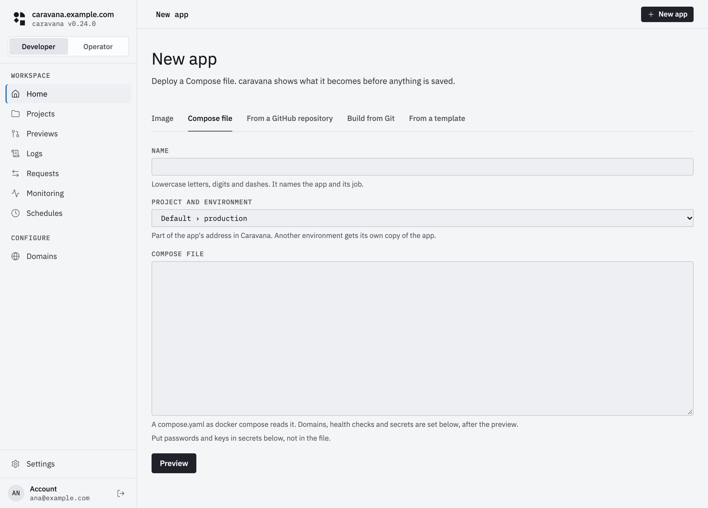
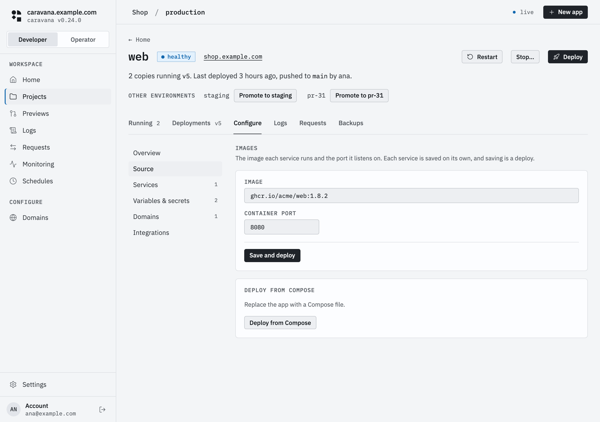

# From a Compose file

If your app already has a `compose.yaml`, you can deploy that file. Caravana reads it, shows you what it becomes, and
deploys it as one app with one service per Compose service. Caravana deploys prebuilt images, so every service needs an
`image:`; see [Build from a Git repository](../../building-from-git.md) if you want Caravana to build one.

Compose has no words for some things Caravana needs: which domains reach a service, how its health is checked, which
values are secrets, whether it is backed up. Those go in an **overlay**. On **New app** the console draws them as inputs
under each service, and the [API](../reference/api.md) takes them as JSON next to the file. Once the app exists, each has
its own page (see below).

<picture>
  <source media="(prefers-color-scheme: dark)" srcset="../../images/new-app-compose-dark.png">
  
</picture>

## Where to deploy a file

- **New app › Compose file** makes a new app from the file. It asks for a **Name** (and the project and environment, when
  there is more than one), and the file in a text box, labelled **Compose file**.
- **Configure › Source** of an app that exists deploys a file to it. If the app was made from a Compose file, Source shows
  that file, ready to edit (see [The file is kept](#the-file-is-kept)). If it was made from images, Source has a
  **Deploy from Compose** panel with a button of the same name, and an app that has no definition yet has the same
  button under its form. The file replaces the app's definition: a service the file does not have is removed, and what
  you set for copies and memory on Configure is replaced by what the file says. Everything the file has no words for
  stays as it is: secrets, domains, health checks, backups and the other options only the API sets.

<picture>
  <source media="(prefers-color-scheme: dark)" srcset="../../images/app-configure-source-dark.png">
  
</picture>

The two forms differ after the first step.

1. Paste the file and press **Preview**. Nothing is saved. The page shows two lists: **What changes in meaning**
   (warnings) and, if something cannot be honored, **Caravana can't deploy this file** (refusals, each naming the path in
   the file). On New app it also shows each service with its image, ports, volumes, memory and copies. On an existing
   app, **Against the app today** says which services would be added or removed.
2. On New app, fill in the overlay inputs for each service, then press **Create and deploy**. On an existing app there
   are no inputs: press **Deploy**, and the form says *Secrets, domains, health checks and backups stay as they are.*
   Either way the deploy previews the file again first and comes back with the refusals instead of deploying, so a
   refused file never reaches Nomad.

## What goes in the overlay

On **New app**, for each service the form offers:

| Input | What it does |
| --- | --- |
| **Domains** | One host per line, with `:port` when the service has several ports. HTTPS is set up for each. See [Domains and HTTPS](../configure/domains.md). |
| **Health check** | A path such as `/healthz` for an HTTP check. Empty checks the TCP port. Beside it, **Check every (seconds)**, **Check timeout (seconds)** and, for a service with several ports, **Check port**. A service with ports and no overlay gets a TCP check on its first port. |
| **Secrets** | A name and a value for each secret. It reaches the service as an environment variable. Values are never kept on the page. See [Variables and secrets](../configure/variables.md). |
| **Backup** | An **Engine** (**PostgreSQL**, **MySQL or MariaDB (the service keeps running)**, **MongoDB (the service keeps running)**, **Volume (stops the service while it runs)**, **SQLite file (the service keeps running)**, or **None**) with **Backup schedule (UTC)** and **Backups to keep**. Drawn for database images and for services with a volume. See [Backups and restore](../operate/backups.md). |

After the first deploy each of these is changed on its own page, and a deploy from the Compose form never touches them:

| Overlay setting | Where it is changed |
| --- | --- |
| Domains | **Configure › Domains**, see [Domains and HTTPS](../configure/domains.md). |
| Health check | **Configure › Services**. For an app that keeps its file, the check is written into the app's Compose settings, beside the file, not into the file's text. |
| Secrets | **Configure › Variables & secrets**, see [Variables and secrets](../configure/variables.md). |
| Backup | The **Backups** tab: **Back up daily** to start, **Change the policy…** to change the engine, schedule and number to keep. See [Backups and restore](../operate/backups.md). |

A service that the file adds to an existing app starts without them: set them on those pages afterwards.

Put passwords and keys in secrets, not in `environment:`. The file is kept as you typed it (below) and plain
environment values are shown in the app's Variables.

The overlay has more keys that only the API sets: `domains` options (`path`, `wwwRedirect`, `teamOnly`), `publish` (open a
port on the server's address, see [Published ports](../../published-ports.md)), `identities`
([Workload identity](../../workload-identity.md)), `placement` ([Placement](../../placement-and-drain.md)), `scale`
([Autoscaling](../../autoscaling.md)) and `disconnect` ([Network blips](../../network-blips.md)), and secrets
that come from a provider ([Secret providers](../../secret-providers.md)). The console form carries these through
unchanged when you deploy a file to an app that already has them, but it has no inputs to set them. The request is described in
[The HTTP API](../reference/api.md) (`deployCompose` and `previewCompose`).

## Which attributes Compose files may use

Every attribute of a file is honored, honored with a warning, or refused with an error that names its path
(`services.web.build`). Nothing is dropped silently. An attribute that is not on the list below is refused, including
ones a future version of Compose adds.

**Honored** as Compose means them:

| Attribute | Becomes |
| --- | --- |
| `image` | The service's image. Required. Tags are pinned to a digest at every deploy, see [How a deploy works](rollback.md). |
| `command`, `entrypoint` | The command and its arguments, and the entrypoint. The string form is split like a shell would. |
| `environment` | Environment variables. Each needs a value, since there is no shell to take it from: `NAME=value`, or send it as a secret. |
| `ports`, `expose` | The service's ports. The container port is what counts, and a `ports[].name` that is a valid port name (lowercase, starting with a letter) becomes the port's name; see below for published ports and UDP. |
| `volumes` | Named volumes only, mounted at their `target`, read-only when the entry is `read_only` or `:ro`. See below. |
| `deploy.replicas`, `scale` | The number of copies. |
| `mem_limit`, `deploy.resources.limits.memory` | The memory ceiling the service may burst to. |
| `mem_reservation`, `deploy.resources.reservations.memory` | The memory reserved for the service. A reservation above the ceiling is refused. See [Copies, memory and health checks](../configure/resources.md). |
| `stop_grace_period` | How long a copy has to stop, rounded up to whole seconds. At most 30 s; a longer period is refused rather than shortened. |
| `dns`, `dns_search`, `dns_opt` | The service's resolvers. See [Copies, memory and health checks](../configure/resources.md). |
| `restart: always`, `unless-stopped` | Nothing to translate: Caravana restarts a service that exits. |
| `name`, `version` (top level) | Accepted and ignored: the app's name is the one you give Caravana. |
| `networks` (on a service) | Accepted by name only, with no warning; deeper keys such as `aliases` are refused. |
| Top-level `volumes` and `networks` | Declared names. A driver of `local` (volumes) or `bridge` (networks) is accepted, since Compose tools write them out; any other driver is refused. |

**Honored with a warning**, listed under **What changes in meaning**:

| Attribute | What the warning says |
| --- | --- |
| `cpus`, `deploy.resources.limits.cpus` | Used, as MHz (1 CPU is 1000 MHz): Nomad shares CPU by MHz, not by cores. |
| `ports` with a host port (`"8080:80"`, `host_ip`, `mode: host`) | The host port is not opened. Other services reach the container port by the service's name, and the internet reaches it through the service's domains. To open it on the server's address, add it to the overlay's `publish` list. |
| `healthcheck` | Not run: Nomad's checks are HTTP or TCP and cannot run commands. The service gets the overlay's health check, or a TCP check on its first port. A service with no port gets no check. |
| `depends_on` | Services start together. Nomad restarts a service that fails until what it needs answers. |
| `restart: "no"`, `on-failure` | Ignored: Nomad restarts a service whenever it exits, with its own limits. |
| `container_name`, `hostname` | Ignored. Other services reach this one by its service name. |
| `labels` | Not applied. Routing comes from the overlay's domains, not from labels. |
| `pull_policy` | Ignored: every deploy pins the image to its current digest. |
| `logging` | Ignored: Caravana keeps each copy's output and shows it under Logs. |
| More than one named `networks` entry | One warning on `networks`: networks do not separate services here. A file with a single network (Aspire always writes one) gets no warning. |
| A top-level volume's `name:` | Ignored: the volume is the app's own, under the key you gave it. |

**Refused**, with a hint where Caravana has one:

| Attribute | Why |
| --- | --- |
| `build` | Caravana deploys prebuilt images: push the image to a registry and use `image:`, or use [Build from Git](../../building-from-git.md). |
| `env_file`, `secrets`, `configs` | Caravana does not read files from your disk. Put values in `environment:`, send secrets in the overlay, or bake a file into the image. |
| `include`, `extends` | Caravana does not read other files. Put every service in one file. |
| `profiles` | Every service of the file is deployed. Remove the services you do not want. |
| `privileged`, `cap_add`, `devices` | Apps run without extra privileges and without host devices. |
| `network_mode`, `links`, `extra_hosts` | Every service gets its own network and reaches the others by name. |
| `user`, `working_dir` | Not supported yet: set them in the image. |
| `volumes` that are bind mounts, tmpfs or anonymous | Only named volumes are supported, since each volume is a directory Caravana creates. |
| Volume `external`, `driver_opts`, `nocopy` | Not supported: Caravana creates every volume of the app and a new one starts empty. |
| Network `external`, `driver_opts` | Not supported. |
| A port protocol other than `tcp` or `udp` | Refused. |
| `deploy` keys other than `replicas` and `resources`, a CPU reservation, and anything else not listed above | Refused, naming the path. |

Other rules of the model apply after translation and are reported against the path in your file: a service name must be a
lowercase DNS label, a named volume can belong to one service only, and a service with a volume runs one copy.
The file may be 512 KiB at most.

### Variables

Caravana never reads its own environment or any file into your Compose file. `${NAME:-value}` takes its default,
`$${NAME}` is a literal `${NAME}`, and a variable with no default (`${NAME}`) is refused with an error that names it and
suggests a default. If a value differs per environment, make it a secret in the overlay, or write the file out with the
value in place.

### Services reach each other by name

Every service of an app reaches the others by its service name, whatever networks the file declares, and also across
servers once you have added more. If the file has `db` and `web`, `web` connects to `db:5432`. Caravana does this by
keeping each copy's hosts file up to date with the addresses of the app's other services.

### Volumes

A named volume becomes a volume Caravana creates on the server, named after the app and the key you gave it. It survives
deploys, and it is deleted when you delete the app. See [Volumes](../configure/volumes.md). A service with a volume runs
one copy, and its deploys stop the old copy before starting the new one, so there is a short gap. A volume name is
lowercase letters, digits, dashes and underscores (no dots: Aspire names its volumes with dots, and the publisher renames them), and may not start
with `caravana-`.

### Published ports and UDP

`ports` and `expose` accept UDP (`"3478/udp"`). A TCP entry and a UDP entry for the same container port make one port that
speaks both. To open a port on the server's public address, add `{"port": 3478}` (or `{"port": 7882, "published": 17882}`)
to the overlay's `publish` list; the file's own host ports never do this. See
[Published ports](../../published-ports.md).

## The file is kept

An app deployed from Compose keeps your file exactly as you typed it, comments included, with the app and with each
deployment. Secret values are removed from the kept copy and never shown on any page. The kept file is what Caravana
edits from now on:

- **Configure › Source** of that app shows the kept file in the same form, under the head **Compose file**. Change it,
  press **Preview**, then **Deploy**. The page says *This app is edited through its Compose file.* Its copies and
  size are the file's, and its health check is still edited on **Configure › Services**: see [Apps that keep a Compose
  file](../configure/resources.md#apps-that-keep-a-compose-file).
- Each entry in the **Deployments** history that was made from a file offers **Download Compose file**.
- **Redeploy this version** (see [How a deploy works](rollback.md)) makes that version's file the kept one.
- An app made from Compose before Caravana kept the file is asked for it once: Source shows an empty editor. Paste the
  file there, and from then on it is kept.

A deploy that changes only images keeps the file too: the Deployments tab's deploy form, CI, and the MCP `deploy_image`
tool send only new image tags, and Caravana rewrites the `image:` lines in the kept file, comments and layout
untouched, as long as the rewritten file still makes exactly the app being deployed.

What drops the kept file, with the warning *This app's Compose file was dropped: it was deployed from a definition,
not a file*:

- a deploy from a definition (the API's `deployApp` with a body) that changes more than images;
- an image change the file cannot take: a variable or alias in `image:`, or a file that no longer makes the same app;
- a promotion into the app from another environment (see [Projects and environments](../operate/projects.md));
- a redeploy of a version that had no file.

## Next

- [From a template](templates.md) installs a known app without writing a file.
- [Variables and secrets](../configure/variables.md), [Domains and HTTPS](../configure/domains.md) and
  [Volumes](../configure/volumes.md) for what you set after the first deploy.
- [From a .NET Aspire AppHost](aspire.md) generates a Compose file and its overlay for you.
