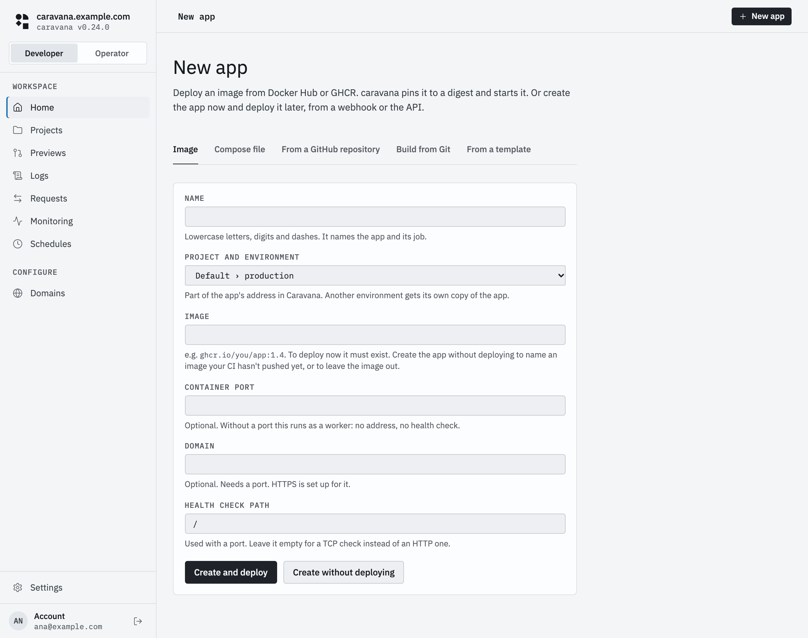

# From an image

The simplest way to run something on Caravana is to name a container image. Caravana looks up the image, pins it,
starts it, and gives it an address with HTTPS if you ask for one. This page covers **New app › Image**, the first tab of
the New app page, and how you deploy a new version of the image afterwards.

<picture>
  <source media="(prefers-color-scheme: dark)" srcset="../../images/new-app-image-dark.png">
  
</picture>

## Make the app

Open **New app** from the Apps page and stay on the **Image** tab. The form has these fields.

| Field | What it takes |
| --- | --- |
| **Name** | Lowercase letters, digits and dashes, at most 31 characters. It names the app and its one service. |
| **Project and environment** | Only drawn when you have more than one environment. It decides where the app lives; see [Projects and environments](../operate/projects.md). |
| **Image** | An image reference such as `ghcr.io/acme/web:1.4`. |
| **Container port** | Optional. The port your app listens on inside its container. Without one the app is a worker: no address and no health check. |
| **Domain** | Optional, and it needs a port. Caravana sets up HTTPS for it. |
| **Health check path** | Used with a port. It starts as `/`. Leave it empty to get a TCP check instead of an HTTP one. |

The form makes one service named like the app, with one copy. Anything else (more copies, memory, environment
variables, volumes, more domains) you set afterwards on the app's **Configure** tab. An app with several services is
better made from a [Compose file](compose.md).

There are two buttons:

- **Create and deploy** saves the app and deploys it. You land on the app's **Deployments** tab and watch the rollout.
- **Create without deploying** only saves it. The image is optional here: you can name the image your CI has not pushed
  yet, or leave the image, port and domain out and create the app by name only. The app's page says "Nothing is deployed
  yet". If you gave an image, the Running tab offers **Deploy now** and **Create a webhook token**. If you gave only a
  name, it says "No definition yet." and offers **Define it in Configure** and **Deploy from Compose**. A port or a domain without an image is refused, since
  there would be nothing for them to belong to.

An app with only a name has no definition, so it cannot be deployed until you give it one in **Configure** (**Define the
app**), from a [Compose file](compose.md), or through the [API](../reference/api.md).

## What the image reference may be

The reference is `[host[:port]/]path[:tag][@sha256:…]`.

- Any registry host works, not only Docker Hub or GHCR. A first part with a `.` or a `:` in it, or that is `localhost`, is read as a host, the
  way Docker reads it. With no host, the image is on Docker Hub, and a bare name such as `nginx` is `library/nginx`.
- Without a tag the tag is `latest`.
- Caravana resolves the tag to a digest on every deploy and runs `repo@sha256:…`, never the tag. A deploy of `web:1.4`
  today and another next week run whatever `1.4` points to at that moment, and each deploy records the exact digest it
  ran. See [How a deploy works](rollback.md).
- If you give both a tag and a digest, the digest wins and the deploy carries a warning that the tag has no effect.
- Registry hosts must serve HTTPS. The one exception is a loopback host (`localhost`, `127.0.0.1`), which Caravana
  reaches over plain HTTP, as Docker does.

## Deploy a new version later

The app keeps the image you typed. There are three ways to move to a new version.

- **By hand.** On the app's **Deployments** tab, the **Deploy** form shows the image (one field per service, labelled
  **Image**, or **web image** when the app has several services). Change the tag, or keep it to pick up a new push to the
  same tag, and press **Deploy**.
- **From CI.** Your pipeline builds and pushes the image and tells Caravana to deploy it, with a webhook or a deploy
  token. See [From CI](ci.md).
- **From the API.** Send the new image in a deploy request. See [The HTTP API](../reference/api.md).

Each deploy is a new version of the app, and the previous version keeps serving until the new copies pass their health
check. [How a deploy works](rollback.md) has the details.

## When the image is missing or private

A deploy fails before anything starts if Caravana cannot find the image. The **Image** field shows the reason, and the
deploy form's failed entry in the history offers a link to fix it.

- If the registry answers "not found" and Caravana has no credentials for that host, the message reads *image not
  found, or private: add credentials for ghcr.io in Settings › Registries*. A private registry refuses anonymous
  requests in the same way as a missing one, so Caravana cannot tell them apart. Either fix the name or add
  credentials; see [Private registries](registries.md).
- If credentials are stored and the registry still refuses them, the deploy fails with `registry_auth_failed`, and the
  failed entry offers **Check the registry's credentials**.
- If the registry cannot be reached or rate-limits the request, the error says so, and trying again later is the fix.
- For a missing image the failed entry offers **Change the image**.

A failed deploy never touches the running version. The app is still saved, so fix the image on the **Deployments** tab
and deploy again.

## Next

- [From a Compose file](compose.md) for apps with several services.
- [From CI](ci.md) to deploy on every push.
- [Private registries](registries.md) for images that need a login.
