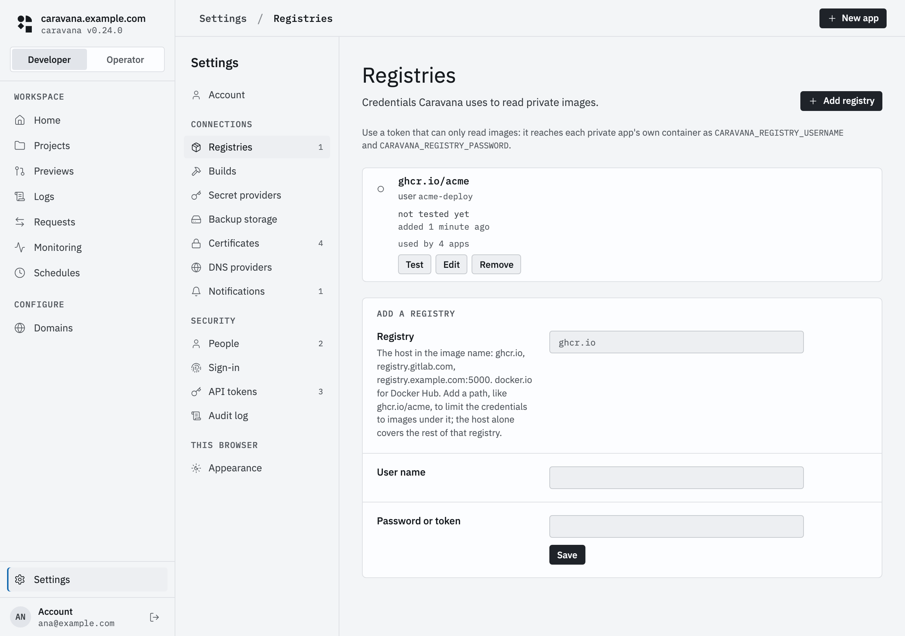

# Private registries

Public images from any registry deploy with nothing set up. To deploy an image from a private registry (a private
GitHub Container Registry package, a private Docker Hub repository, your own registry), give Caravana a login for it in
**Settings › Registries**.

<picture>
  <source media="(prefers-color-scheme: dark)" srcset="../../images/settings-registries-dark.png">
  
</picture>

## Read this first: the login reaches the app

Use a token that can **only read images**, not your own password and not a token that can push or change anything.

Nomad's Docker driver, which starts your containers, has no other way to hand a login to one job, so Caravana passes it
as two environment variables of the app: `CARAVANA_REGISTRY_USERNAME` and `CARAVANA_REGISTRY_PASSWORD`. That means the
app's own container can read the credential of the registry its image comes from, and so can anyone who can open a
[terminal](../operate/commands.md) in it or run a command in it. The job itself, its export and Caravana's records never
hold the password: they hold the variable names only. The console says this above the registry list, as a reminder.

A registry that issues read-only tokens, scoped to one repository or one organization, makes this harmless. For GitHub
Container Registry that is a classic personal access token with only the `read:packages` scope (*as of writing, not
checked live*). If you use [Build from Git](../../building-from-git.md), the entry for the registry you push to must be
able to push, and the app's container then holds that credential: limit the entry to your own path (below) and use the
narrowest token the registry offers.

## Add a registry

1. Open **Settings › Registries** and go to **Add a registry**.
2. **Registry**: the host as it appears in the image name: `ghcr.io`, `registry.gitlab.com`, `registry.example.com:5000`.
   For Docker Hub write `docker.io`. A bare name such as `acme` is refused, since it would read as a Docker Hub user, not
   a host.
3. **User name** and **Password or token**.
4. Press **Save**, then **Test** on its row.

The password is write-only. It is kept in Caravana's secret store, never in its database, and no page, answer or log
shows it. The row shows the user name, whether the credentials work, when they were tested, and **used by** how many apps.

### An entry is a host, or a host and a path

An entry can be limited to a path: `ghcr.io/acme` in place of `ghcr.io`. Use that when one registry holds images of
several owners and you have a login for only one of them, or a narrower token for one. Paths are lowercase, separated by
`/`.

For each image Caravana uses the **most specific entry that covers it**:

| Entries you added | Image | Uses |
| --- | --- | --- |
| `ghcr.io`, `ghcr.io/acme` | `ghcr.io/acme/web` | `ghcr.io/acme` |
| `ghcr.io`, `ghcr.io/acme` | `ghcr.io/other/tool` | `ghcr.io` |
| `ghcr.io`, `ghcr.io/acme` | `ghcr.io/acme-old/x` | `ghcr.io` (a path matches whole segments only) |
| `ghcr.io/acme` | `ghcr.io/other/tool` | nothing: an anonymous request |
| none | any image | nothing: an anonymous request |

The image on `ghcr.io` with no matching entry is looked up anonymously, so it works if the package is public and fails
the way a private image does if it is not.

## Test

**Test** asks the registry to accept the stored login, the same way Caravana does when it looks an image up. The result is
stored and shown on the row, and a notice says it: *ghcr.io accepted the credentials.* or *ghcr.io refused the
credentials: …*. A row is one of:

- **works**, with when it was tested;
- **refused**, with a note that deploys of private images from this registry fail until it accepts the credentials, and
  an **Update password** button that opens the edit form;
- **not tested yet**, for an entry just added;
- **changed · not tested since**, after you saved different credentials (the old result no longer applies).

A registry's login check cannot say which images a login can read. For a path entry, **Test** therefore reports only that the
login is accepted, and says that the first deploy of an image under that path shows whether it can read it.

## Change or remove credentials

- **Edit** changes the user name or the password. Leave **Password or token** empty to keep the current one.
- When you save, Caravana rewrites the credentials of every app already deployed with that entry. Nothing restarts:
  a running copy picks up the new login the next time its task starts, which is any redeploy or restart. If Caravana cannot
  reach the secret store while doing this, the page says *saved, but apps already deployed still have the old
  credentials*.
- **Remove** deletes the entry. Apps already running keep running. The next deploy of a private image it covered fails
  until you add credentials again, unless a host entry, or another path entry, covers the image.

## When a deploy can't pull

A deploy looks the image up in the registry before it starts anything, so a problem shows up on the **Deployments** tab as a
failed entry, not as a half-started app, and the running version is not touched. The messages:

- **`image not found, or private: add credentials for ghcr.io in Settings › Registries`** (API code `image_not_found`).
  No login was sent and the registry said it does not have the image. A private registry answers the same as a missing
  image, so either the name is wrong or you need an entry. The failed entry offers **Change the image**.
- **`image not found, or the stored credentials for ghcr.io can't read it`** (`image_not_found`). A login was sent, and
  the registry still does not show the image to it: check the name, and that the token may read that repository.
- **`the registry refused the stored credentials`** (`registry_auth_failed`). The registry answered 401 or 403 to the
  stored login: it expired, was revoked, or is not allowed to read that image. The failed entry offers **Check the
  registry's credentials**, which goes to **Settings › Registries**. Press **Test** on the row, then **Edit** to change the login (a row whose test failed also shows **Update password**).
- A message that the registry is unavailable or is rate-limiting requests (`registry_unavailable`): not about your
  credentials, so try again later.

The webhook, CI and **Redeploy this version** give the same errors. A redeploy of an old version checks the registry too, and
refuses if the image of that version has been deleted ([How a deploy works](rollback.md)).

## Next

- [From an image](image.md) and [From CI](ci.md), which deploy private images from a pipeline.
- [Build from a Git repository](../../building-from-git.md), which pushes to a registry you add here.
