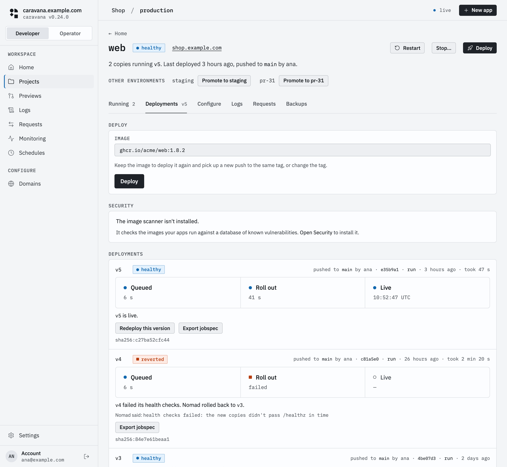

# How a deploy works, and how to undo one

Every way of deploying (the console, a webhook, CI, the API, a Compose file, a template) ends in the same process. This page
explains what that process does, how to read the history of it on an app's **Deployments** tab, and how to go back to an
earlier version.

<picture>
  <source media="(prefers-color-scheme: dark)" srcset="../../images/app-deployments-dark.png">
  
</picture>

## What a deploy does

1. **Pins the images.** Caravana looks up each service's image tag in its registry and turns it into a digest:
   `ghcr.io/acme/web:1.4` becomes `ghcr.io/acme/web@sha256:…`. The app runs that exact image, never the tag. Two deploys of
   the same tag run different images if the tag moved between them, and each deploy records the digests it ran. A deploy never
   uses a floating tag, and a deploy with no change to the app still looks the tag up again, so it picks up a new push to the
   same tag. If the image cannot be found the deploy fails here, before anything starts; see
   [Private registries](registries.md).
2. **Makes a new version.** Every deploy is a new version of the app, numbered `v0`, `v1`, `v2`… even when nothing in the
   definition changed. The history lists them newest first.
3. **Rolls out.** The new copies start next to the old ones. The old version keeps serving every request while the new one
   starts, and no traffic goes to a new copy until it passes its health check. Each new copy has 3 minutes to pass its checks
   and has to stay healthy for 10 seconds; a rollout that makes no progress for 10 minutes fails. When the whole new set is
   healthy, the old copies are stopped (after a few seconds, so the proxy drops them first) and the new version is **live**.
4. **Reverts on failure.** If the new version does not get healthy, it is rolled back automatically to the last good version,
   which never stopped serving. You do not have to do anything, and the history says what happened.

Environment variables and secrets are replaced by each deploy, not merged: a variable the new version does not name is
gone. (Naming a secret without a value keeps the value it has.)

Two things do not follow the rule of running old and new side by side. A service with a **volume**, and a service with a
**published port**, cannot have two copies at once, since the new copy would need the volume or the port while the old one
still holds it. These services **stop, then start**: the old copy stops and the new one starts, so there is a short gap.
They are still health-checked, and a failure is still reverted. See [Volumes](../configure/volumes.md).

Deploys of one app go one at a time. If you deploy again while a rollout is going, the newest deploy wins: the older one is
marked **superseded** and the newer one carries on. If Caravana restarts during a rollout, it picks the rollout up again.

## Reading the history

Each entry in the history is one deployment.

- **The version** (`v7`) and a status: **rolling out**, **healthy**, **failed**, **reverted** or **superseded**. *Failed*
  means it never started (for example the image was not found) or failed during its rollout. *Reverted* means it failed its
  health checks and the previous version was put back. *Superseded* means a newer deploy replaced it.
- **Who and what started it**, in plain words: *by you* or *by ana@example.com* for the console, *through the API by ci*
  for a token, *by the webhook*, *pushed to main by ana · 4e0a77c* for a deploy from [CI](ci.md) (with a **run** link),
  *promoted from staging* for a [promotion](../operate/projects.md), *Redeploy of* and the short ID of the deployment it repeats, for a redeploy of an earlier
  version, and *Refreshed secrets* for a [secret refresh](../../secret-providers.md). The time and how long it took
  follow.
- **The stages**: **Queued** (waiting until Caravana has handed the new version to the scheduler), **Roll out** (with
  progress such as *1 of 2 new copies healthy*, and how long it took) and **Live** (the time it became live). An app built
  from [a Git repository](../../building-from-git.md) has a **Build** stage first. A failed stage is marked, and the stage
  after it reads "—". Older entries show the stages as a single line.
- **A sentence** saying where it stands, for example *v7 failed its health checks. Nomad rolled back to v6, which is
  serving.* Nomad is the scheduler Caravana runs your apps on. After a rollback the version that runs is a new one that
  repeats the last good version, and the entry says so: *v8 (v6 again)*.
- **The reason**, in detail, under the sentence, and **one button** when there is a thing to fix: **Check the registry's
  credentials**, **Change the image**, or **Deploy again**.
- **A list of warnings**, such as a secret that was removed or a Compose attribute that was honored differently, and a
  list of the images as deployed: the short digest of each service's image.

### Deploy again, without choosing a version

The **Deploy** form at the top of the tab deploys the app as stored, with the image of each service in a box. Keep the image
to deploy again and pick up a new push to the same tag, or change the tag. This always looks the tags up again.

## Go back to an earlier version

An entry that ended **healthy** and has a recorded definition offers **Redeploy this version**. It opens a confirmation, and
**Redeploy** does this:

- It deploys that version's definition again, with the same images, pinned by the same digests. **No tag is looked up**: you
  get the image that version ran, even if the tag has moved since.
- That definition becomes the app's stored one. **Configure** shows it, and the next deploy starts from it. If the version was
  made from a [Compose file](compose.md), its file becomes the kept file again.
- It goes through the normal rollout, so it is health-checked and can itself be reverted. The new entry says *Redeploy of* and links to the
  deployment it repeats.

What it does **not** restore:

- **Data.** A volume, a database, an uploaded file: none of it goes back in time. If a version's migration changed your
  database, redeploying the old image does not undo it. Restore from a backup for that; see
  [Backups and restore](../operate/backups.md).
- **Secret values.** Secrets keep their current values. A secret the app has now and that version did not have is deleted
  with its value, and the confirmation lists those before you press **Redeploy**. A secret that version had and the app
  lacks now has no value to come back with, so the redeploy is refused until you give it one. Values that come from a
  [secret provider](../../secret-providers.md) are read again now, not as they were, and the confirmation says so.
- **Pinned images for later.** The restored version is pinned, but the definition it stores has your tags, so a later
  redeploy or a webhook looks the tags up again and moves on from it.

The console offers **Redeploy this version** only on entries that ended healthy and have a recorded definition (the API
refuses the others with `deployment_not_healthy` or `definition_not_recorded`). A redeploy is refused, with the reason in
the confirmation, when:

- the app is stopped (see [Stop, start and restart](../operate/commands.md));
- **an image has been deleted**. Before anything changes, Caravana asks each registry whether it still has the pinned
  digest. If one is gone, the redeploy fails with the registry's answer, naming the image. Nothing is changed and the running
  version keeps running.

## Export a jobspec

**Export jobspec** on a history entry, or on the **Export** panel of **Configure › Integrations** (for the live version), downloads the
app as a plain [Nomad](https://developer.hashicorp.com/nomad) job file, `<app>.nomad.hcl`, the job Caravana would run for
that deployment. It is there so that Caravana is never a trap: the app is described in a standard format that Nomad runs by
itself (`nomad job run web.nomad.hcl`), and uninstalling Caravana leaves your apps running.

A comment block at the top says what the job needs from the cluster, because the job refers to things Caravana normally
provides: the Traefik proxy and its routes for each domain, the host volumes, and the Nomad Variables that hold your
secrets, with their names. The file holds **no secret value**. It is made with this Caravana's current settings, which can
differ from the job that ran if those settings changed since, and images are the pinned digests.

An entry made before definitions were recorded cannot be exported, and neither can the live version of an app with no healthy
deployment.

## Conditional deploys

The API can make a deploy conditional, so two writers cannot overwrite each other: `If-Match` with the app's revision saves only
if the app has not changed since you read it (a `412 app_changed` otherwise), and, on a Compose deploy, `If-None-Match: *` creates the app only if
the ID is free (`409 app_exists` otherwise). See [The HTTP API](../reference/api.md).

## Next

- [Backups and restore](../operate/backups.md): the way back for data.
- [Notifications](../operate/notifications.md): hear when a deploy fails or is reverted.
- [From CI](ci.md): deploy on every push and wait for the result.
