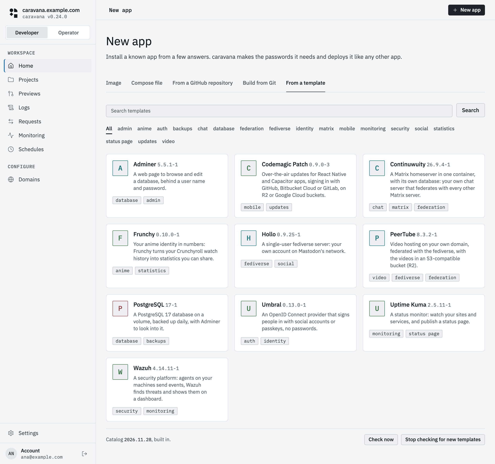

# From a template

A template installs a known app from a few answers. You choose it from a grid, type a domain (and whatever else it
needs), and Caravana makes the app: its services, its volumes, its passwords, and its backups. A template is a
[Compose file](compose.md) with blanks and a short list of questions for the blanks, so installing one is an ordinary
Compose deploy of a new app. Nothing about it is special afterwards: you edit, back up, update and delete it like any
other app.

<picture>
  <source media="(prefers-color-scheme: dark)" srcset="../../images/new-app-templates-dark.png">
  
</picture>

## Install one

1. Open **New app** and choose the **From a template** tab.
2. Pick a card. You can search by name, or filter by tag.
3. The template's page says **What it makes** (its services, the address each is reached at, which are backed up and
   which secrets they use) and shows its **Notes**: what to do first, for example creating the admin account.
4. Fill in the form: a **Name** (the template suggests one), the project and environment when you have more than one, and
   the template's own questions.
5. Press **Preview** to see the services, secret names and warnings the answers would make, and the Compose file they
   produce. Nothing is made: no app, no password, no deploy. Then press **Create**.

You land on the app's **Deployments** tab, which carries an *Installed from the … template* notice with the notes, now
filled with your answers, and the rollout in the history. A template with a Team only domain also shows its password
there, once (see below). On **Configure › Overview**, the **Source** panel says **Template ·** followed by the
template's title and version. Because the app is made from a Compose file, **Configure › Source** shows that file for editing.

## What is in the catalog

The console comes with a catalog of six templates. Template versions are the upstream app's version, then a dash and
the number of the template's own revision.

| Template | What it is | What it makes |
| --- | --- | --- |
| **Uptime Kuma** | A status monitor: watch your sites and services, and publish a status page. | One service with a volume, backed up daily. |
| **Hollo** | A single-user fediverse server: your own account on Mastodon's network. | Hollo and Postgres, Postgres backed up daily. |
| **PostgreSQL** | A PostgreSQL 17 database on a volume, backed up daily, with Adminer to look into it. | Postgres and Adminer. |
| **Adminer** | A web page to browse and edit a database, behind a user name and password. | One service behind Team only. |
| **Umbral** | An OpenID Connect provider that signs people in with social accounts or passkeys, no passwords. | One service with a volume, backed up daily. |
| **Codemagic Patch** | Over-the-air updates for React Native and Capacitor apps, on your own server and R2 buckets. | A server and Postgres, Postgres backed up daily. It asks you for an image: Codemagic publishes none, so you build and push one first (the template's notes say how). |

This is the catalog built into this version of Caravana. A newer catalog can be fetched, as described below, so the grid
on your installation may have more.

## Questions, passwords and choices

Each template asks for what it cannot decide for you. The kinds of question are:

- **Domain**: the host name the app is served at. Its DNS must point at this server (see
  [Domains and HTTPS](../configure/domains.md)).
- **Text** and **email**: free answers, checked against a pattern the template gives.
- **Secret**: a value you type, such as a database password. It is a password field, and nothing writes it back into the
  page: if the form comes back with an error you type it again.
- **Choice**: radio buttons when there are up to four answers and the question is required or has a default, otherwise a
  drop-down. A required drop-down starts at **Choose…**, an optional one at "—". A question that only one answer needs is grouped under a heading such as **Only for GitHub**, and is hidden while another
  answer is chosen.

A question marked **optional** can be left empty.

Some passwords you are never asked for. When a template needs a password only the app's own services use (a database
password shared by Hollo and its Postgres, an application key), Caravana generates it at install time. The template page
says how many it will make and the names of the secrets they are kept in. Generated and typed secrets go to the app's
secret store, like any [secret](../configure/variables.md). They are never shown on any page or in the kept Compose
file, in the API's answers or in the logs. If you need a value later, you cannot read it back: set a new one on the
app's Variables page.

**Team only passwords.** Adminer (alone, and inside the PostgreSQL template) is served behind a user name `team` and a
password that Caravana makes. After **Create**, the Deployments tab you land on shows that password once, with a
**Copy password** button: copy it then, because Caravana keeps only a hash and no later page shows it. If it is lost,
open the app's **Domains** page and press **New password** on the domain to make another, also shown once. See
[Domains and HTTPS](../configure/domains.md).

## Backups in a template

A template that holds data comes with a backup policy, daily by default, and its notes say when. Backups need somewhere
to go: **Settings › Backup storage**, see [Backups and restore](../operate/backups.md). If no destination is set, the
template's page says so and offers a box, **Install without backups for now**. With it ticked, the app is installed
with no backup policy and the deploy carries one warning per service that would have been backed up. You can turn
backups on later.

## Keeping the catalog up to date

At the bottom of the grid the page says which catalog is in use: *Catalog 2026.11.12, built in*, or *Catalog …,
fetched Nov 12 09:30 UTC*. Caravana checks for a newer one about a minute after it starts and then once a day. It asks
the catalog's release page on GitHub for a checksum file first, downloads the catalog only if its checksum changed,
verifies it, and runs every template through the same checks the built-in ones pass. The request carries Caravana's
user agent and nothing about your server. A catalog that fails any check is not used, and the page says that the last
check failed.

- **Check now** asks right away. It does nothing if the last check was less than ten minutes ago.
- **Stop checking for new templates** turns the check off: Caravana then makes no request about templates at all, and
  keeps using the catalog it has. **Check for new templates daily** turns it back on.

A template in the catalog that needs a newer Caravana, or that this one cannot read, is left out of the grid. The API lists it with the reason, and
its address in the console answers "This template isn't offered: …" with the reason. The rest of the catalog still works.

## Next

- [Backups and restore](../operate/backups.md) and [Backup destinations](../../backup-destinations.md).
- [From a Compose file](compose.md) to see what a template's file looks like once it is kept with the app.
