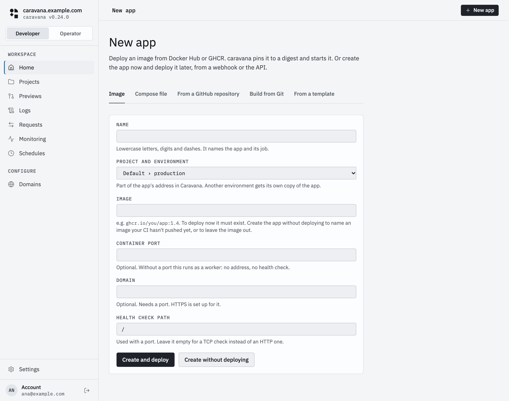
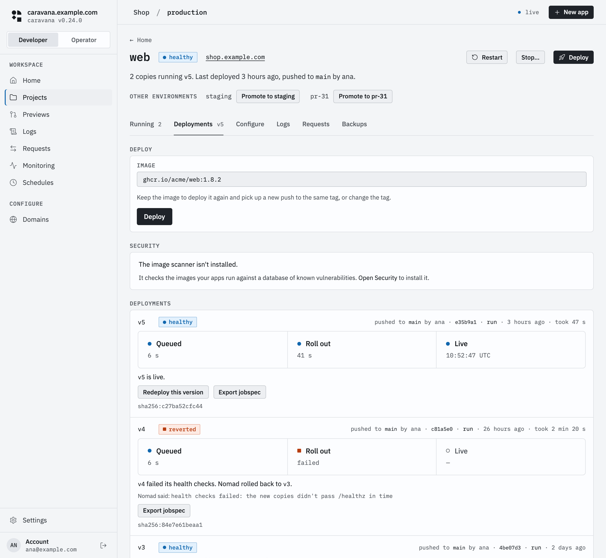
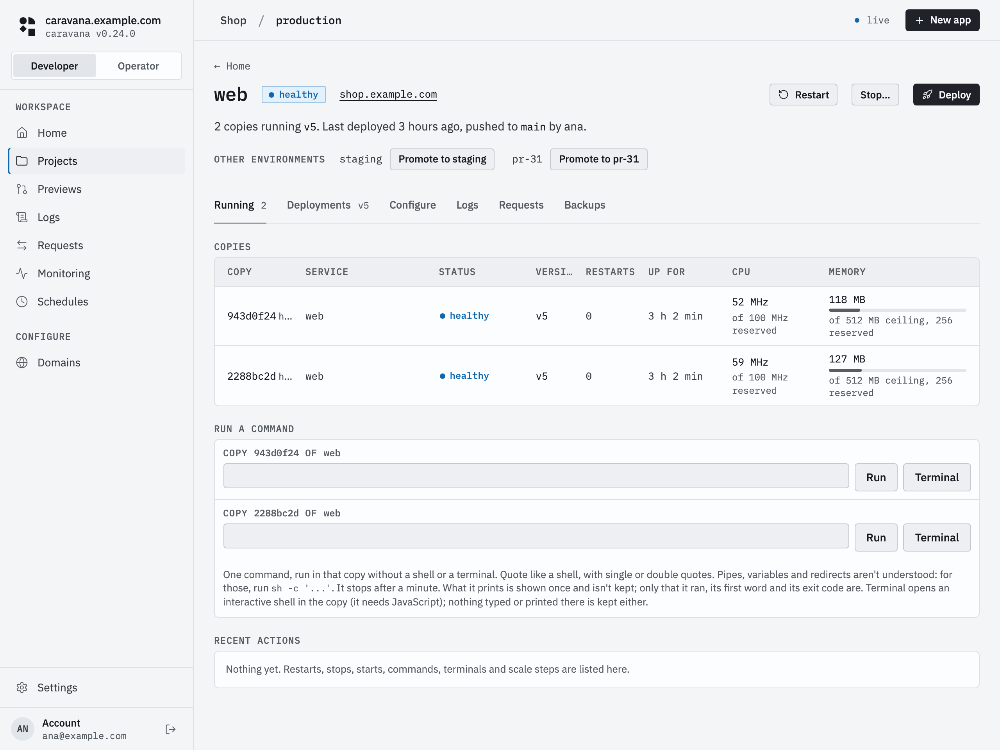

# Your first app

This walkthrough deploys a small public image from the console, watches the rollout, opens the
address, changes a setting, deploys again and goes back to the first version. It takes about ten
minutes. You need a running installation ([Install](install.md)) and, to give the app an address, a
domain you can point at the server.

The app is `traefik/whoami`, a tiny web server that answers every request with a description of the
request. It listens on port 80.

## Before you start

Make a DNS record for the app's domain, for example `whoami.example.com`, an A record pointing at the
server's public IP address. Caravana does the HTTPS part itself: when the app has a domain, Traefik
gets a certificate for it. If the domain's zone is at Cloudflare, Caravana can make the DNS
record for you once you connect the zone: see [Domains and HTTPS](configure/domains.md).

## 1. Sign in and open New app

Open `https://caravana.example.com/login`, sign in, and click **New app** at the top right of the
page.

The page has five tabs under the title: **Image**, **Compose file**, **From a GitHub repository**,
**Build from Git** and **From a template**. Stay on **Image**.

<picture>
  <source media="(prefers-color-scheme: dark)" srcset="../images/new-app-image-dark.png">
  
</picture>

## 2. Fill in the form

| Field | Value | What it means |
| --- | --- | --- |
| **Name** | `whoami` | Lowercase letters, digits and dashes, at most 31 characters. It names the app and its job. |
| **Image** | `traefik/whoami:v1.10` | An image from any registry. Caravana turns the tag into a digest at every deploy. |
| **Container port** | `80` | The port the app listens on. Without a port the app runs as a worker with no address and no health check. |
| **Domain** | `whoami.example.com` | Optional, and it needs a port. HTTPS is set up for it. |
| **Health check path** | `/` | A new copy must answer this path with a success status before it takes traffic. Leave it empty for a plain TCP check. |

A **Project and environment** choice appears only once you have more than one environment. A fresh
installation has one, so the app goes there. Projects are in [Projects and
environments](operate/projects.md).

Click **Create and deploy**. The other button, **Create without deploying**, saves the app and
leaves the deploy for later.

## 3. Watch the rollout

You land on the app's **Deployments** tab. It opens with the **Deploy** form, and under it is the
history, where the first entry is marked **rolling out**.

<picture>
  <source media="(prefers-color-scheme: dark)" srcset="../images/app-deployments-dark.png">
  
</picture>

Each entry shows three stages: **Queued** (Caravana looked up the image's digest and Nomad accepted
the job), **Roll out** (for example "0 of 1 new copy healthy") and **Live**. The page updates by
itself; you do not need to reload it.

The new copy starts next to whatever ran before, here nothing. Traffic only reaches a new copy after
it passes its health check. If it never does, Nomad reverts to the previous version and the entry ends
as **reverted**. When the first copy is healthy the entry turns **healthy** and the app is live.

## 4. Open the address

Click the **Running** tab. The **Copies** table lists each copy with its **Status**, **Version**,
**Restarts**, how long it has been up and its CPU and memory use.

<picture>
  <source media="(prefers-color-scheme: dark)" srcset="../images/app-running-dark.png">
  
</picture>

The app's address is next to its name at the top of the page. Open it: whoami prints the request it
received. If the browser warns about the certificate, Let's Encrypt has not finished yet. Wait a
minute and reload.

## 5. Read its logs

Click the **Logs** tab. It shows what the app's copies write to standard output and standard error,
read from Nomad when you open the page. The Logs page and its filters are in [Logs](operate/logs.md).

## 6. Change something and deploy again

Every change to an app is a deploy. There are two simple ways to try it.

**Change a setting.** Open the **Configure** tab. Under **Copies & size**, set **Copies** to `2` and
click **Save and deploy**. A new entry appears on the **Deployments** tab, and when it is healthy the
**Running** tab lists two copies.

**Deploy a new image.** On the **Deployments** tab, the **Deploy** form has an **Image** field with
the image you gave. Change the tag, or keep it to pick up a new push to the same tag, and click
**Deploy**. The **Deploy** button at the top of the app page goes to the same form.

If a deploy cannot start, for example because the tag does not exist, the form says what is wrong
under the **Image** field. Nothing was registered with Nomad, so the running version keeps running.
The failed attempt may also appear in the history as **failed**, with its **Queued** stage showing
"didn't start".

## 7. Go back to the first version

Every deploy records the app's definition and the exact image digests it used. On the
**Deployments** tab, find the first healthy entry, the one with one copy, and click **Redeploy this
version**. Read what it says and click **Redeploy**.

Caravana deploys that definition again with the same digests, without looking the tags up again. It is
a new entry in the history, with a new version number and a line saying it is a redeploy of the older
one. The **Running** tab goes back to one copy.

The same entries offer **Export jobspec**, which downloads that version as a plain Nomad job. See [How
a deploy works, history and rollback](deploy/rollback.md).

## Where to go next

- [From an image](deploy/image.md) in detail: tags, digests, private registries, copies.
- [Variables and secrets](configure/variables.md) to give the app its environment.
- [Domains and HTTPS](configure/domains.md) to add more addresses.
- [A tour of the console](console.md) to see every page.
- Deploy from [CI](deploy/ci.md) so a push does this for you.
