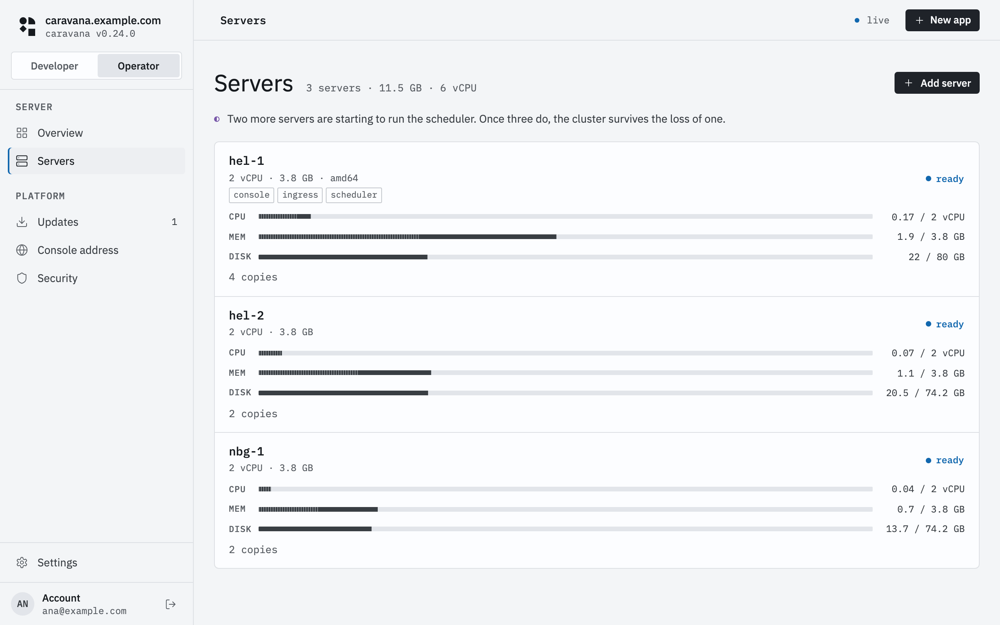
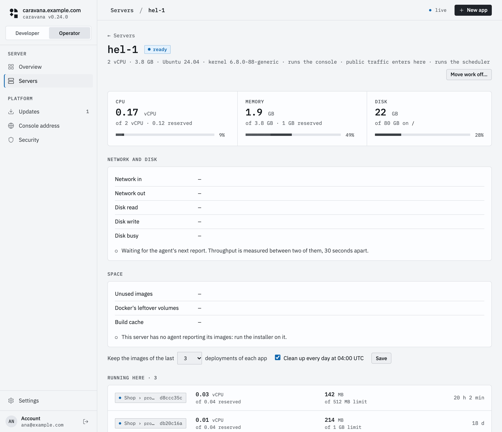

# More servers

Caravana starts on one server and can grow to several. A server you add joins a private, encrypted network with the first one and takes copies of your apps. With three servers the cluster survives the loss of one.

<picture>
  <source media="(prefers-color-scheme: dark)" srcset="../../images/ops-servers-dark.png">
  
</picture>

## When to add one

Add a server when the first one runs out of memory or CPU (see [Monitoring](../operate/monitoring.md): **Room for about N more apps**), when you want an app to have copies on two machines, or when you want the cluster to survive the loss of a machine. One server is fine for most small installations; nothing requires more.

## What joining does

Every server runs Docker, Nomad and a small agent (`caravana-node`) that keeps it in step with the console. When a server joins:

- It gets a place on a private, encrypted network (WireGuard) between all the servers. Each server has a number from 1 to 63, and its addresses on that network come from the number. Nothing is typed in.
- It gets a certificate, signed by a certificate authority Caravana keeps, so the servers' Nomad traffic is encrypted and each server proves who it is. The server keeps its own private key; it never leaves the machine. Certificates last 90 days and are renewed by the agent.
- Nomad on it starts taking copies. Services with several copies are spread over the servers. Services of one app reach each other by name across servers.

### What still runs only on the first server

Say it plainly: adding servers adds capacity for your apps, not redundancy for Caravana itself.

- **The console, the API and its database** (one SQLite file) run only on the first server. If it is down, you can't use the console or deploy, though the apps already running on the other servers keep running.
- **The proxy** (Traefik, which serves your domains over HTTPS and holds the certificates) runs only on the first server, so only the first server answers on ports 80 and 443. Requests reach copies on other servers over the private network.
- **Apps' ports published directly** (see [Published ports](../../published-ports.md)) are on the first server only.
- **A volume lives on one server.** All the volumes of a service are on the same server, and a service with a volume runs one copy there.
- **Caravana's updater** runs on the first server. Joined servers are not updated from the console: rerun the installer on them (below).

## Add a server

You need a machine you own, with Ubuntu 24.04 or 26.04 LTS, or Debian 12 or 13 (amd64 or arm64), 2 GB of memory or more, and Docker and Nomad not installed yet.

1. In the Operator view, open **Servers** and choose **Add server**.
2. Give it a **Name** (lowercase letters, digits and dashes; leave it empty to use the machine's own name) and a **Pool** (leave `default`: apps run on servers in `default`, and a server in another pool takes no apps). Choose **Make the join command**.
3. Copy the command shown ("Run this on the new server as root"). It is shown once: it looks like

   ```bash
   curl -fsSL https://github.com/Cosmic-Chimps/caravana/releases/download/vX.Y.Z/install.sh |
     sudo bash -s -- --join cvjn_… --url https://caravana.example.com
   ```

   The token inside works once and for one hour. If you lose the command, cancel the join and make a new one.
4. Run it on the new server. The page's **Checks** panel follows along and ticks four checks: **Connected to the cluster**, **Docker running**, **Reaches the other servers on the private network** and **Ready to take work**.

<picture>
  <source media="(prefers-color-scheme: dark)" srcset="../../images/ops-server-dark.png">
  
</picture>

The installer on the new server installs Docker, Nomad and the agent, joins, starts Nomad, and waits up to three minutes for the four checks, printing each as it passes. It ends with "This server joined as NAME." If it times out it shows the checks still open and exits with an error; the agent keeps trying every 30 seconds either way. If a server never gets ready, remove it (below) and make a new command.

### What the new server needs

- **The console's address reachable over HTTPS** from the new server.
- **UDP port 51820 open between the servers**, in your provider's firewall too. The installer opens it on the host itself. The network check says "Check that UDP port 51820 is open between the servers." when it can't reach the others.
- **Each server reachable by the others at one address**, which the console learns from the join call. If the address the machine calls from isn't the right one, add `--address IP` to the command.
- The installer refuses a host that already has an address or route inside `10.97.0.0/16`, `10.98.0.0/24` or `10.99.0.0/24` on another interface: Caravana uses those private ranges between servers.
- If your console runs on Traefik's own certificate (the installer's `--acme none`), the command the console shows adds `--insecure`, and the page warns that the new server can't check who it is talking to. Use this only on a network you trust.

On a joined server only SSH (22) answers from the internet, plus WireGuard on 51820/udp. Apps' ports are on a private interface and reach the internet only through Traefik on the first server.

## Three servers

With one or two servers there is one Nomad server (the scheduler). When **three** servers are ready, the console makes the first server and the two oldest others Nomad servers, one at a time. Three voters survive losing one. Nomad restarts once on each server being promoted, and its copies keep running. When the third server joins the page says: "With three servers the cluster survives the loss of one." A server that is down for good is removed, not waited for.

When a server stops answering, Nomad calls it disconnected after about 45 seconds. By default its copies are kept for 5 minutes in case it comes back: a stateless service gets replacements on other servers meanwhile, and a service with a volume waits for its server, because its data is on that server's disk. After that the server is **down**, and the console puts "`server-name` is down. Its copies are being replaced on other servers; what has a volume there waits for it." on the needs-you list. See [Network blips](../../network-blips.md) for the details and for changing the 5 minutes.

## Labels, placement and moving work off

Give a server labels (`ssd=true`, `region=eu`), tell a service where it may run, and **Move work off…** a server you want to empty: see [Placement and moving work](../../placement-and-drain.md). Moving work off never moves a volume or the proxy; the page lists what stays and why.

## Remove a server

- **A server that is running**: take it out on the server first. Run the release's installer with `--leave`:

  ```bash
  sudo bash install.sh --leave
  ```

  It stops the agent and Nomad, removes the private network interface, the agent, its certificates and Nomad's configuration there, and keeps Docker, Nomad's binary and the packages. Containers the apps left running are not touched. Then remove the server in the console too, or it stays listed as down.
- **A join nobody used** (the command was never run): on that join's page, choose **Cancel this join**.
- **A server that called in but never got ready**: on its join page choose **Remove this server**, then confirm.
- **A server that is down** (or disconnected): open it on **Servers** and choose **Remove server…**, then **Remove server-name**. "Its place in the cluster and its token are deleted. The other servers stop talking to it within a minute." Apps with a volume on it can't start elsewhere, because their data is on its disk; removing it deletes nothing there.
- **The first server can't leave.** Removing Caravana from it is `--uninstall`: see [Keeping Caravana up to date](upgrade.md#uninstall).

## Updating joined servers

Caravana's **Update to X…** updates the first server. A joined server is updated by running the same join command again on it: it makes no new call to the console, and just upgrades the server's agent and Nomad configuration to the release. The OS updates of joined servers aren't read by the Updates page. Update their OS on each machine.

## See also

- [Placement and moving work](../../placement-and-drain.md)
- [Network blips](../../network-blips.md)
- [Host I/O](../../host-io.md)
- [Reclaim space](../../reclaim-space.md)
- [Keeping Caravana up to date](upgrade.md)
