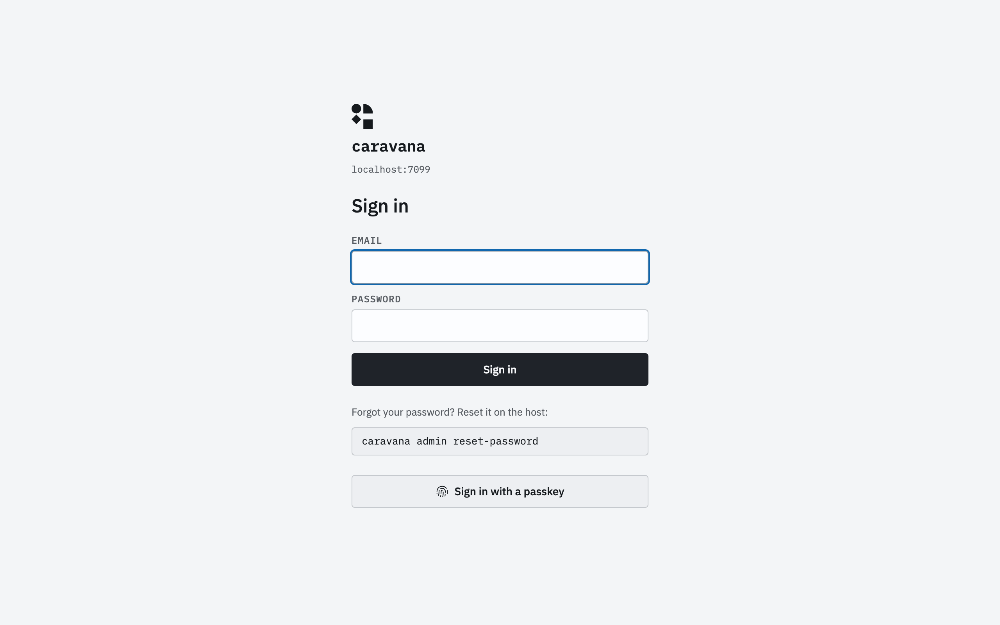
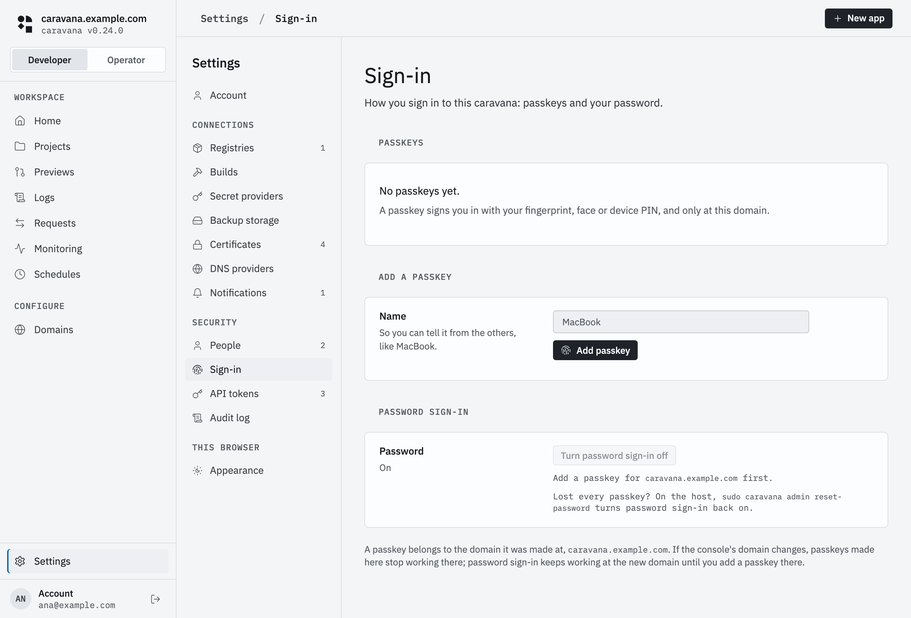
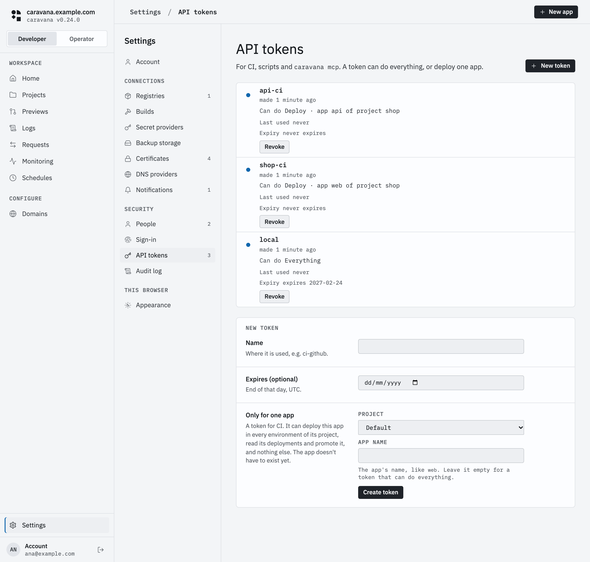

# Sign-in, passkeys and tokens

How people and programs prove who they are to Caravana: a password or a passkey for people in the console, API tokens for scripts and CI.

<picture>
  <source media="(prefers-color-scheme: dark)" srcset="../../images/sign-in-dark.png">
  
</picture>

## The first owner

A new installation has no one who can sign in. The installer asks for a password twice at the end and makes the first owner with the email you gave it. If it ran without a terminal it prints the command instead. On the host:

```bash
sudo caravana admin init --email ana@example.com
```

It asks for a password of at least 12 characters, and works while Caravana runs. It is refused once anyone exists. Until then the sign-in page says "This caravana has no admin yet." and shows the command. Other people are invited from the console: see [People and roles](../../people.md).

Check who exists and how each signs in with `sudo caravana admin status`.

## Signing in

Open the console's address, enter **Email** and **Password**, and choose **Sign in**. A successful sign-in sets a cookie called `caravana_session` (named `__Host-caravana_session` and marked secure over HTTPS). Only a hash of its value is kept on the server.

- A session ends after **12 hours without use**, and no session lasts longer than **7 days**.
- Changing your password in **Settings › Account** signs your other browsers out.
- Wrong passwords are limited per address: **5 failures in 15 minutes** lock further sign-ins from that address for 15 minutes ("Too many failed sign-ins from this address. Try again in N minutes."). An IPv6 address counts as its whole `/64`. The count is by the address Caravana sees. Behind a proxy it believes `X-Forwarded-For` only from the proxies in `CARAVANA_TRUSTED_PROXIES`; the installer sets `127.0.0.1,::1`.
- A request that changes something, made with a session cookie from another site's page, is refused (`cross_origin`). This protects the console from other sites; there is nothing for you to do.

## Passkeys

A passkey signs you in with your fingerprint, face or device PIN, without typing a password, and only at the domain it was made for.

<picture>
  <source media="(prefers-color-scheme: dark)" srcset="../../images/settings-sign-in-dark.png">
  
</picture>

### Where they work

Passkeys need a real domain name over HTTPS, or `localhost`. They don't work at an IP address or over plain HTTP, because browsers don't allow it. If the console has a public address set (`CARAVANA_PUBLIC_URL`, which the installer sets from the console's domain), passkeys work only at that address. At any other address **Settings › Sign-in** says "Passkeys work at …, this caravana's own address."

A passkey belongs to the console's domain. If you move the console to a new domain (see [Console address](../../console-address.md)), passkeys made at the old one stop working there, and password sign-in keeps working at the new one until you add a passkey there.

### Add one

1. Open **Settings › Sign-in**. Under **Add a passkey**, adding one needs you to have signed in or confirmed in the last 10 minutes. If you haven't, **Confirm it's you first**: enter your password and choose **Confirm with password**, or **Use a passkey**.
2. Give it a **Name** so you can tell it from the others, like `MacBook`.
3. Choose **Add passkey** and follow your browser or device.

Adding a passkey needs JavaScript. The list shows each one's name, domain, when it was added and last used, and offers **Rename** and **Remove**.

### Sign in with one

On the sign-in page choose **Sign in with a passkey** (the button appears only when your browser can use passkeys here). A passkey that doesn't match the console's user or domain is refused. Failed attempts count against the same 5-in-15-minutes limit as passwords.

### Turn the password off

Under **Password sign-in**, once you have a passkey for the console's domain, choose **Turn password sign-in off**. Then only passkeys sign in, and the sign-in page says "Password sign-in is off on this caravana." The button is disabled until you have one: "Add a passkey for `caravana.example.com` first."

What stops you locking yourself out:

- You can't remove your **last passkey** for the console's domain while password sign-in is off. Turn the password on first, or add another passkey.
- If no passkey exists for the console's domain, the password still works, even if it is off. A change of domain never locks you out.
- **Lost every passkey?** On the host, `sudo caravana admin reset-password` sets a new password and turns password sign-in back on. If you need to remove a passkey from the host: `sudo caravana admin passkeys list`, then `sudo caravana admin passkeys remove --id <id>`.

## A forgotten password

The sign-in page says "Forgot your password? Reset it on the host:". On the server:

```bash
sudo caravana admin reset-password
```

It asks for a new password twice. It signs out every browser of that account and turns password sign-in on if it was off; API tokens keep working. With several people, give `--email ana@example.com` to choose whose password; without it, it is the first owner's.

## API tokens

An API token lets a script or CI call the HTTP API as you, without a password. Open **Settings › API tokens** and choose **New token**.

<picture>
  <source media="(prefers-color-scheme: dark)" srcset="../../images/settings-tokens-dark.png">
  
</picture>

1. Give it a **Name** for where it is used, for example `ci-github`.
2. Optionally set **Expires (optional)**: it ends at the end of that day, UTC.
3. Choose **Create token**. The token (`cvat_…`) is shown once, with a ready `curl` line. Copy it now: "Caravana only keeps a hash and can't show it again."

Use it as a bearer token:

```bash
curl -H "Authorization: Bearer cvat_…" https://caravana.example.com/v1/apps
```

The list shows each token's name, what it can do, when it was last used and its expiry. **Revoke** ends it at once: "This token can't be used again." A token acts with the rights of the person who made it, so a role change or removal of that person applies to it at the next call.

On the host, `sudo caravana admin create-token --name ci [--expires-in <duration>]` makes one and prints it; `sudo caravana admin revoke-token --name ci` revokes it.

### Deploy tokens

A token made with **Only for one app** (a **Project** and an **App name**) is a **deploy token**: it can deploy that app in every environment of its project, read its deployments and promote it, and nothing else. It is the token CI should have. You can also make one from the app's **Configure › Integrations** page. See [From CI](../deploy/ci.md) for how to use it.

## Inviting people

Each person has their own sign-in, their own tokens and a role. Invite them from **Settings › People**: Caravana makes an invite link that you send them; it doesn't send mail. See [People and roles](../../people.md).

## See also

- [People and roles](../../people.md)
- [Audit log](../../audit-log.md): sign-ins, failed sign-ins and token changes are recorded.
- [From CI](../deploy/ci.md)
- [Troubleshooting](troubleshooting.md)
