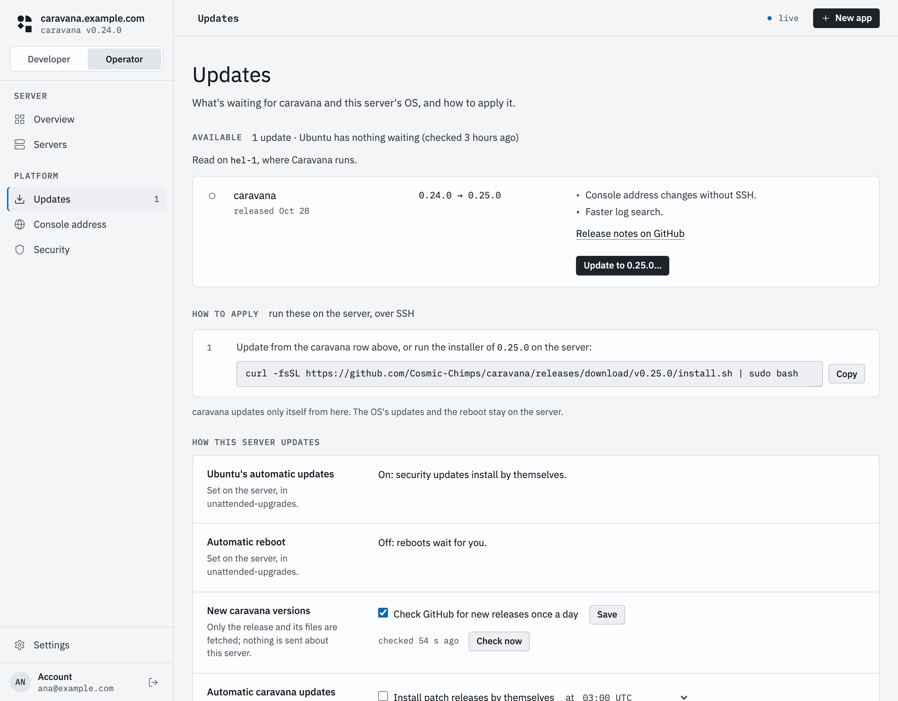

# Keeping Caravana and the host up to date

Three things get old: Caravana, the host's operating system, and the pieces Caravana installs for you (Nomad and Traefik). Caravana updates itself and those two pieces when you ask. The operating system is yours to update: Caravana reads its state and tells you, but never applies anything to it.

## The Updates page

Switch to the Operator view and open **Updates** (`/ops/updates`). The page says what is waiting for Caravana and for the server's OS.

<picture>
  <source media="(prefers-color-scheme: dark)" srcset="../../images/ops-updates-dark.png">
  
</picture>

Under **Available** you will see, when they apply:

- **caravana**: a newer release (`0.16.0 → 0.17.0`), when it was released, its notes (a link to the release on GitHub) and, if the release changes them, the Nomad and Traefik versions it installs ("Updates Nomad 2.0.7 → 2.1.0 and Traefik 3.7.13 → 3.8.0."). The button is **Update to X…**.
- **The OS's updates**: how many updates are waiting and how many are security updates. The package names are shown only after you choose **Check package names**, and only on a host that is Ubuntu with its `pro` tool; otherwise the page says plainly that names need it.
- **Reboot**: a reboot is needed (a new kernel is installed but an older one runs, or packages were updated that need one).

Under **How to apply** the page lists, in order, the commands to run on the server over SSH: `sudo apt update && sudo apt upgrade` for the OS, Caravana's installer command, and `sudo reboot` if one is needed. Beneath them it says: "caravana updates only itself from here. The OS's updates and the reboot stay on the server."

The same facts also appear on the needs-you list on the Apps home: **N updates are waiting, M of them security updates** and **This server needs a reboot…**, and are sent to your [notification channels](../operate/notifications.md). Security updates appear at once when the host's automatic updates are off, and otherwise after they have waited 24 hours. See [Monitoring and the needs-you list](../operate/monitoring.md).

**How this server updates** has the settings:

- **Check GitHub for new releases once a day**: on by default. Only the release and its files are fetched; nothing is sent about this server. Turn it off and Caravana makes no request at all; **Check now** asks once.
- **Install patch releases by themselves**, **at** an hour (UTC): see below.
- The host's own automatic updates and automatic reboot (unattended-upgrades) are shown read-only: "Set on the server, in unattended-upgrades."

**Past updates** lists what happened and when, in UTC.

When a new Caravana release comes out, every notification channel that isn't paused gets one message about it.

## Update from the console

Caravana can update itself without ever getting root.

1. On **Updates**, choose **Update to X…** on the caravana row. A page says what will happen: the console stops for about a minute while the new version starts, your apps keep running and answering, and which of Nomad and Traefik change. Choose **Update to X** to confirm.
2. The console writes a small request (a version and nothing else). A root-owned timer on the server, `caravana-update.timer`, looks for it every minute and starts the updater.
3. The updater, which runs as root, checks the request is plain and valid, refuses any version that isn't newer than the one running, downloads that release's `SHA256SUMS`, `install.sh` and tarball, and refuses to continue unless the installer and the tarball match the checksums. Then it runs that installer.
4. The installer copies Caravana's data aside, installs the new version, and waits up to a minute for it to answer its health check. If it doesn't, the installer puts the previous version and its data back.
5. A panel on the page follows the run: updated, rolled back, failed or refused. You can reload the page while Caravana restarts; it picks the run up again.

A rolled-back, failed, refused or lost update puts an item on the needs-you list and sends a notification, and it stays there until a later update succeeds. The updater's status and the installer's output are kept on the server, readable only by root:

```bash
sudo cat /var/lib/caravana-update/status
sudo less /var/lib/caravana-update/logs/<id>.log
journalctl -u caravana-update
```

A host installed before the updater existed doesn't have it. The row then says to run the installer of that version once on the server, which adds the updater; later updates can start from the console.

### Automatic patch updates

Turn on **Install patch releases by themselves** and choose an hour. At that hour (UTC) Caravana asks for the newest patch release of the version it runs (for example `0.17.1` when `0.17.0` runs), the same way as a button press, and never a version that already had a run. Minor and major releases always wait for you. It is off by default.

## Or rerun the installer

The installer is the same command you installed with, run again as root over SSH. The Updates page shows the exact command for the new release:

```bash
curl -fsSL https://github.com/Cosmic-Chimps/caravana/releases/download/vX.Y.Z/install.sh | sudo bash
```

- Give no options: it reuses the ones you gave the first time. Options given on a later run replace the recorded ones, for example a new `--domain`.
- A newer version replaces Caravana in place and keeps the data, the people and tokens, the certificates and every running app. Apps don't stop: Nomad runs them, not Caravana.
- If the new version doesn't answer its health check within a minute, the installer puts the previous version back, with its data as it was, and exits with an error.
- The same version changes nothing. An **older** version is refused.
- To see which version runs: `sudo caravana version`.

### When the installer needs to run

Updating from the console runs the installer for you, so it also brings the host's own pieces up to date. When you update by hand, or a release note says **Upgrade**, run it. Some releases add a host piece or a permission that only the installer can apply: for example, a new permission for Caravana's Nomad token, a new setting in Traefik's job (Traefik then restarts once, for a few seconds without HTTP) or the Nomad configuration for a new feature. Until you run it, the console shows a clear message (for instance that Nomad refused something and to run the installer again), and everything else keeps working. Read the **Upgrade** part of each release in [Release notes](../../../CHANGELOG.md) before updating.

## The operating system

Caravana installs on Ubuntu 24.04 LTS, Ubuntu 26.04 LTS, Debian 12 and Debian 13 (amd64 or arm64), and refuses any other system before changing anything. It reads the state of the system's package manager; it never installs updates or reboots the machine.

On the server:

```bash
sudo apt update && sudo apt upgrade
sudo reboot        # only if the page says a reboot is needed
```

A reboot stops every app for about a minute; the console and the apps come back when the server does. Ubuntu's and Debian's own `unattended-upgrades` can apply security updates by themselves; Caravana shows whether it is on.

## Uninstall

To remove Caravana from the first server:

```bash
curl -fsSL https://github.com/Cosmic-Chimps/caravana/releases/latest/download/install.sh |
  sudo bash -s -- --uninstall
```

This removes Caravana's service and binary and the updater (its script, timer, status and logs), stops the agent's timer and deletes its `node.env`, and revokes Caravana's Nomad token. The agent's program and units stay, because Nomad and the private network need them. **Nomad, the private network, Docker, Traefik and every app keep running**, so your apps stay up. The console's domain answers 502 until Caravana is installed again. Export the apps' jobspecs first if you want to manage them with plain Nomad (**Configure › Integrations › Export jobspec**, see [How a deploy works](../deploy/rollback.md)).

Caravana's data stays in `/var/lib/caravana`, and installing again picks it up. Add `--purge` to delete it as well: `... | sudo bash -s -- --uninstall --purge`. On a server that joined a cluster, the command is `--leave`: see [More servers](servers.md).

Removing the rest (Nomad, Traefik, Docker) is up to you, because the apps depend on it. The installer's README lists the commands: [Installing Caravana](https://github.com/Cosmic-Chimps/caravana/blob/main/deploy/install/README.md#uninstall).

## See also

- [Install](../install.md)
- [More servers](servers.md)
- [Troubleshooting](troubleshooting.md)
