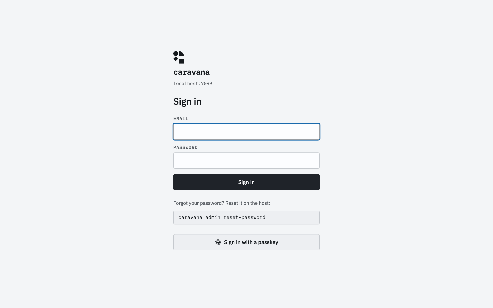

# Install

One command turns a fresh VM into a Caravana host. This page says what the VM needs, what the
command does and where things end up. Adding more servers later uses the same installer: see
[Servers](host/servers.md).

## Requirements

- **A VM or a physical server** running Ubuntu 24.04 LTS, Ubuntu 26.04 LTS, Debian 12 or Debian 13,
  on amd64 or arm64. Any other system is refused before anything changes, and the refusal names these
  four. A container (a Docker or LXC container, or a node of a container platform) is refused too:
  Caravana makes network interfaces and firewall rules that a container does not allow.
- **2 GB of memory.** The installer refuses a machine with less.
- **A fresh machine.** The installer refuses a host that already has Nomad or Docker that it did not
  install, and one where something other than Traefik already listens on port 80 or 443.
- **Free private ranges.** Caravana's servers use `10.97.0.0/16`, `10.98.0.0/24` and `10.99.0.0/24`
  between them. The installer refuses a host that already has an address or a route inside one of them
  on another interface, because that traffic would go the wrong way. Change that network first.
- **Ports 22, 80 and 443 reachable from the internet.** Open them in your provider's firewall if it
  has one. If you will add servers later, UDP 51820 must be open between them as well.
- **A domain for the console**, such as `caravana.example.com`, with an A record pointing at the VM's
  public IP address. Unless you install with `--acme none`, the installer checks that the name
  resolves to this machine and refuses otherwise, because Let's Encrypt cannot issue the certificate
  until it does. To try Caravana
  without a domain, leave `--domain` out: the installer then uses `<ip-with-dashes>.sslip.io`, a
  name that resolves to the VM's IP address.
- **Root.** Run the installer with `sudo`.

The machine must also be able to reach the internet: the installer downloads Caravana, Nomad and
the packages it needs, and asks `https://checkip.amazonaws.com` for the machine's public IP address
(it needs `curl` for that; on a Debian image without it, run `apt-get install -y curl` first).

## The command

```bash
curl -fsSL https://github.com/Cosmic-Chimps/caravana/releases/latest/download/install.sh |
  sudo bash -s -- --email ana@example.com --domain caravana.example.com
```

The installer checks the machine first and changes nothing if a check fails. Then it installs
everything, which takes a few minutes, and asks you to choose the admin's password (12 or more
characters) twice. It ends with the console's address:

```text
Caravana 0.x.y is installed.
  Console:  https://caravana.example.com/
  Next:     sign in at https://caravana.example.com/login as ana@example.com
```

It exits with 0 when done, 1 when a step failed and 2 when it refused before changing anything.

## Options

| Option | Default | Meaning |
| --- | --- | --- |
| `--email` | required the first time | The admin's email. You sign in with it. |
| `--domain` | `<ip-with-dashes>.sslip.io` | The console's domain. It serves the console, the API and webhooks. Passkeys belong to this domain, so a new domain needs new passkeys. |
| `--acme` | `production` | `production` and `staging` use Let's Encrypt's production or staging service (staging has no rate limits and its certificates are not trusted by browsers). `none` uses Traefik's own certificate, for private networks, and browsers will warn. |
| `--acme-email` | the value of `--email` | The address given to Let's Encrypt for expiry notices. |
| `--address` | the public IP address | The address other servers reach this one at, an IPv4 or IPv6 address. Only needed when the installer cannot find a public IP or you want another address. |
| `--first` | the default | This is the first server, the one that runs Caravana and Traefik. |
| `--from DIR` | download | Use a release's files from a folder instead of downloading them. |
| `--uninstall` | | Remove Caravana from the first server and keep Nomad, Traefik and every app. See [Upgrade and uninstall](host/upgrade.md). |
| `--purge` | | With `--uninstall`, delete Caravana's data too. |
| `--join`, `--url`, `--insecure`, `--leave` | | For the other servers of a cluster: see [Servers](host/servers.md). |
| `--help` | | Print the options. |

Another ACME issuer than Let's Encrypt, or certificates you bought, are set up later in
**Settings › Certificates**: see [Certificates](../certificates.md).

Run from a script with no terminal, the installer cannot ask for the password. It finishes the
install and prints the command that creates the admin:

```bash
sudo caravana admin init --email ana@example.com
```

## What it installs

The installer sets up, in this order of importance to you:

- **Docker**, from the system's `docker.io` package, and the other packages it needs (`ufw`,
  `iptables`, `wireguard-tools` and a few more).
- **Nomad**, at a version the installer pins, with ACLs on from the start and the CNI network
  plugins. Nomad's HTTP API listens on loopback only; its server-to-server ports are on the
  private network between servers.
- **A private network** for apps: an interface named `caravana0`. App ports live there and reach the
  internet only through Traefik.
- **A firewall** (`ufw`): incoming traffic is denied except ports 22, 80 and 443, UDP 51820 (used
  only between servers added later) and traffic on the private network between servers.
- **Traefik**, as a Nomad job, with Let's Encrypt and one static route that sends your console domain
  to Caravana.
- **Caravana**, under systemd as the `caravana` user, listening on `127.0.0.1:7070`.
- **Two small timers**: one for the server agent (every 30 seconds, it keeps the server's network and
  Nomad certificates in line with the console) and one for the updater (every minute, it does
  nothing unless you asked for an update in the console).

## Where things live

| Where | What |
| --- | --- |
| `https://<domain>/` | The console, the API (`/v1`) and webhooks (`/v1/webhooks/<app>`), through Traefik. |
| `/opt/caravana/<version>/` | Caravana's binary and files for each installed version. `current` points at the running one. |
| `/var/lib/caravana/` | Caravana's data: one SQLite file. |
| `/etc/caravana/caravana.env` | Caravana's [settings](reference/settings.md), including its own Nomad token, which is limited to what Caravana does. |
| `/var/lib/caravana-host/` | The installer's choices, Nomad's management token and Traefik's certificates. |
| `/usr/local/bin/caravana` | The command line, for use with `sudo`. See [The caravana command](reference/cli.md). |
| `/usr/local/bin/caravana-nomad` | Nomad's own CLI, already pointed at this host with the management token. |
| `/etc/nomad.d/` | Nomad's configuration and certificates. Caravana writes them; change them through Caravana, not by hand. |

Useful commands on the host:

```bash
sudo caravana version
sudo caravana admin status
sudo caravana-nomad status
journalctl -u caravana
```

## Apps share the host's network

Apps on one host are not isolated from each other: any app's container can reach another app's port
directly. Apps of one project and environment reach each other by name: a service with ports answers to
`<app>-<service>`, and to `<app>` when it is the app's only service with ports. Configure's Overview
says which names a service answers to. See [Connect apps to each other](configure/connect-apps.md); names are a
convenience, not a barrier.

An app that trusts `X-Forwarded-*` headers should trust them only from `10.99.0.1`, the address
Traefik's requests come from, and never from the bridge gateway.

## First sign-in

1. Open the address the installer printed, ending in `/login`. If you open it within a minute of the
   install, the browser may warn about the certificate: Traefik serves its own until Let's Encrypt
   has issued the real one.
2. Sign in with the admin's email and password.

<picture>
  <source media="(prefers-color-scheme: dark)" srcset="../images/sign-in-dark.png">
  
</picture>

The admin is the installation's first owner. Passkeys, more people and a forgotten password are in
[Sign-in](host/sign-in.md). The console's tour is in [A tour of the console](console.md), and the first
app is in [Your first app](first-app.md).

## Running it again

Run the same command again, without options: it reuses the ones you gave the first time, which are
recorded on the host. Options you give on a later run replace the recorded ones.

- A newer version replaces Caravana in place and keeps the data, the people, the tokens, the
  certificates and every running app. Apps keep running because Nomad runs them, not Caravana.
- If the new version does not answer its health check within a minute, the installer puts the
  previous version back, with its data as it was before the upgrade, and exits with an error.
- The same version changes nothing. An older version is refused.

The console can also run the update for you. Both ways, and the rollback, are in
[Upgrade](host/upgrade.md).

## Next

- [Your first app](first-app.md)
- [Upgrade, update from the console, uninstall](host/upgrade.md)
- [Add a server](host/servers.md)
- [Settings](reference/settings.md) for `/etc/caravana/caravana.env`
