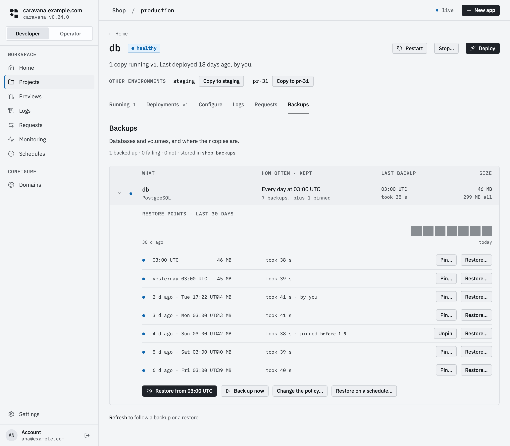
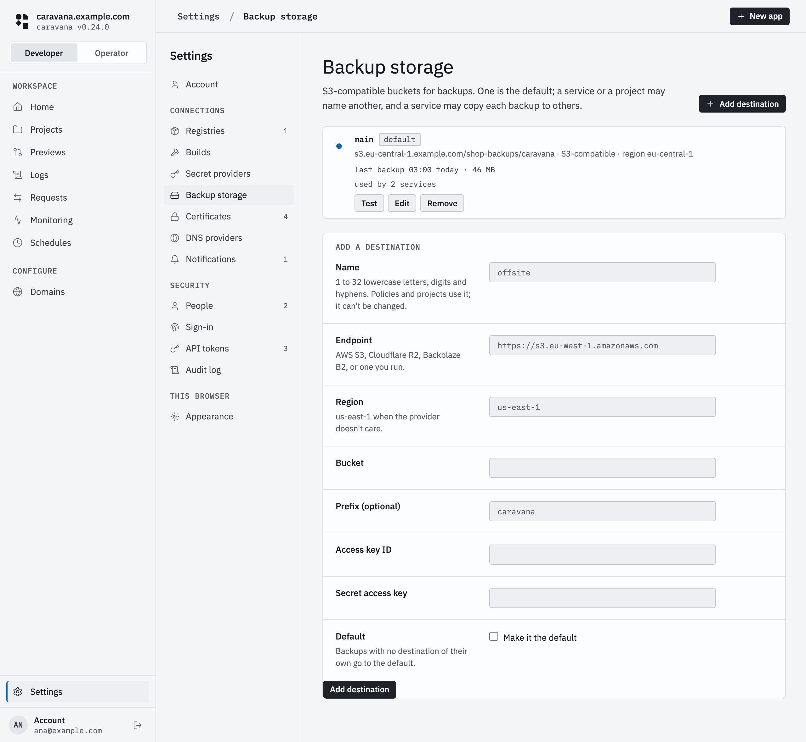
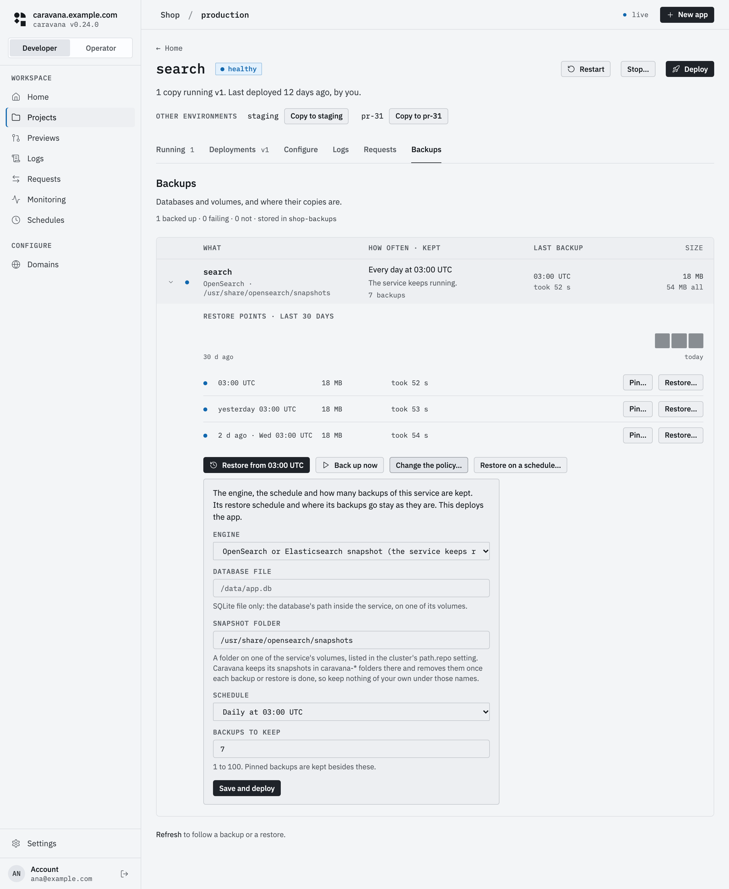

# Backups and restore

Caravana backs up a database, a search cluster or a volume of an app on a schedule, uploads the backup to a bucket you own, keeps the newest ones, and restores one when you ask. This page is the path through: set a destination, turn a backup on, take one, restore one. The engine details are in [Database backups](../../database-backups.md) and [Backup destinations and copies](../../backup-destinations.md).

<picture>
  <source media="(prefers-color-scheme: dark)" srcset="../../images/app-backups-dark.png">
  
</picture>

## 1. Set a destination first

Backups go to an S3-compatible bucket (any provider that speaks the S3 API). Nothing runs until one is set: the Backups tab says "No backup destination is set. Backups can't run until there is one." and offers **Set the destination**.

1. Open **Settings › Backup storage**.
2. Fill in **Name**, **Endpoint**, **Region**, **Bucket**, **Prefix (optional)**, **Access key ID** and **Secret access key**, then **Save destination** (the first one is the default).
3. Choose **Test** on its row. It writes a small object and deletes it, and the row shows the outcome.

The secret access key is kept in Nomad's secret store, never in Caravana's database, and no page shows it again. You can keep several destinations, choose one per project or per service, and have each backup copied to a second place: see [Backup destinations and copies](../../backup-destinations.md).

<picture>
  <source media="(prefers-color-scheme: dark)" srcset="../../images/settings-backup-storage-dark.png">
  
</picture>

## 2. Which engine

A service's backup has an **engine**. Choose by what the service is.

| Engine | For | While it runs | A restore |
| --- | --- | --- | --- |
| `postgres` | a PostgreSQL service | the database keeps running | replaces what the database holds, in one transaction |
| `mysql` | MySQL or MariaDB | the database keeps running | drops and remakes each table in the dump; tables made since stay |
| `mongodb` | MongoDB | the database keeps running | replaces each collection in the dump; collections made since stay |
| `opensearch` | an OpenSearch or Elasticsearch cluster | the cluster keeps running | closes and replaces the snapshot's indices while the cluster runs (an index deleted since is made again); indices made since stay |
| `sqlite` | one SQLite file on a volume | the service keeps running | the service stops for a few seconds while the file is replaced |
| `volume` | any service with a volume | **the service stops** while its volumes are archived | the service stops; volumes are replaced by the backup's files; files added since are deleted |

Use a database engine for a database that has a server: a `volume` backup stops the service every time it runs. For a search cluster use `opensearch`, which needs a port (the first one is the cluster's HTTP API), `path.repo` set and a snapshot folder on a volume (see [OpenSearch and Elasticsearch snapshots](../../database-backups.md#opensearch-and-elasticsearch-snapshots)). The three database engines dump the live database and need a login the backup can use: see [Database backups](../../database-backups.md) for the variables each one looks for.

## 3. Turn a backup on

Any of these three ways produces the same policy.

- **The Backups tab.** A service that has no backup yet and whose image is `postgres`, `mysql`, `mariadb` or `mongo` with a port is offered **Back up daily** with the matching database engine. Any other service with a volume is offered **Back up daily** too, with the `volume` engine; its confirmation says "The service stops for a few seconds each time." Choose a **Schedule** (**Every day at 03:00 UTC** or **No automatic backups (Back up now only)**) and **Back up and deploy**. Every service with a volume is also offered **A SQLite file instead**: give the **Database file** (its path inside the service, on one of its volumes; the field starts with the first volume's path) and choose **Back up the file and deploy**. Turning a backup on deploys the app. The Backups tab never offers the `opensearch` engine to a service that has no backup yet: set it through the API or a Compose request, or take **Back up daily** first and then **Change the policy…**.
- **The Compose form of New app** (New app › Compose file): each service has a **Backup** section with **Engine**, **Backup schedule (UTC)**, **Backups to keep** and, for SQLite, **Database file**, and, for OpenSearch or Elasticsearch, **Snapshot folder**. The Compose form of an app that exists has only the file and leaves its backups as they are.
- **The definition**, through the API or a Compose overlay:

```yaml
backup:
  engine: postgres      # postgres, mysql, mongodb, opensearch, sqlite or volume
  schedule: "0 3 * * *" # optional, five-field cron in UTC, or "never"
  keep: 7               # optional, 1 to 100
```

### Schedule and keep

The default schedule is every day at 03:00 UTC (`0 3 * * *`) and the default `keep` is 7: Caravana deletes the oldest backups beyond the newest 7 (pinned ones aren't counted, see below). The schedule is a five-field cron line in UTC.

`schedule: never` takes no automatic backups at all. **Back up now**, pinning, and the retention of backups you take by hand still work.

### Change the policy

Each service on the **Backups** tab that already has a backup policy has a **Change the policy…** button, next to **Back up now**. It opens a
form with:

- **Engine**: the engine the service has now, plus the others it can use: the one that matches its image, **Volume
  (stops the service while it runs)** for a service with a volume, **SQLite file (the service keeps running)** for a
  service with a writable volume, and **OpenSearch or Elasticsearch snapshot (the service keeps running)** for a
  service with a port and a writable volume.
- **Database file**, drawn when **SQLite file** is among the engines: the database's path inside the service.
- **Snapshot folder**, drawn when **OpenSearch or Elasticsearch snapshot (the service keeps running)** is among the engines: the folder the cluster writes snapshots to, on one of its volumes and in its `path.repo`.
  Caravana keeps its snapshots in `caravana-*` folders there and removes them once each backup or restore is done, so keep nothing of your own under those names.
- **Schedule**: **Daily at 03:00 UTC**, **No automatic backups**, or, when the stored schedule is another cron line,
  **Keep** followed by its words.
- **Backups to keep**: 1 to 100. Pinned backups are kept besides these.

<picture>
  <source media="(prefers-color-scheme: dark)" srcset="../../images/app-backups-policy-dark.png">
  
</picture>

**Save and deploy** changes the policy and deploys the app. The service's restore schedule, where its backups go and
its copies stay as they are, and a refusal is drawn at the field it is about. The button is not offered while the app is
stopped, or to someone who may not configure the app. For an app that keeps its Compose file, the change is written
into the app's Compose settings, beside the file, which is not rewritten.

## 4. Back up now

Open a service on the Backups tab and choose **Back up now**. For a `volume` service it first says "The service stops for a few seconds while the backup runs." and asks you to confirm. A running backup is shown as "running now"; the page refreshes when it ends. Each backup row shows when it ran, its size, how long it took, who started it ("by you" or a name) and where it went.

The strip "Restore points · last 30 days" shows one bar per backup; failed ones are marked. If a backup failed, the row says why, in Caravana's words.

## 5. Restore

Restoring is destructive. It replaces what the service holds now with the backup you choose.

1. On the Backups tab, find the backup and choose **Restore…** on its row (or **Restore from <time>** under the service for the newest).
2. Read what the form says will happen. Type the service's name to confirm.
3. Choose the red button: **Restore db**, **Restore and stop the service briefly** (SQLite), **Restore and stop the service while it runs** (volume) or **Restore the indices** (OpenSearch, Elasticsearch).

What happens, by engine:

- **PostgreSQL, MySQL, MariaDB, MongoDB**: the dump is loaded into the running service, which isn't stopped. "Clients connected meanwhile may see errors. It can't be undone, except by restoring another backup." Details per engine (what stays, what is replaced) are in [Database backups](../../database-backups.md#restore-semantics).
- **OpenSearch, Elasticsearch**: the backup is downloaded while the cluster runs, then each index in it that exists is closed, replaced and opened again, and an index of the backup that was deleted since is made again; indices made since stay. While it runs the snapshot's indices are closed, so queries and the dashboard on them fail for that long, though the service itself never stops. The button says **Restore the indices**. Details are in [OpenSearch and Elasticsearch snapshots](../../database-backups.md#restore).
- **SQLite**: the backup is downloaded and checked while the service runs, then the service stops for a few seconds, the file is swapped and the service starts. "Changes made since the backup are lost."
- **Volume**: the service stops, its volumes are replaced by the backup's files, and it starts again. "Files added since the backup are deleted." It is all or nothing across the service's volumes.

Restores are listed under **Restores** on the same tab, with who asked, how long it took and the result. A restore is refused while the app is stopped ("The app is stopped: start it first.") or while a backup of the service runs.

With several destinations or copies, the form offers **Restore from**: **Automatic: the first that has it**, or a place you pick.

## 6. Pin a backup, restore it on a schedule

A **pin** gives a backup a label so retention never deletes it and it isn't counted in the backups kept.

1. Choose **Pin…** on a backup, keep or change the label (lowercase letters, digits and dashes, at most 32; the default is `golden`) and choose **Pin**. Pinning a label another backup has moves it here.
2. **Unpin** puts it back under normal retention.

A service can restore its pinned backup on a schedule, for example a public demo that starts each day from the same state. Choose **Restore on a schedule…**, give a five-field cron line in UTC and **Restore the backup pinned as** the label, then **Save and deploy**. Each time, that backup replaces what the service holds. **Stop restoring** removes it. If no backup carries the label the tab says "each restore is refused until one is". A restore that finds the service busy is recorded as skipped; one that fails is recorded failed. Restores started this way read "on schedule from <label>". The same two settings are in the Compose form of New app as **Restore on a schedule (UTC)** and **from the backup pinned as**.

## What is not backed up

- **Caravana itself.** The backups above cover the apps' databases and volumes. Caravana does not back up its own data, and nothing in the product does it for you. Its data is one SQLite file in `/var/lib/caravana` on the first server: your apps' definitions and history, the people, tokens and settings. The installer copies that folder to `/var/lib/caravana.pre-<version>` only while it upgrades, to roll back, and replaces that copy on the next upgrade; it is not a backup. If you want one, copy the folder yourself while Caravana is stopped (`sudo systemctl stop caravana`).
- **Secret values.** They live in Nomad's secret store on the server, not in Caravana's database, and not in any backup. See [Variables and secrets](../configure/variables.md).
- **Anything without a backup policy.** The Backups tab lists each service with a database image or a volume and no policy as "has no backup".

## Failures reach you

A failed backup, a failed restore, a failed copy to a second destination, and "Backups are set up, but no backup destination is." are items on the needs-you list on the Apps home, and are sent to your [notification channels](notifications.md). See [Monitoring and the needs-you list](monitoring.md).

## See also

- [Database backups](../../database-backups.md)
- [Backup destinations and copies](../../backup-destinations.md)
- [Volumes](../configure/volumes.md)
- [Schedules](schedules.md): each backup also shows there as a read-only built-in schedule.
