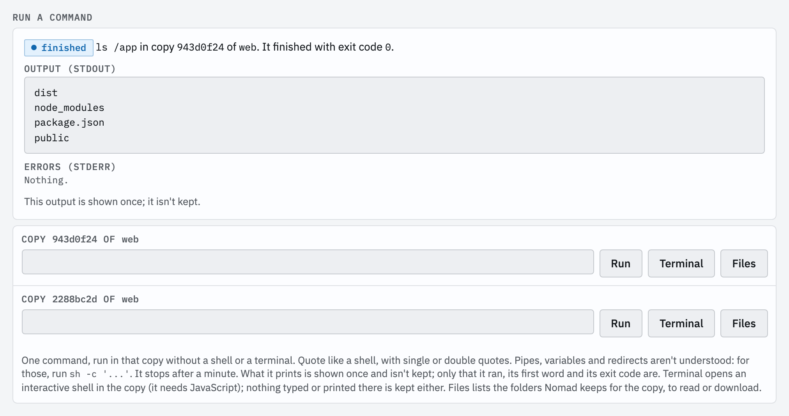
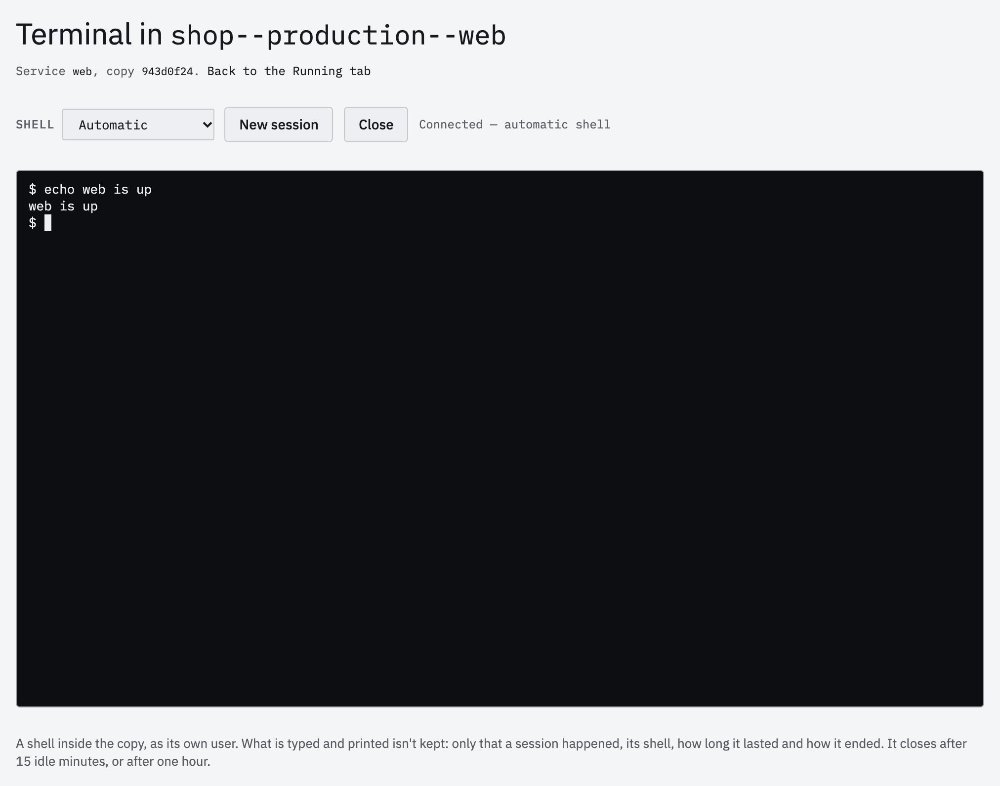
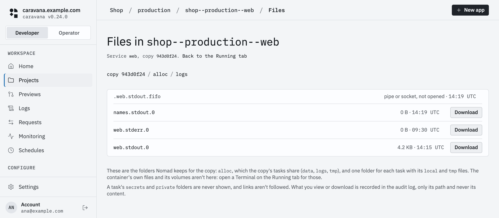
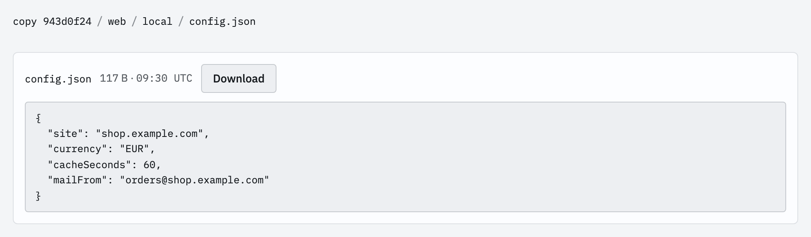

# Stop, start, restart, Run a command, Terminal, Files

This page covers what you can do to a running app without deploying it: stop it, start it again, restart its
copies, run one command in a copy, open a shell in a copy, or browse its files. Everything here is on the app's own page.

## The header buttons

The header of an app has **Restart**, **Stop…** and **Deploy**. On a stopped app, **Restart** and **Stop…**
are replaced by **Start**. Each action goes in the app's **Recent actions** list, and the page shows a one-line
notice when you come back to it, such as "Restarting: its copies restart one at a time, so the app keeps
answering. Recent actions shows how it goes."

### Restart

**Restart** restarts the copies of the version that is running, **one at a time**. It waits for each copy to be
running again, and to pass its health check when the service has one, before it touches the next; a copy
that does not come back within two minutes ends the restart as failed, naming that copy, and the copies already
restarted stay restarted. The button answers at once and the restart goes on in the background. It does not
change the image, the settings or the version: use it to clear a stuck process. A service with a single copy is unavailable while that
copy restarts.

A restart is not a deploy, so new values of variables or secrets do not arrive with it: those need a deploy (see
[Variables and secrets](../configure/variables.md)). Restarts you ask for are not counted as a crash loop.

### Stop

**Stop…** opens a confirmation page ("Stop web?") rather than stopping at once. It says: "Every copy stops (2
copies now) and the app stops answering. Deploys, the webhook and scheduled backups wait until you start it."
and "Nothing is deleted: its definition, secrets, volumes, webhook token and history stay. Start runs it again
exactly as it was, without looking up its images again." Press **Stop web** to confirm.

While an app is stopped:

- Every copy is stopped and the app's domains show "app stopped".
- Every way of deploying it is refused: **Deploy**, a redeploy of an older version, a promotion into it, and the
  webhook. So are **Back up now** and **Restore**. The forms say "The app is stopped: start it first." and the
  API answers `409 app_stopped`.
- Its scheduled backups do not run. Its schedules do not start new runs, and a run in progress is stopped
  with the app.
- It is not on the needs-you list, and it shows as **stopped** in lists, not as trouble.

### Start

**Start** runs the stopped app again with the same job and the same image digests it had: nothing is looked up
again, so a tag that has moved since is not picked up. A notice says "Started. It runs the same images and
settings as before it stopped." To deploy something new, start it first, then deploy.

Stop, Start and Restart each take the app's deploy lock. If a deploy, a volume backup or another action of the app is
running, they are refused ("A deploy, a volume backup or another action of this app is running. Wait for it
to finish, then try again.") and do not wait. They also need something to act on: an app that was never
deployed has nothing to stop or restart.

## Run a command

On the **Running** tab, below the copies, **Run a command** has a form for each running copy, labelled "Copy
1a2b3c4d of web". Type a command and press **Run**. The result appears on the page you get back.

<picture>
  <source media="(prefers-color-scheme: dark)" srcset="../../images/run-command-dark.png">
  
</picture>

- **How the line is read.** It is split into words the way a shell reads them: spaces separate words;
  `'single quotes'` keep everything inside literally; `"double quotes"` keep everything except `\"` and `\\`;
  outside quotes a backslash makes the next character an ordinary one. There is **no shell**: pipes,
  redirects, variables like `$HOME`, and globs like `*.log` are not understood and reach the program as plain
  text. When you need them, ask for a shell yourself: `sh -c 'ls /data | wc -l'`.
- **Where it runs.** In the running copy you chose, inside the service's container. The program has to exist in
  the image: an image with no `ls` cannot run `ls`.
- **Limits.** The command stops after 60 seconds. A command is 1 to 64 words of at most 4 KiB each. The output
  of each of stdout and stderr is cut at 64 KiB ("The output was cut: only the first part is shown.").
- **The result.** The page shows the command, the copy, how it ended (**finished** with "It finished with exit
  code 0", an other exit code, "It didn't finish in time, so it was stopped", or **not started** with Nomad's
  reason), and the **Output (stdout)** and **Errors (stderr)**.
- **The output is shown once and never kept.** It is in that one answer and nowhere else: not in the history,
  not in a log line, not in a notice, not in the address. Reload the page and it is gone. The page says "This
  output is shown once; it isn't kept."

There is no way to give a command input, and no terminal. For those, use the Terminal.

## Terminal

Next to **Run**, each copy has a **Terminal** button: an interactive shell in that copy, in your browser.
It opens a page, "Terminal in web", for the service and copy.

<picture>
  <source media="(prefers-color-scheme: dark)" srcset="../../images/app-terminal-dark.png">
  
</picture>

- **Shell.** The **Shell** picker has **Automatic**, `bash` and `sh`. Automatic starts `bash` if the image has it and
  `sh` otherwise. An image with neither (a "distroless" image) answers "no shell found in this image".
  **New session** starts again; **Close** goes back to the Running tab.
- **It needs JavaScript.** Without it the page says "The terminal needs JavaScript. Run a command (on the
  Running tab) works without it."
- **Limits.** A session closes after 15 minutes without input, or after 60 minutes in all. At most five terminals
  are open at once on an installation; a sixth is refused. If your sign-in ends, or the API token that opened it
  is revoked, the session closes within about 30 seconds.
- **Nothing is kept.** What you type and what is printed is never logged or stored. Caravana records only that a
  session happened, which shell, how long it lasted and how it ended.

## Files

Next to **Terminal**, each copy has a **Files** link: a page, "Files in web", that lists the folders Nomad keeps
for that copy, to read a file or download it. It is for finding a config file, a crash dump or an export
without opening a terminal. It reads only: you cannot edit or upload a file here.

<picture>
  <source media="(prefers-color-scheme: dark)" srcset="../../images/app-files-dark.png">
  
</picture>

- **What is there.** The folders of the copy's directory: `alloc`, which the copy's tasks share (`data`, `logs`
  and `tmp`: what an app writes to `/alloc/data`, and its output logs), and one folder for each task with its
  `local` and `tmp` files. In `local` you find the files a service defines (Caravana puts them in
  `caravana-files`). **The container's own files and its volumes are not here**: for those, open a Terminal.
- **Browsing.** Each folder is a link, with the path above the list. Folders come first, then files with their
  size and when they changed. A file opens on its own page, with **Download** beside it.
- **Reading a file.** A text file up to 512 KB is shown on the page. A larger file says "It is larger than 512
  KB: download it to read it." and a file that is not text says "It isn't text: download it." **Download**
  gives the file as it is.
- **Secrets are never shown.** A task's `secrets` and `private` folders are not listed and cannot be opened or
  downloaded, whichever way the path is written. Links are listed but never followed, so a link an app made
  cannot lead into them either, and pipes (such as the ones Nomad's log collector keeps in `alloc/logs`) are
  never opened.
- **What is recorded.** Viewing or downloading a file is an entry in the [audit log](../../audit-log.md), `read a
  file`, with the copy and the path and never the content. Listing a folder is not. The content is not logged,
  stored or put in a notice.
- **It needs no script.** Every folder and file is a plain link. Over the API the same two reads are
  `listCopyFiles` and `downloadCopyFile`.

<picture>
  <source media="(prefers-color-scheme: dark)" srcset="../../images/app-files-view-dark.png">
  
</picture>

## Recent actions

Below the copies, **Recent actions** lists the last actions on the app: restarts, stops, starts, commands,
terminal sessions and scaling steps. Each row has what was done, how it ended, who did it ("from the console",
"through the API", "by you" or by a person's email, or "on a schedule"), and when. For a command it shows the
program, which is the first word, the copy, and the exit code or the reason it did not finish. For a terminal
session it shows the shell and how long it lasted.

It never shows a command's arguments or output. A command like `psql -c "select …"` is listed as `psql`, with
its exit code. Do not rely on the history to know what was run; it only says that something was.

## Who may do what

Restart and Start need the **deploy** role on the app. Stop, Run a command, the Terminal and Files need **maintain**,
because they act inside a running app and a copy's files can hold any secret. A deploy token, which CI uses, can do none of
them. See [People and roles](../../people.md).

## Next

- [Logs](logs.md)
- [Monitoring and the needs-you list](monitoring.md)
- [How a deploy works, history, rollback](../deploy/rollback.md)
