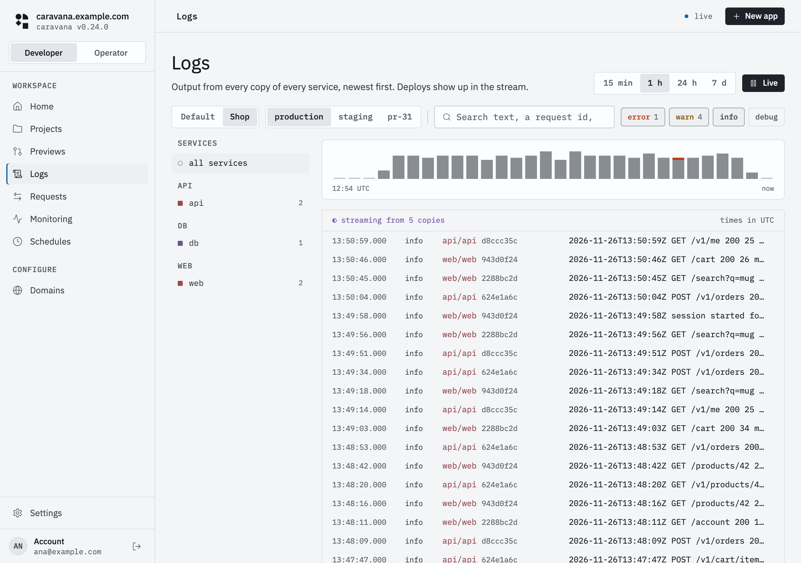

# Logs

The **Logs** page shows the output of every copy of every service in one environment, newest first, on one
page, with the deploys in between. An app's **Logs** tab shows the same page for that app alone.

<picture>
  <source media="(prefers-color-scheme: dark)" srcset="../../images/logs-dark.png">
  
</picture>

## Where to find it

- **Logs** in the sidebar (under **Workspace**) is one environment. When you have more than one project or
  environment, a **Project** and an **Environment** bar at the top choose which.
- An app's **Logs** tab is the same page filtered to that app, with its services on the left and **All logs**
  at the end of the sentence under the title to go back to the environment's page.

Logs are not stored by Caravana. Each time you open or refresh the page, Caravana reads the output files that
Nomad keeps for each copy and shows what it found. Nothing about your log lines is kept in Caravana's
database, files or own log.

## The stream

Each row is one line of output: the time, the level, the service (with the copy's short ID after it) and
the text. Both stdout and stderr are read. Deploys appear as their own rows in the stream, with a rocket,
for example "web v24 started rolling out · pushed to main by ana", "is live · rollout finished", "failed its
health checks · rolled back to v23" or "was replaced by a newer deploy". Deploy rows are never filtered out by
level or search.

A page shows the newest 500 rows; **Show older** goes further back. A line's text is shown as text, with
terminal control sequences (colors, cursor movement) removed, so a log cannot change your screen.

### Range, Live and Paused

The range bar chooses how far back to look: **15 min** (the default), **1 h**, **24 h** or **7 d**. A
histogram above the stream counts lines over that range, with the errors marked and a marker for each deploy.

The button beside it toggles **Live** and **Paused**. While it says **Live**, new lines appear by
themselves, and the header says "streaming from 3 copies". When you pause, a counter tells you how many new
lines arrived since, with a **Show** link. Live needs JavaScript; without it the page says "Following needs
JavaScript. Reload the page to see newer lines." A page where you opened a line, or one that reads a fixed
window (from the Requests page or Monitoring), is always paused. Times are shown in UTC.

### Filters

- **Services**, on the left: **all services**, or one service, with the number of its copies. Choose a
  service to list its copies under it and pick one copy.
- **Levels**: the chips **error**, **warn**, **info** and **debug**, each with its count. Error, warn and info
  are on by default; debug is off. Click a chip to show or hide that level.
- **Search**: text, a request ID or a status code. It matches anywhere in the line, ignoring case, and also
  matches the `app/service` name. The filters work without JavaScript: they are links and one form.

## How times and levels are read

Caravana does not ask your app to log in a special format. It reads each line.

**The time** comes from the line when it has one: a JSON field, a leading ISO time or the time most logging
libraries write first, a `time=` pair. A line with no time, or with one outside the copy's life, is given the
time of the line before it in the same stream, and its time is shown with a leading **~** (for example
`~14:02:11.000`). Hover over it: "estimated: this line carried no time; taken from the line before it". It
is a guess that keeps the line near its neighbours; do not treat it as exact.

**The level** is read from the line too: the `level`, `severity` or similar field of a JSON line, a leading
level word such as `ERROR`, `WARN` or `DEBUG`, a `level=` pair, a klog prefix such as `E1025`, or the first words
of the line. A continuation line (an indented stack frame, `Caused by:`, a Postgres `DETAIL:`) takes the level of
the line before it. A line Caravana cannot place is **info**, on stdout and stderr alike: output on stderr is
not an error by itself.

### Folded repeats

Consecutive lines with the same text are folded into one row with **×N** after it, so a loop that prints the same
message a thousand times does not push everything else off the page. A download keeps every line.

## Open a line to see around it

Click a row to open it. A strip appears under it: the stream it came from (`stdout` or `stderr`), the service
and the copy, and these actions:

- **Lines around this**: the lines before and after it in the same copy, every level, with the line marked.
  The page says "Around 14:02:11.000 in copy 1a2b3c4d of web. Every level, this copy only." and has **Back to
  the stream**.
- **Only web**: filter to that service.
- **Raw** for a JSON line, to see it whole. The strip also has the line's address, as text you can copy, and
  **Close**.

If the output was rotated away since the page was drawn, the page says "That part of the copy's output has
been rotated away."

## Download

**Download** (under the stream) saves what the current filters select as a text file, oldest first, without
the 500-row limit and without folding. The first line is `# newest last`, then a line with the range and what
the read covered. Each log line is `time`, `app/service`, copy, stream, level and text, separated by tabs; an
estimated time ends in `~`; deploy rows appear as `# deploy …` lines, and a `# cut:` line at the end says when
the read stopped before the beginning. A download is limited to 8 MiB from each stream (the stdout and stderr of each copy) and 64 MiB in all, and only
one runs at a time ("A download is already running; try again in a moment.").

## Limits: how far back it can go

Caravana reads Nomad's output files live, so the page can show only what Nomad still has:

- Nomad rotates each copy's output files and removes the oldest. A copy that has ended stays listed, marked
  "(gone)", and readable for a while, until Nomad collects it. After a copy is replaced by a deploy, its lines
  remain readable until then. Beyond that the lines are gone, and the page says "Older lines were dropped."
- A page read is limited: a budget of about 1 MiB per stream (the page's total is shared when there are many
  streams), and 5 seconds. When the read did not reach the start of the range you asked for, the histogram says
  **read from 14:21 UTC**, which is how far back the lines go; if the time ran out before the budget did it adds
  **not all read in time**. A shorter range, or one service or one copy, reads further back.
- At most two page reads run at once on one installation, so a busy moment can make the page slow.
- If Nomad cannot be reached, the page says "Nomad can't be reached right now, so logs can't be read."

Caravana does not forward logs to another system today, so if you need them for longer than Nomad keeps
them, download them before they go.

## Secrets in logs

Caravana cannot tell which part of a log line is secret. If your app prints a password, a token or a whole
request, it is in the log and anyone who may view the app can read it; viewing includes logs (see
[People and roles](../../people.md)). Keep secrets out of what your app writes. Caravana does mask the secret
values it knows in the output of a schedule run, but not in an app's own log.

## Next

- [Requests](../../requests.md): each HTTP request Traefik served
- [Monitoring and the needs-you list](monitoring.md)
- [Schedules](schedules.md): the output of a scheduled command is kept with its run
