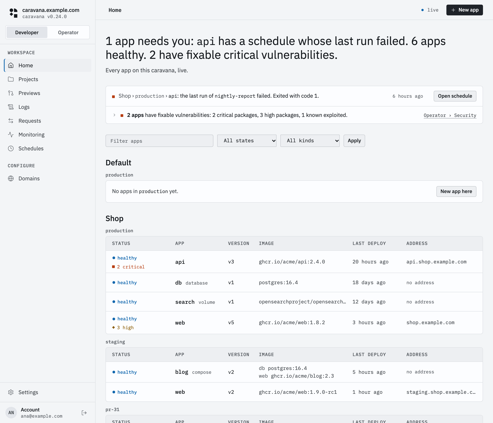
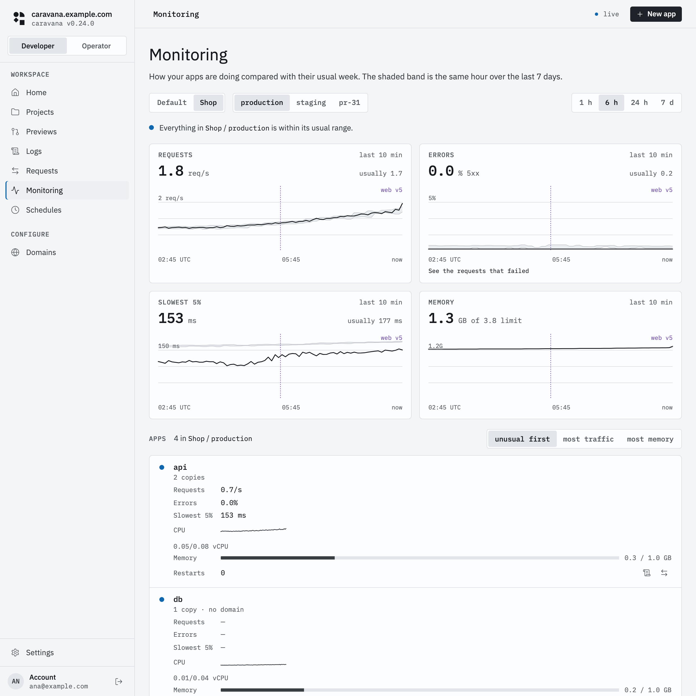

# Monitoring and the needs-you list

Caravana answers two questions without you looking at graphs: is anything wrong that needs me, and are my apps behaving like they usually do. The first is the **needs-you list** on the Apps home. The second is the **Monitoring** page.

<picture>
  <source media="(prefers-color-scheme: dark)" srcset="../../images/apps-home-dark.png">
  
</picture>

## The Monitoring page

Open **Monitoring** in the sidebar. It shows one project and environment at a time, over a time range you choose: **1 h**, **6 h** (the default), **24 h** or **7 d**.

<picture>
  <source media="(prefers-color-scheme: dark)" srcset="../../images/monitoring-dark.png">
  
</picture>

### What it measures

There are four charts for the place you chose:

- **Requests**, in requests per second.
- **Errors**, the percentage of requests that returned a 5xx status.
- **Slowest 5%**: the time within which 95 % of requests finish. The slowest 5 % of requests take longer than this number.
- **Memory**, what the copies use.

Requests, errors and the slowest 5 % come from Traefik's metrics. Memory and CPU come from Nomad. Request numbers exist only for services that Traefik routes, that is, services with a domain. A number Caravana couldn't read shows as a gap or "—", never as 0.

Below the charts, the apps table lists each service with its state, **Requests**, **Errors**, **Slowest 5%**, CPU, **Memory** and **Restarts**, and links to its Logs and Requests. Sort it by **unusual first** (the default), **most traffic** or **most memory**.

### The shaded band

Each chart has a shaded band. It shows what that number was at the same time of day over the last 7 days: the lowest to the highest, with the typical value inside. A line inside the band is normal for your app; a line outside it is not.

- In the first day after you install Caravana there is no band. The page says "Building the baseline: started <date>. The usual range appears after a full day." and "The usual range is still being learned".
- From one to six full days the band is drawn from the days there are. After seven days it uses the full week.
- On the **7 d** range the band thins to the left, because older hours have fewer earlier days kept.

### Unusual first

Above the charts, a service that is behaving unusually gets a sentence and a button to the logs or requests that explain it. When nothing is unusual the page says "Every app is within its usual range." The rules are fixed and not configurable:

- **Slower**: the slowest 5 % over the last 10 minutes is well above its usual range and at least 100 ms over it (with at least 20 requests).
- **More errors**: more than 1 % of requests (and at least 5 errors) over the last 10 minutes, above the band.
- **Quieter**: under half of the lowest usual traffic.
- **Memory**: a copy is using over 90 % of its memory limit.
- **Restarting**: a copy restarted 2 or more times in the last hour.

A service that is mid-deploy is not judged for requests, and a stopped app isn't judged at all. When an unusual stretch began shortly after a deploy, the sentence says so.

### Deploy markers

Each time a deploy finishes rolling out, a marker appears on the charts, labelled with the app and version (for example `web v24`). It lets you see whether a change in a number lines up with a deploy.

### The host

Under the charts, **This host** shows the server's capacity: memory, CPU and each watched disk as meters. Each meter has a used part and a **reserved** part (hatched). Reserved is what Nomad has set aside for the apps' reservations; used is what they actually use right now. The two watched disks are the one that holds Nomad's data and the one that holds Docker's images (one row when they are the same disk). A seven-day chart shows memory used and reserved.

**Room for about N more apps like web**: how many more apps of the size of your typical app fit in what is left, going by reservations. If memory in use is already at 85 % or more, the sentence adds that. "No room for another app like web: memory is fully reserved." means a new app with that size would not be placed. This counts what Nomad has reserved only. Caravana's own and the host's processes aren't reserved, so leave yourself some headroom.

With more than one server, a **Server** selector shows each in turn; network and disk throughput per server are described in [Host I/O](../../host-io.md).

### What is not counted

- Long-lived connections such as streams are not part of the **Slowest 5%**, as the page says in its footer.
- Only apps routed through the proxy have request numbers.

### How long it is kept

Samples are taken every minute. Minute-by-minute numbers are kept for 48 hours; after that they are kept in 10-minute slots, for 8 days in all. That is what builds the 7-day band. If you restart Caravana, the first minute after it has memory and CPU but no request numbers.

## The needs-you list

The Apps home opens with the needs-you list. When all is well it says "Nothing needs you." Otherwise each item is one sentence, how long ago it began, and one button that takes you to where you fix it. The list is worked out fresh every time you look; nothing is stored, so when the cause goes, the item goes. The same items are what [notifications](notifications.md) send, as "opened" when one appears and "resolved" when it goes.

A failed (red) mark means something is broken; a warning (amber) mark means it needs attention soon.

| What it says | What it means | What to do |
| --- | --- | --- |
| **Shop › staging › web: v7 failed during its rollout.** (or **failed its health checks.**, or **didn't start.**), then which version keeps running. (Button **View deployment**) | The latest deploy failed or was reverted. The sentence says which version keeps running, if any. | Open the deployment entry on the Deployments tab for the reason, then Logs. See [Troubleshooting](../host/troubleshooting.md). |
| **1 copy of Shop › staging › web/web ran out of memory.** (**Raise memory**) | Nomad killed a copy for passing its memory ceiling. | Raise the service's memory on **Configure › Services**. See [Copies, memory and health checks](../configure/resources.md). |
| **1 copy of Shop › staging › web/web keeps restarting.** (**View logs**) | Restarts plus failed copies in the last hour reached 3. | Read the logs. Usually the app crashes at start. |
| **1 copy of Shop › staging › web/web is failing its health check.** (**View logs**) | A copy fails its check outside a rollout. | Read the logs and check the health path. |
| **The latest backup of Shop › production › db/db to main failed.** (**Open backups**) | The newest backup run failed. | Open Backups; the run says why. See [Backups](backups.md). |
| **The copy of Shop › production › db/db's backup to offsite failed.** (**Open backups**) | A second-destination copy failed (a warning). | Test that destination in Settings › Backup storage. |
| **The latest restore of Shop › production › db/db failed.** (**Open backups**) | The newest restore failed. | Open Backups for the message; a PostgreSQL restore leaves the database as it was. |
| **Backups are set up, but no backup destination is.** (**Set destination**) | A service has a backup policy and there is nowhere to put the backups (a warning). | Add one in Settings › Backup storage. |
| **Shop › production › web: the last run of rates-sync failed. Stopped at the 5 min limit.** (**Open schedule**) | A schedule's newest run failed, stopped at its limit, or couldn't start. | Open the schedule and read the run. See [Schedules](schedules.md). |
| **Shop › production › web: …** (the sentence says the schedule skipped its last runs) (**Open schedule**) | A schedule skipped its last 3 slots (a warning). | Open the schedule; see why they were skipped. |
| **Shop › production › web: shop.example.com points at another host.** (or **points at 203.0.113.9, which isn't this host.**) (**Open domain**) | The domain's DNS doesn't lead here, and there is no valid certificate (shown as failed). | Fix the DNS record. See [Domains and HTTPS](../configure/domains.md). |
| **Shop › production › web: the certificate for shop.example.com expires in 6 days and hasn't been renewed.** (**Open domain**) | A domain's certificate is near its end (a warning). | Check the domain's state and that ports 80 and 443 reach the host. |
| **The uploaded certificate for *.example.com expires in 5 days…** (**Open certificates**) | A certificate you uploaded is near its end (a warning; it turns red once it has ended). | Upload its replacement in Settings › Certificates. See [Certificates](../../certificates.md). |
| **The disk at /opt/nomad is 87% full: 12 GB left.** (**Free up space** or **Open monitoring**) | A watched disk of a server is 85 % full (red from 95 %). It closes below 83 %. | Free space. See [Reclaim space](../../reclaim-space.md). |
| **This server needs a reboot…** (**Open updates**) | An OS update wants a reboot (a kernel, or packages). | Reboot when it suits you. See [Upgrade](../host/upgrade.md). |
| **14 updates are waiting, 9 of them security updates.** (**Open updates**) | Security updates are pending (a warning). It appears at once when automatic updates are off, else after they have waited 24 hours. | Apply them on the host. See [Upgrade](../host/upgrade.md). |
| **caravana 0.17.0 didn't start, so 0.16.0 runs again.** / **The update to caravana … failed: …** (**Open updates**) | A Caravana update from the console was rolled back, failed, was refused or didn't finish. It stays until a later update succeeds. | Read the run on Operator › Updates. See [Upgrade](../host/upgrade.md). |
| **server-two is down. Its copies are being replaced on other servers; what has a volume there waits for it.** (**Open server**) | Nomad says a server is down. | Check the server. See [More servers](../host/servers.md). |
| **server-two's Nomad certificate ends Nov 29. Its agent couldn't renew it; run the installer on it again.** (**Open server**) | A server's certificate is within 14 days of its end (a warning). | Run the installer on that server again. |
| **server-two: the move-off passed its deadline; 2 copies still run there.** (**Open server**) | "Move work off" didn't finish in time (a warning). | Open the server; see [Placement and moving work](../../placement-and-drain.md). |
| **Shop › production › web/web: 2 copies can't be placed: no server that accepts work matches its placement rules, or none has room.** (**Open placement**) | A service with placement rules has copies waiting. | Loosen the rules, free memory or add a server. |
| **Shop › production › web/web: at its maximum of 3 copies and still over its target. Raise the maximum, give it more CPU, or add a server.** (**Open scaling**) | Autoscaling can't add more (a warning). | See [Autoscaling](../../autoscaling.md). |
| **zlib 1.2.11 in Shop › production › web/web has CVE-2022-37434 (critical), fixed in 1.2.12.** (**Open findings**) | The image scanner, if you installed it, found a fixable vulnerability at or above the level you chose (critical, or high). | See [Image scanning](../../image-scanning.md). |

An app in Default › production is named by its ID alone (`web/web`); every other app is named with its project and environment, as above. The items about OS updates, a server and a disk name the server once you have more than one.

## Related pages

- [Logs](logs.md) and [Requests](../../requests.md) are where the buttons lead.
- [Notifications](notifications.md) send the same items to you.
