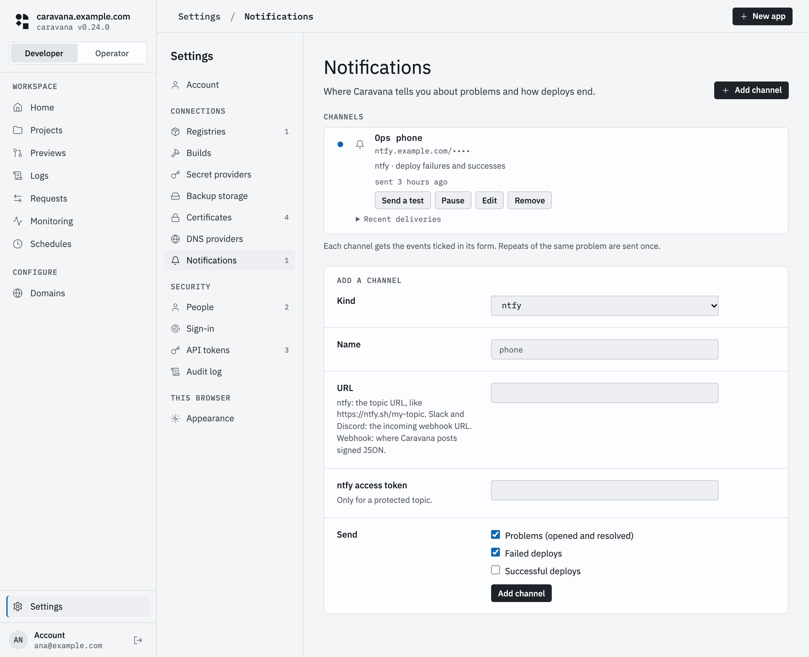

# Notifications

Caravana tells you when something needs you, so you don't have to keep the console open. You add one or more **channels**; each one receives the events you tick.

<picture>
  <source media="(prefers-color-scheme: dark)" srcset="../../images/settings-notifications-dark.png">
  
</picture>

## What is sent

- **Problems (opened and resolved).** Every item of the [needs-you list](monitoring.md#the-needs-you-list) is sent once when it appears ("opened") and once when it goes away ("resolved"). A disk that goes from warning to failed sends one more message ("worsened"). The console sums up all the [image findings](monitoring.md#image-findings) in one row, but a channel is not told about the row: it gets one message for each app, service and package that has a fixable vulnerability.
- **Failed deploys** and **Successful deploys.** Each deployment that ends is one message, with the outcome (healthy, failed, reverted, superseded) and what started it. If the deploy came from CI, the message says which commit, branch and run.
- **A new Caravana release.** When a newer release is out, every channel that isn't paused gets one message ("caravana 0.16.0 is out. You run 0.15.0."), whatever it has ticked.
- **A test**, when you ask for one.

A channel gets only the events ticked in its form: **Problems (opened and resolved)**, **Failed deploys**, **Successful deploys**. A message never contains a secret value or a command's output.

## Channels

Open **Settings › Notifications** and use **Add a channel**. Choose a **Kind**, give it a **Name** (for example `phone`) and tick what it should **Send**.

| Kind | What you enter | What you get |
| --- | --- | --- |
| **ntfy** | **URL**: the topic URL, like `https://ntfy.sh/my-topic`. **ntfy access token**: only for a protected topic. | A push message with a title, a priority and a link to the console when Caravana knows its address. |
| **Slack** | **URL**: an incoming webhook URL from Slack. | A short text message. |
| **Discord** | **URL**: a Discord webhook URL. | A short text message. |
| **Webhook** | **URL**: where Caravana posts signed JSON. | The event as JSON, signed. See below. |
| **Email** | **Mail server** and **Port**, **Security**, **User name** and **Password** if the server needs a login, **From** (one address) and **To** (one to ten addresses, separated by commas, spaces or line breaks). | A message with a plain-text part and an HTML part. |
| **Telegram** | **Chat ID** (a number like `-1001234567890`, or a public channel's `@name`) and **Bot token** (the one BotFather gave). **Bot API server** only if you run your own. | A plain-text message. |

For email, **Security** is **STARTTLS (port 587)**, **TLS (port 465)** or **None, for a mail server on this host**. A login is only sent over TLS or to a server on the same host, and **None** is accepted only for a mail server on this host (localhost or a loopback address).

A Slack or Discord URL, an ntfy topic, tokens and passwords are secrets: Caravana stores them in Nomad's secret store, never shows them again, and an empty field in Edit keeps the saved one. A webhook's address is shown in full.

## Send a test

Choose **Send a test** on a channel's row. It sends a message of type `test` to that channel only, and the row shows "sent" or "failed" with the reason. Do this after adding a channel to know the address and the secret work.

## Pause, edit, remove

- **Pause** stops messages to a channel without removing it; **Resume** brings them back. Messages waiting for a paused channel are dropped, not sent later.
- **Edit** changes the name, address and events. Leave a secret field empty to keep it.
- **Remove** deletes the channel and its delivery history.

## Recent deliveries and retries

Each row has **Recent deliveries**: the last 20 messages sent to that channel and how each ended. Sending has a 10-second limit and any 2xx answer counts as delivered. A message that fails is tried again after 30 seconds, then after 2 minutes, then marked failed with the reason; the row then says "Messages to this channel aren't getting through." A slow receiver doesn't delay other channels, and a message waiting for retry survives a restart of Caravana.

## The signed webhook

A **Webhook** channel receives `POST <url>` with `Content-Type: application/json` and three headers:

| Header | Value |
| --- | --- |
| `Caravana-Event` | the event's type: `problem.opened`, `problem.worsened`, `problem.resolved`, `deploy.succeeded`, `deploy.failed`, `caravana.release` or `test` |
| `Caravana-Delivery` | the delivery's ID. A retry sends the same one. |
| `Caravana-Signature` | `t=<unix seconds>,v1=<hex>` |

`v1` is the HMAC-SHA256, using the channel's **signing secret**, of the text `<t>.<raw body>`. Caravana makes the signing secret (64 hex characters) when you add the channel and shows it **once**; copy it then. **New signing secret** (under Edit) replaces it; the old one stops working at once.

To check a message, compute the HMAC over the raw body bytes (before any JSON parsing), compare it with each `v1` in constant time, and refuse a `t` more than 5 minutes from your clock, so a captured message can't be replayed. For example, in Python:

```python
import hashlib, hmac, time

def verify(secret: str, header: str, body: bytes, tolerance: int = 300) -> bool:
    parts = dict(p.split("=", 1) for p in header.split(","))
    t = int(parts["t"])
    if abs(time.time() - t) > tolerance:
        return False
    expected = hmac.new(secret.encode(), f"{t}.".encode() + body, hashlib.sha256).hexdigest()
    return hmac.compare_digest(expected, parts["v1"])
```

The body is one JSON object. Some fields are always there: `id`, `type`, `title`, `text` and `at`. Others appear when they apply. A deploy event looks like this:

```json
{
  "id": "ndl_3f9a1c2b4d5e",
  "type": "deploy.failed",
  "app": "shop--staging--web",
  "project": "shop",
  "environment": "staging",
  "appName": "web",
  "title": "shop--staging--web: deploy v8 was reverted",
  "text": "shop--staging--web's deploy v8 was reverted, started by its webhook.",
  "deployment": "9f2c41b7a0d3",
  "version": 8,
  "outcome": "reverted",
  "trigger": "webhook",
  "url": "https://caravana.example.com/apps/shop--staging--web/deployments#deployment-9f2c41b7a0d3",
  "at": "2026-11-26T09:30:00Z"
}
```

`title` and `text` are the console's own wording. A `detail` field, when there is one, is the raw reason (the registry's or Nomad's message). (The body is sent as a single line; it is laid out here to read.) For a problem, `kind` is the needs-you kind (`deploy_failed`, `backup_failed`, `disk_nearly_full` and so on) and some kinds add their own fields (`schedule` and `exitCode`, `domain`, `server`, `mount`, `destination`, and others). Receivers should accept kinds and fields they don't know. The full list is the `NotificationEvent` schema in [`api/openapi.yaml`](https://github.com/Cosmic-Chimps/caravana/blob/main/api/openapi.yaml).

## Timing, and links in messages

- Caravana checks the needs-you list every 30 seconds. The first check comes 30 seconds after it starts.
- A problem that goes away is "resolved" only after it has stayed away for a while, so a problem that flaps sends one "opened" and not many. The default is 5 minutes (`CARAVANA_NOTIFY_RESOLVE_AFTER`, at least 10 seconds).
- If more than 10 problems open (or resolve) in one check, each channel gets one summary message instead.
- Messages link to the console when Caravana knows its address: `CARAVANA_PUBLIC_URL` (the installer sets it from the console's domain). On a host installed before that setting existed, rerun the installer to get it. Without it messages have no link. See [Settings](../reference/settings.md).

## See also

- [Monitoring and the needs-you list](monitoring.md)
- [Schedules](schedules.md) and [Backups](backups.md): their failures are problems too.
