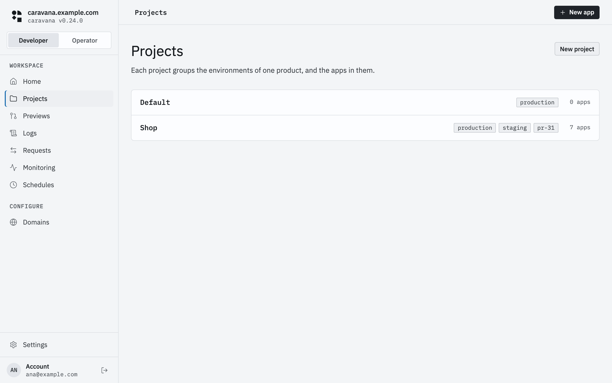
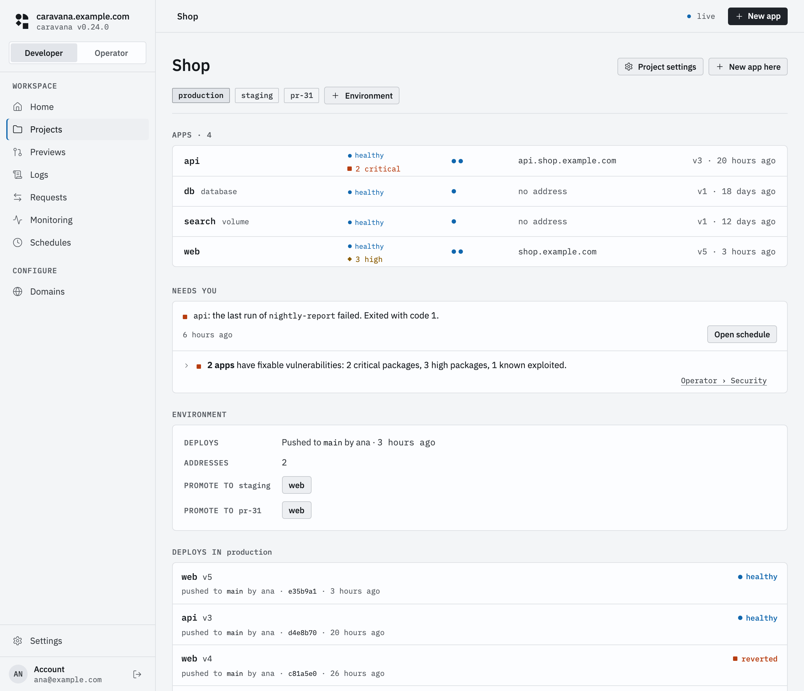
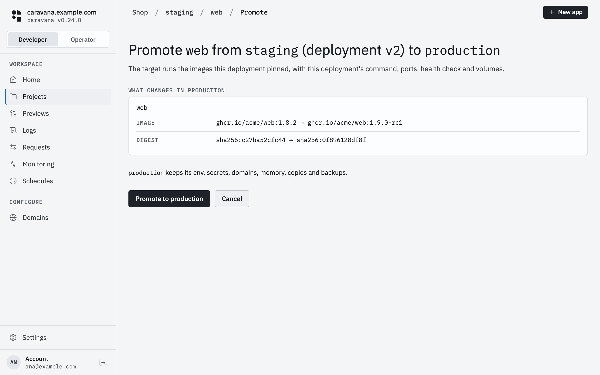

# Projects and environments

A **project** groups the apps of one product. Each project has **environments**, such as `staging` and
`production`, and each environment has its own copy of the apps. This is how you run the same product in more
than one place on one installation, and how you move a tested version from one place to the next.

<picture>
  <source media="(prefers-color-scheme: dark)" srcset="../../images/projects-dark.png">
  
</picture>

## Default › production

Every installation has a project called **Default** with one environment, **production**. Apps you make
without choosing a place go there, and apps that existed before projects were added live there. While that is
the only environment, the console shows no project or environment anywhere: the pages look as if projects did
not exist. Default and its production cannot be deleted.

## Create a project and environments

1. Open **Projects** in the sidebar and press **New project**. (Creating a project is for admins; see
   [People and roles](../../people.md).)
2. Type a **Name** (lowercase letters, digits and single dashes, at most 63 characters; it cannot be changed
   afterwards) and, if you like, a **Display name**, which is what the console calls the project. Press
   **Create project**. The project starts with a **production** environment.
3. Open the project and press **Environment** (or, on **Project settings**, **Add environment**) to add
   `staging`, giving it a name with the same rules.

A project's page has one tab per environment, with the environment's apps as a table, what needs you in it,
and its latest deploys. **New app here** makes an app in the environment you are looking at. On **New app**,
once there is more than one environment, a **Project and environment** select chooses where the app goes.

<picture>
  <source media="(prefers-color-scheme: dark)" srcset="../../images/project-page-dark.png">
  
</picture>

## App IDs

Every app has an ID, and the ID says where the app lives:

| Where | ID of an app named `web` |
| --- | --- |
| Default › production | `web` |
| Project `shop`, environment `staging` | `shop--staging--web` |
| Project `shop`, environment `production` | `shop--production--web` |

The rule: in Default › production the ID is the bare name; anywhere else it is
`<project>--<environment>--<name>`. A project, environment or app name is a lowercase DNS label (letters,
digits and single dashes, at most 63 characters) and must not contain `--`, which separates the parts. The
service name is added to the ID in the address Traefik routes to, and `<id>-<service>` has to fit in 63
characters, so a long project and environment name leaves less room for the app's name. The **New app** form
keeps the app's name to 31 characters for that reason.

The ID is what matters outside the console. It is the `{id}` in every `/v1/apps/{id}/…` call, so the staging
app above is `/v1/apps/shop--staging--web`; the webhook of an app is `/v1/webhooks/{id}`; and CI refers to an
app by it. Deploying to an ID that does not exist yet creates the app, in the place the ID names (the project
and the environment must already exist). A deploy token for CI is scoped to one app **name** in one
**project**, and can deploy it in any environment of that project, so the same token serves `staging` and
`production`. The API also has a route by names, `/v1/projects/{project}/environments/{environment}/apps/{name}`,
so a client need not compute the ID. See [The HTTP API](../reference/api.md) and
[From CI](../deploy/ci.md).

## Copy to

An app's header lists its **Other environments**. For one where the app does not exist yet, it offers
**Copy to <environment>**. A copy creates the app there **without deploying it**.

What is copied:

- the app's services as stored: images, ports, health checks, copies, memory, command, plain variables and
  their values, volume declarations and backup policies;
- the names of the secrets;
- a kept Compose file, if the app has one.

What is not copied:

- **domains**: an address belongs to one environment, so the copy has none, and its services' published port
  numbers are cleared too. Set them for the new environment;
- **secret values**: Caravana never kept them in its database. A deploy of the copy is refused until each
  secret has a value. Right after the copy you land on its **Configure** tab (**Overview**), which names once the secrets that
  still need one ("Copied to `staging`. Set its domains and these secrets before deploying: …"). Secrets that are
  references to a secret provider need nothing, since they are read at each deploy;
- the webhook token, the deploy history, and the contents of volumes and of backups.

Copy to is refused when the other environment already has an app of that name; use Promote instead. See
[Variables and secrets](../configure/variables.md) and [Domains and HTTPS](../configure/domains.md).

## Promote to

**Promote to <environment>** deploys the version that is running in this environment into the same app in
another environment of the project, which must already have it (Copy to makes it). It does not build or look
up a tag again: the target runs the **same image digests** the source's newest deployment pinned, so what you
tested is what you get.

The page that opens is a preview, and nothing is deployed yet. For each service it shows the **Image** (from
what the target runs now to what it will run), the **Digest**, and what is **Replaced**; then the warnings the
deploy will carry, and a sentence saying what the target keeps.

<picture>
  <source media="(prefers-color-scheme: dark)" srcset="../../images/promote-preview-dark.png">
  
</picture>

**The target keeps** its own plain variables, its secrets and their values, its domains, its number of copies,
its memory and CPU, its backup settings, its identities and its published port numbers.

**The target takes from the source**: the image, entrypoint, command and arguments, ports, health check,
volume declarations, stop timeout, DNS settings, ulimits, sysctls and files (not the values of the secrets they name),
placement rules, disconnect time and Git build source. A
service that only the source has is added whole, without domains; its secrets need values in the target first.

Press **Promote to <environment>** to deploy. You land on the target's **Deployments** tab, where the entry
says "promoted from staging". The preview carries the target's revision, so if someone changed the target
after you opened the preview, nothing is promoted: the page is drawn again with a fresh preview ("production
changed since this preview; review it again.").

Promotion is refused, with the reason on the page, when:

- the source has no healthy deployment yet, or its newest deployment is not healthy, or it was made before
  Caravana recorded what each deployment deployed;
- the target is stopped ("start it there first");
- the target has a service the source does not, since promoting would remove it ("remove it from the target
  yourself, or add it to the source");
- the target does not have the app ("Copy it there first");
- an image is gone from its registry, or the secrets or settings of the result would fail an ordinary deploy.

A target that keeps a Compose file is not a refusal: the promotion drops the file, and the preview warns "This
app's Compose file was dropped: it was deployed from a definition, not a file."

## Delete

On **Project settings**:

- An environment has a **Delete <environment>** button. It is disabled while the environment has apps ("Move
  or delete its 2 apps first."). Default's production cannot be deleted.
- **Delete project…** asks you to type the project's name, and works only when the project has no apps ("no
  app is deleted for you"). Default cannot be deleted.

Deleting an app is on its **Configure** tab: **Overview** has **Delete app…** at the bottom. It removes its copies, its history and its volumes.

## Settings of a project

**Project settings** also holds:

- **Display name**: the name the console shows; the project's own name cannot change.
- **Backups go to**: the backup destination a project's services use when their own policy names none. See
  [Backup destinations](../../backup-destinations.md).
- **Previews**: a sentence about preview environments (`pr-<number>`) and a link to the Previews page, where
  you set how many may be open, how long they last and their shared password. See [Previews](../../previews.md).

Who may see and change a project is decided per person: a role per project, with an optional override per
environment. See [People and roles](../../people.md).

## Next

- [Variables and secrets](../configure/variables.md)
- [Previews](../../previews.md)
- [From CI](../deploy/ci.md)
- [How a deploy works, history, rollback](../deploy/rollback.md)
