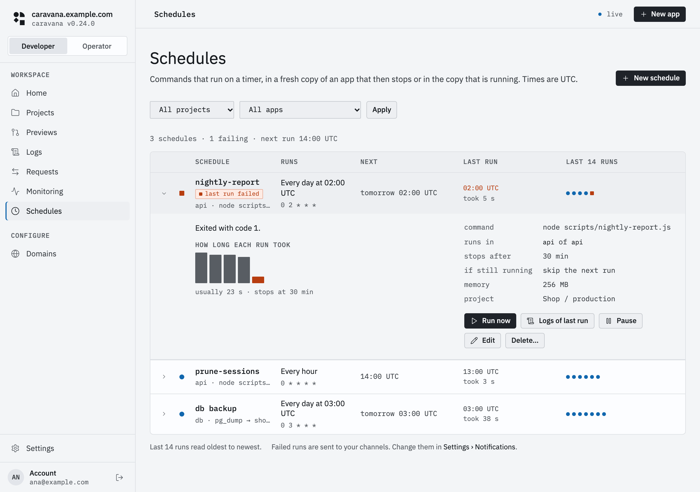
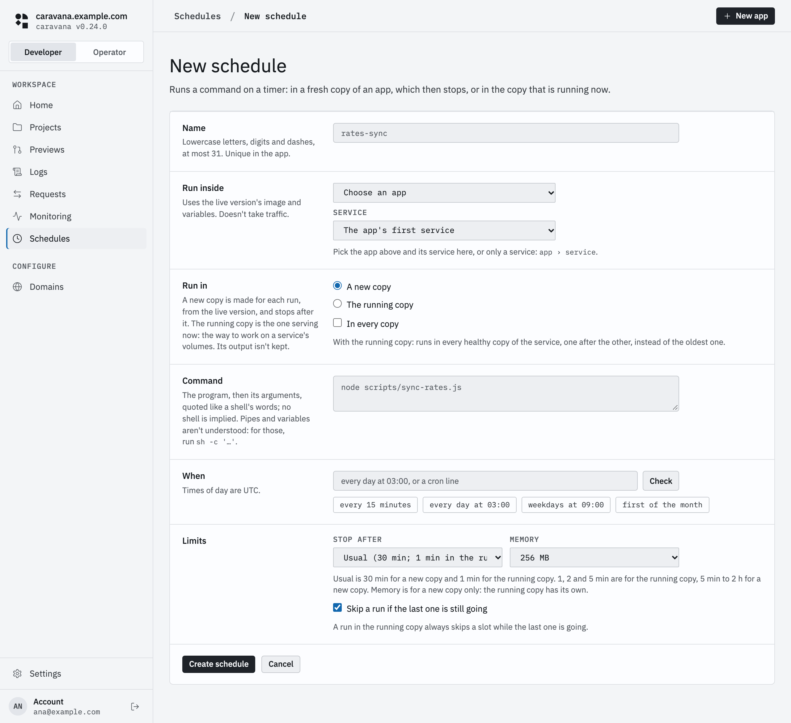

# Schedules

A schedule runs a command on a timer: clear a cache every night, sync a feed every 15 minutes, send a weekly report. You give it an app and a service, a command, and a time. Caravana keeps the clock and starts each run.

<picture>
  <source media="(prefers-color-scheme: dark)" srcset="../../images/schedules-dark.png">
  
</picture>

Open **Schedules** in the sidebar. Each row opens to show what the schedule did last, how long its runs usually take, its settings, and its buttons. For one app, the **Schedules** panel on the app's **Configure › Overview** lists its schedules and has **Manage schedules** and **New schedule**.

## In a new copy or in the running copy

Every schedule has a **Run in** choice.

**A new copy** starts a separate copy of the service for each run, from the image of the live version, with the service's variables and secrets. The copy takes no traffic. When the command ends, the copy stops. Use it for batch work that doesn't need the service's data on disk: a report, a sync, a clean-up that talks to a database over the network.

**The running copy** runs the command inside the copy that is serving now, the way **Run a command** does (see [Stop, start, restart, Run a command, Terminal](commands.md)). Use it when the command needs the service's volumes, for example a clean-up of files in `/data`. A service that mounts a volume can only use this choice: the form says "Every service of this app mounts a volume, so a schedule there can run only in the running copy."

With the running copy, **In every copy** runs the command in each healthy copy of the service, one after the other, instead of only in the oldest one.

| | A new copy | The running copy |
| --- | --- | --- |
| Starts | a separate copy for each run, stopped after it | nothing: runs inside the copy that is serving |
| Service has volumes | refused | allowed |
| Sees the service's variables and secrets | yes | yes (it is the same copy) |
| Sees the service's volumes | no | yes |
| Memory | its own, set by **Memory** | the copy's own |
| **Stop after** | 5 min, 30 min, 1 h or 2 h (usual: 30 min) | 1, 2 or 5 min (usual: 1 min) |
| Output | kept for the last 100 runs | never kept |
| Skips a slot while the last run is going | your choice | always |

## Make a schedule

1. Open **Schedules** and choose **New schedule**.
2. Fill in the form:
   - **Name**: lowercase letters, digits and dashes, at most 31, unique in the app.
   - **Run inside**: the app, and the service if the app has more than one. It uses the live version's image and variables and doesn't take traffic.
   - **Run in**: **A new copy** or **The running copy**, and **In every copy** if you want it.
   - **Command**: the program, then its arguments, quoted like a shell's words. No shell is implied, so pipes and variables don't work; to use them, run `sh -c '…'`.
   - **When**: in words (for example `every day at 03:00`) or as a five-field cron line. See below.
   - **Stop after**, **Memory** and **Skip a run if the last one is still going**.
3. Choose **Check** to see how Caravana read the time, then the submit button.

<picture>
  <source media="(prefers-color-scheme: dark)" srcset="../../images/schedule-new-dark.png">
  
</picture>

### When

Times are UTC. The **When** field takes words such as `every 15 minutes`, `every 2 hours`, `weekdays at 09:00`, `Mondays at 08:30`, `first of the month at 06:00`, or a cron line such as `0 3 * * *`. The four preset links under the field fill it with **every 15 minutes**, **every day at 03:00**, **weekdays at 09:00** and **first of the month**.

**Check** redraws the form with the cron line Caravana understood, the next three run times and the timezone (always UTC). If it can't read the text it says so and suggests `every 2 hours` or a cron line. Caravana shows each time in UTC and, in your browser, also in your local time (for example `14:15 UTC · 16:15 local`). There is no timezone setting.

### Stop after, memory, skip

**Stop after** is a hard limit on one run. A run that goes past it is stopped and counted as failed: "Stopped at the 5 min limit."

**Memory** applies to a new copy only (256 MB, 512 MB, 1 GB or 2 GB). If you don't choose, it is the service's memory reservation rounded up to one of those. The running copy keeps its own memory.

**Skip a run if the last one is still going** is on by default: when the time comes and the previous run hasn't finished, the slot is recorded as skipped. Turned off for a new copy, runs may overlap, up to 3 at once; a fourth slot is skipped with "3 runs already going". A schedule in the running copy always skips.

## Run now and Stop

Open a schedule's row and use:

- **Run now** starts one run at once, outside the timer. It is refused if the schedule's rule doesn't allow another run now.
- **Stop this run** (shown while a run goes) asks for confirmation, then stops it. A run you stop counts as stopped by you, not as a failure, and sends nothing.
- **Pause** and **Resume** keep the schedule but skip its timer.
- **Edit** and **Delete…**. Deleting removes the schedule and its run history. A run in progress is stopped.

A change to a schedule applies from its next run. Earlier runs keep the command they ran.

## A run's page and its output

The strip of marks at the right of each row is the last 14 runs, oldest to newest; each mark links to that run's page. The page says when the run started, how long it took, which service and version it ran, and its **Output**.

- For a **new copy**, the output (the last 64 KiB of each of standard output and standard error) is kept for the schedule's last 100 runs. Caravana removes any of the service's secret values (six or more characters) from it before it is stored. The output is shown only on the run's own page, and the page is never cached.
- For **the running copy**, the output is never kept: the run's page says "This run was in the running copy: its output isn't kept." It records the exit code and the outcome only. If you need the output, run the command with **Run a command** and read it there.

A run's page is a record, not a live view. If the run is still going it says "Still running: reload for more." **Logs of last run** opens the Logs page for the run's copy.

## What a run sees

A run in a new copy has the live version's image and the service's variables and secrets, and the service-name addresses of the app's other services work as in the app. It has no volumes, no ports and takes no traffic. It reads the secrets from a copy Caravana makes for that run and deletes afterwards. It can't read anything the app itself can't.

A run in the running copy is the same environment the service has, volumes included.

## While the app is stopped or deploying

- If the app is **stopped**, a slot for a new-copy schedule waits and is tried again for up to an hour; a slot for a running-copy schedule is recorded as skipped with "the app is stopped". Stopping the app also stops its runs.
- While a deploy is going, or the app has no healthy version yet, a new run waits until the deploy ends (then it uses the new version). A slot waits for up to an hour and is then dropped.
- A running-copy schedule also waits for a healthy copy to exist.
- If Caravana itself was down when a slot came, it runs the slot once if it is less than an hour late.

## Built-in backup schedules

Each service with a backup policy appears in the list as `<service> backup`. It is read-only here: it has no **Run now**, **Pause**, **Edit** or **Delete…**, only **Change in Backups**. Its time and retention are set on the app's Backups tab. See [Backups and restore](backups.md).

## Needs you and notifications

- A schedule whose newest finished run failed (exit code other than 0, stopped at its limit, or could not start) puts an item on the Apps home's needs-you list: "the last run of `<schedule>` failed", with the reason in Caravana's words, never the command's output. The next successful run clears it.
- A schedule that skipped its last 3 slots in a row is a warning item.
- A run stopped by you is not a failure.
- Both go out through your [notification channels](notifications.md) as opened and resolved problems. The Schedules page's footer reminds you of that when you have channels.

See [Monitoring and the needs-you list](monitoring.md) for the list.

## See also

- [Stop, start, restart, Run a command, Terminal](commands.md)
- [Backups and restore](backups.md)
- [Notifications](notifications.md)
