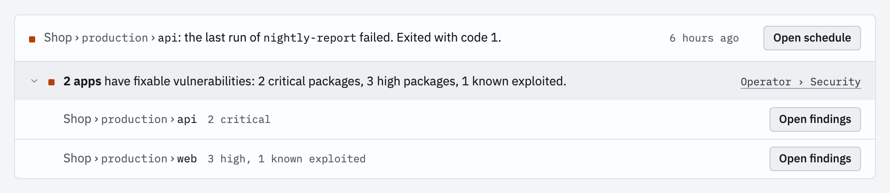
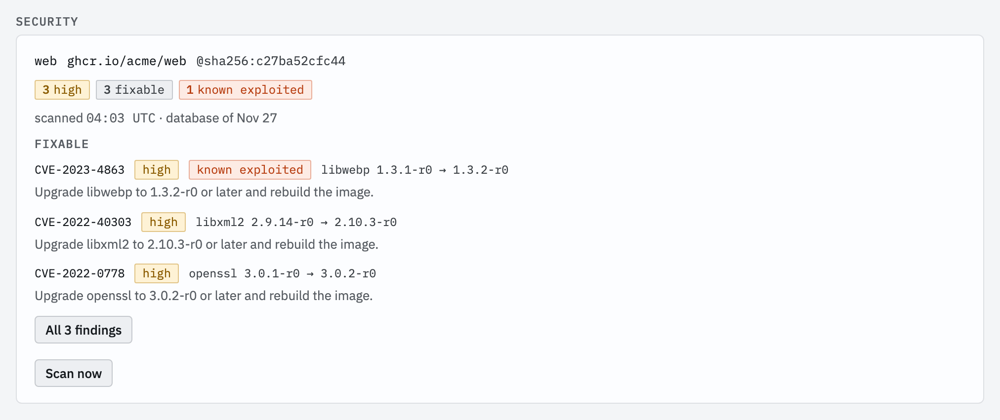
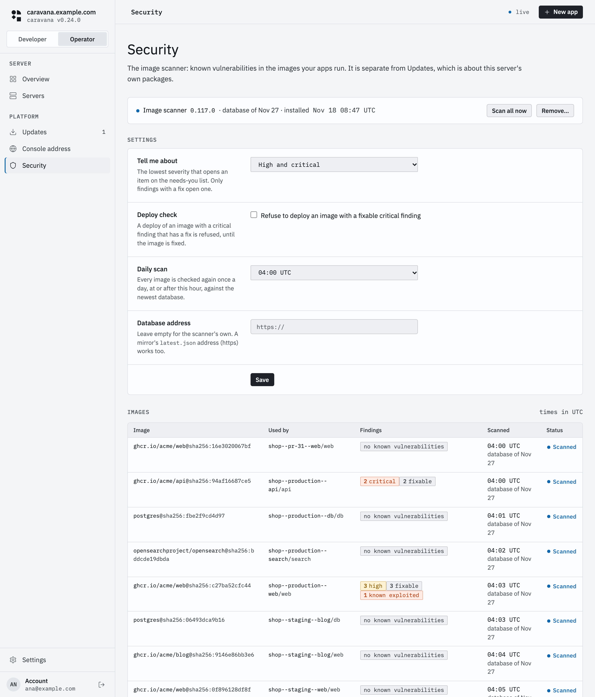

# Image scanning: known vulnerabilities in the images your apps run

Caravana deploys images by digest, so it knows exactly what runs. With the image scanner installed it also looks
inside them: every image an app runs is checked against a database of known vulnerabilities (CVEs and the
advisories of each Linux distribution and language ecosystem), when it is deployed and again every day, since new
advisories are published for old images all the time.

The scanner is [Grype](https://github.com/anchore/grype), open source (Apache-2.0), pinned by digest. It is an
add-on: nothing of it exists on your servers until you install it.

## Install it, or remove it

Operator › Security › **Install the image scanner**, or `PUT /v1/addons/image-scanner`.

What it costs:

- **Disk:** about 3.5 GB on one server, for the vulnerability database, plus a small SBOM per scanned image. For a
  moment, while a new database replaces the old one, about twice that. Scans are skipped while that server has less
  than 4 GB free.
- **Download:** about 204 MB a day, once for the whole installation (not once per server).
- **Memory:** 512 MB reserved while a scan runs (up to 2 GB for a large image), nothing in between. Scans are
  skipped while the server hasn't that much memory left unreserved.

Installing makes a Nomad host volume `caravana-scanner` on one server (Nomad picks it), downloads the database
there, then scans every image your apps run. Every scan runs on that server, one at a time, as a short Nomad batch
job `_scan-<id>` that is purged when it ends.

**Remove** (Operator › Security › Remove…, or `DELETE /v1/addons/image-scanner`) stops the queue and any running
scan, deletes the volume with the database and the SBOMs, and forgets every result. The needs-you items about
vulnerabilities go away without "resolved" notifications. To move the scanner to another server, remove it and
install it again.

## What is sent, and where

Nothing about your servers or your apps. The scanner's update check is turned off and it has no telemetry. It
downloads two things:

- its database, from Anchore's public listing (`https://grype.anchore.io/databases/v6/latest.json`), or from your
  mirror: set **Database address** on Operator › Security (`databaseUrl` in `PUT /v1/scans/settings`) to the
  `latest.json` of a mirror of Grype's database;
- the layers of the image it scans, from the image's own registry, the same way your server's Docker pulls them.

Without network, scans keep using the database they have for up to 5 days; after that they fail with "the
vulnerability database is more than 5 days old" and the pages keep showing the last results with their date.

## When images are scanned

- **After a deploy:** each image a healthy deployment brought that has no result from the last 24 hours.
- **Every day** at 04:00 UTC (Operator › Security › Daily scan): every image a running app uses. This rescan
  reads the SBOM kept from the image's first scan, so it pulls nothing and needs no registry credentials.
- **When you ask:** Scan now on an app, Scan all now on Operator › Security, or `POST /v1/scans` (`{"app": "<id>"}`,
  or no body for every app). These read the image from its registry.
- **Before a deploy**, with the gate on (below).

A private image is scanned with the credentials you stored in Settings › Registries. They reach the scan only
through the scan job's own Nomad Variable, which is deleted with the job; no page, log, job or answer holds them.

## What you see

- **The app's Deployments tab** has a Security panel: per service of the live version, the counts by severity,
  when it was scanned and the database's date, the findings with a fix first (advisory with its link, package, the
  installed version, the version that fixes it, "known exploited" when the advisory is on CISA's KEV list), then
  every finding in a table. Each history entry says "1 critical · 9 high" for its images.
- **Operator › Security** lists every image the installation runs, with who runs it, its counts and its last scan,
  and the recent scan runs.
- **The needs-you list** ends with one row for all the image findings, after every other item. It is closed, and
  it sums up the apps and packages that have a vulnerability with a fix, at or above the notify level (critical by
  default; critical and high is a setting), in the apps you haven't stopped: "3 apps have fixable vulnerabilities:
  14 critical packages, 2 known exploited." (for one app, its name and "has"). Open it for one line per app, with
  its counts and **Open findings**, which leads to the app's Security panel; owners and admins also get a link to
  Operator › Security. The row is on the Apps home, the Operator Overview and the side panel of a project's page.
  It goes when a deploy brings an image without the findings. Findings without a fix are listed on the pages but
  open nothing.
- **A tag under an app's status** in the apps table of the Apps home, the project's page and the Operator
  Overview: "■ 9 critical" or "◆ 4 high", the number of packages with a fixable finding at the app's worst level.
  An app with none has no tag. The tag links to the Security panel, except on the project's page, where the whole
  row is a link.
- **The Apps page's top sentence** counts outages, not findings: an app whose only items are findings counts as
  healthy. A last sentence says how many apps have them, for example "3 have fixable critical vulnerabilities."
- **Your notification channels** get one message for each app, service and package with a fixable vulnerability at
  or above the notify level, like every other item: it names the package, its version, the advisory and the fixed
  version. `GET /v1/attention` lists them the same way, one item each.

The needs-you list with its row for image findings opened:

<picture>
  <source media="(prefers-color-scheme: dark)" srcset="images/apps-home-security-dark.png">
  
</picture>

An app's Security panel, on its **Deployments** tab:

<picture>
  <source media="(prefers-color-scheme: dark)" srcset="images/app-deployments-security-dark.png">
  
</picture>

And Operator › Security, with the add-on installed:

<picture>
  <source media="(prefers-color-scheme: dark)" srcset="images/ops-security-dark.png">
  
</picture>

Severities are one scale: critical, high, medium, low, info (Grype's "negligible" and "unknown" are info). Each
finding has an ID that stays the same across scans, with the first and the last time a scan saw it, its EPSS score
when the database has one, and a remediation sentence. Read them all with `GET /v1/apps/{id}/scan`,
`GET /v1/apps/{id}/deployments/{deploymentId}/scan` and `GET /v1/scans`; agents can use the MCP tool
`get_app_scan`.

## Refuse to deploy a fixable critical

Operator › Security › **Refuse to deploy an image with a fixable critical finding** (`refuseFixableCritical`),
off by default. With it on, a deploy, a redeploy, a rollback, a promotion and a webhook call scan each image they
bring that has no result from the last 24 hours before Nomad gets the job, and an image with a critical finding that
has a fix fails the deploy with 422 `image_vulnerable` on `services[i].image`:

```
web's image has CVE-2022-37434 (critical) in zlib 1.2.11-r3, fixed in 1.2.12-r2
```

A scan that can't be made (the database can't be downloaded, the server is short of room, the scan takes too long)
doesn't block: the deploy goes on with a warning saying the image wasn't checked.

## Security here, Updates there

Operator › Updates counts the operating system updates of your servers and names no vulnerability: those packages
belong to the server and are fixed by `apt`. Operator › Security is about what you deploy: the fix is to rebuild the
image or bump its base, and the advisory ID is what lets you judge whether a finding matters to your app.
